<p align="center">
  
</p>

<h1 align="center">Theme Roller</h1>

<p align="center"><b>Good ol' fashioned Linux desktop theming for your Linux Mint Cinnamon desktop.</b></p>

<p align="center">
  <a href="https://github.com/xlcheese/theme-roller/releases/latest"><b>⬇&nbsp;Download for Linux&nbsp;Mint&nbsp;22&nbsp;(.deb)</b></a>
</p>

<p align="center">
  <a href="#installing">How to install</a>
  &nbsp;·&nbsp; <a href="#customization-options">What you can change</a>
  &nbsp;·&nbsp; Free and open source
  &nbsp;·&nbsp; <a href="https://www.paypal.com/donate/?hosted_button_id=SDDYDENKXPCWN">Like Theme Roller? Leave a tip!&nbsp;☕</a>
</p>

<p align="center">
  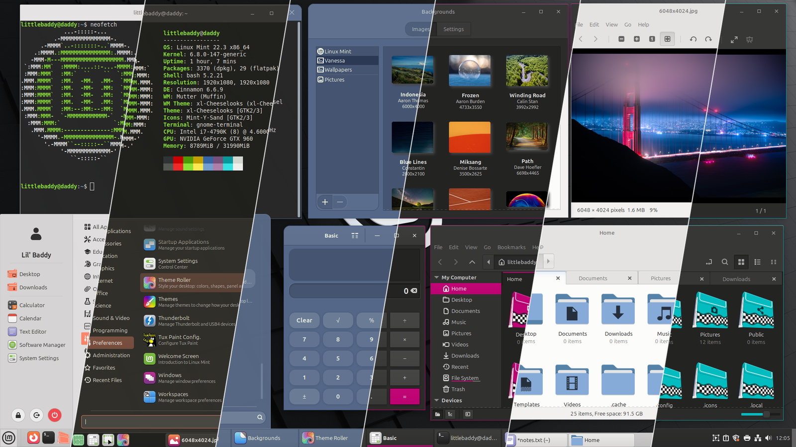
  <br><i>One desktop, six themes: the panel, the menu, every app and the window borders change together.</i>
</p>

Remember when customizing the theme on your Linux desktop was easy? There were hundreds of GTK2 themes available on sites like gnome-look.org, rated, reviewed, and shared by the people who made them. You could download a theme or edit the gtkrc file to make your own without a lot of time invested. At one point, we had a tool in Ubuntu and GNOME 2 which allowed effortless changes to the color and style of your theme without ever opening a gtkrc file. You could instantly make your theme as ugly as can be. That was one part of using Linux on my personal computer that I found fun.

Somewhere along the way this got lost. Today you get an accent color, a light or dark switch, and if you want more, you're hunting for themes, hand-editing CSS, and living with the apps that never match. Creating a robust theme in Linux Mint is more work than it needs to be.

Theme Roller brings it back. Choose your colors, turn some knobs and dials, then click **Apply**. Your entire desktop theme changes within a second. You can make endless color and style changes from just living on the first few tabs of Theme Roller. If you want to dive deeper just click through the rest of the tabs which include the Cinnamon panel and menu, Window borders, Terminal, Icons, and other widgets if you want them.

> **Status:** getting ready for its first release. Install the `.deb` package (below), or run it from a copy of this repository.

## Your colors, everywhere

Change one color and the whole desktop follows: the panel, the menu, selections, buttons, window borders, even the folders in your file manager. Here is xl-Cheeselooks Dark with nothing changed but its accent:

<p align="center">
  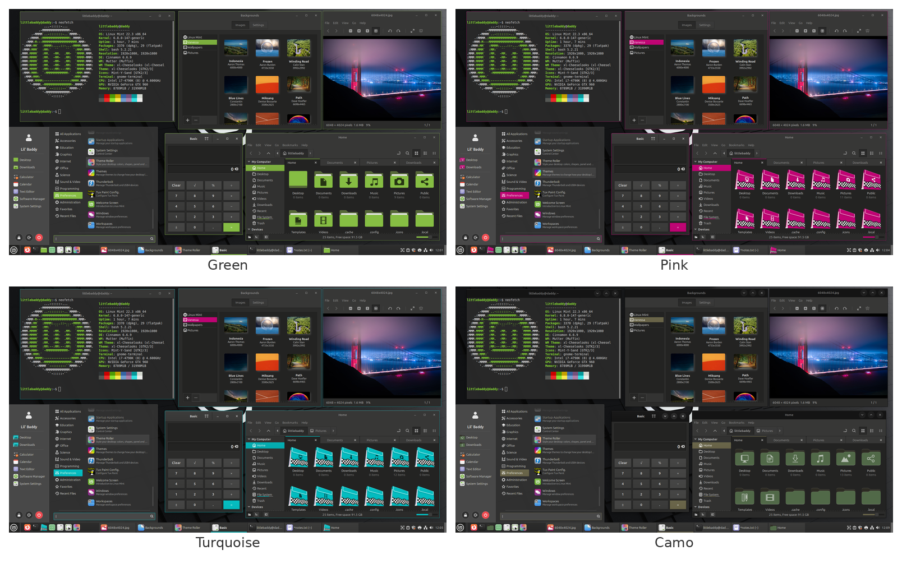
</p>

And some of the themes that come with it, light and dark:

<p align="center">
  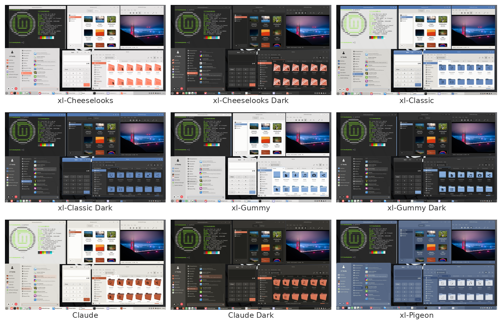
  <br><i>Click any picture for full size. Full-size screenshots are in <a href="docs/screenshots">docs/screenshots</a>.</i>
</p>

## Customization Options

- **Theme:** start from any of the built-in themes, one shared from someone else, or one of your own. Save, duplicate, rename, and share themes as a single `.xltheme` file.
- **Global:** three colors make a complete light *or* dark theme. Size, roundness, gradient, and how hovers fade in and out. Or pick your accent from your wallpaper or any picture.
- **Style:** how things are drawn (edges, highlights, shadows, tabs), with a Depth slider. Ships with light and dark styles you can use. You can take it further and craft your own style sheets. Make a copy of an existing one or create a starter style sheet, with every option explained, from the Documentation tab.
- **Panel & Menu:** the Cinnamon panel's and menus' own colors, height, roundness, gradient and transparency.
- **Window Borders:** title bar colors, height and gradient, border width and color, window roundness, and many styles of window buttons with a choice of style for **Minimize, Maximize and Close** glyphs.
- **Terminal:** follow the theme or choose your own preferred colors.
- **Details:** tooltips, scrollbars, sliders, switches and the focus ring.
- **Icons:** folder icons in your colors, in multiple styles to choose from. Theme Roller follows your current icon scheme and only customizes the folders. Other icons stay as they were.
- **Integration:** brings your colors to the hodgepodge of apps that don't read the theme on their own: GNOME-style apps, Flatpak apps, Qt apps like VLC, and text editors. **Scan my apps** button shows which of your apps are which kind, and whether the theme reaches them. See below for apps which have limitations.

<p align="center">
  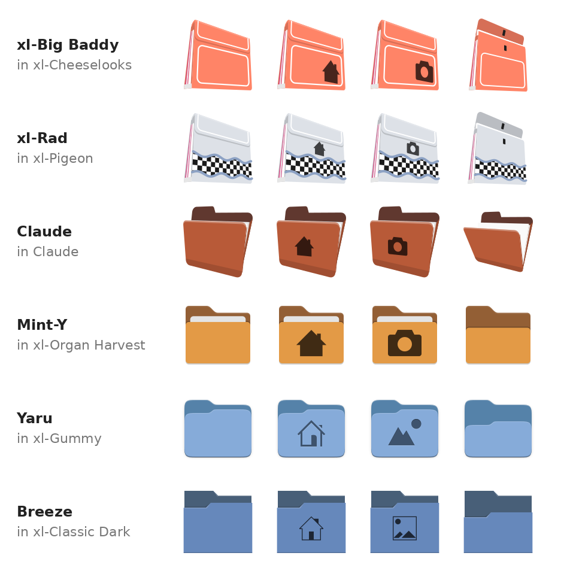
  <br><i>The six folder styles, each in a different theme's colors. Drag a file over a folder and it opens.</i>
</p>

Everything shows in a live preview first. Nothing changes on your desktop until you click **Apply**, and **Revert** puts your previous theme back. None of your prior theme work outside of Theme Roller will be lost.

## A tour of the tabs

<table>
  <tr>
    <td>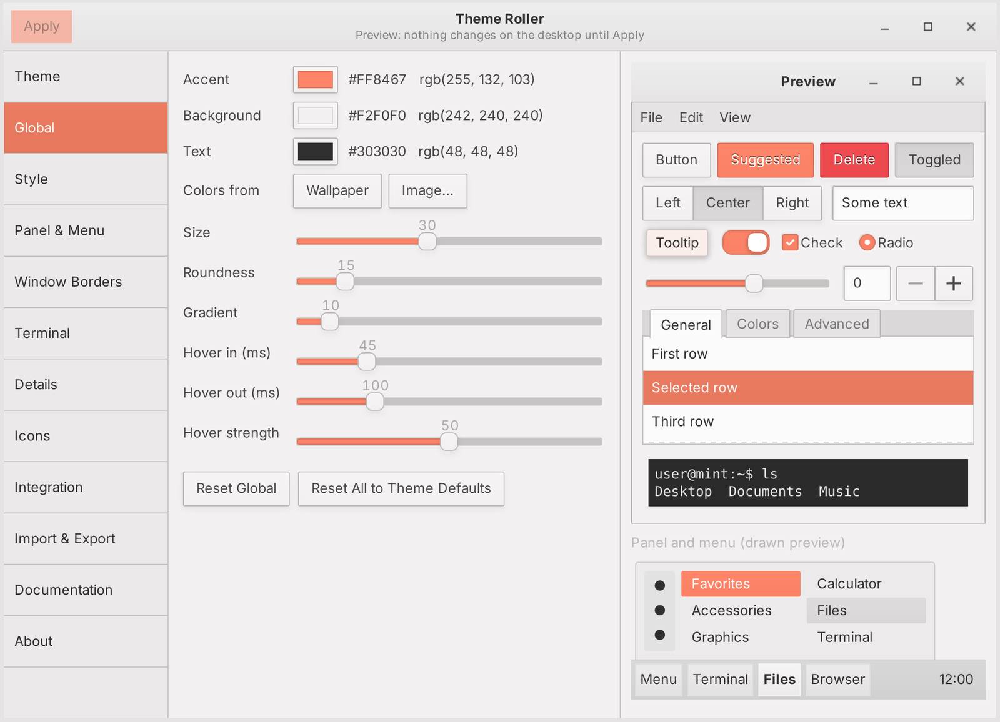<br><b>Global</b>, in xl-Cheeselooks: three color options with sliders to adjust the overall look.</td>
    <td>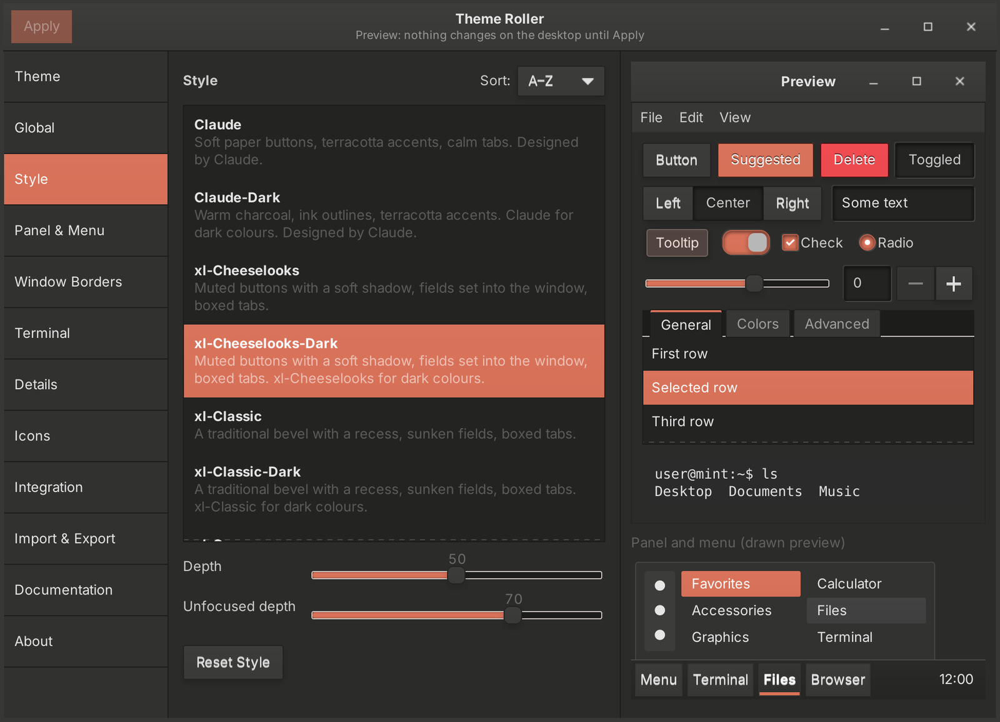<br><b>Style</b>, in xl-Cheeselooks Dark: displays a list of style sheets which define details of how widgets, such as buttons, are drawn.</td>
  </tr>
  <tr>
    <td>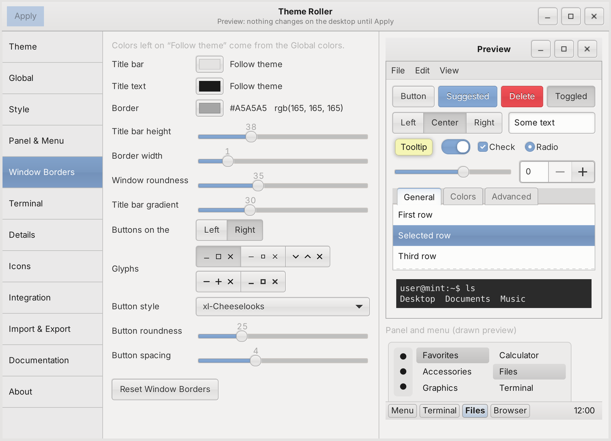<br><b>Window Borders</b>, in xl-Gummy: title bars, borders and window buttons.</td>
    <td>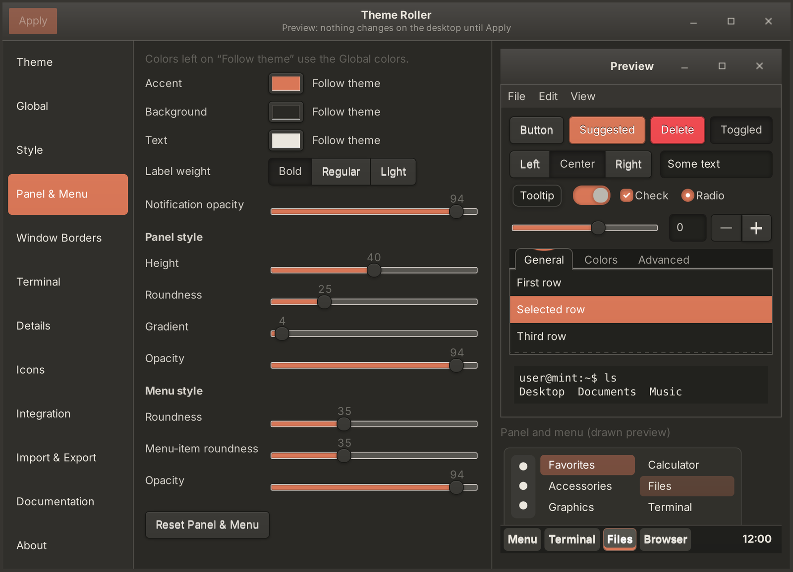<br><b>Panel &amp; Menu</b>, in Claude Dark: the Cinnamon panel and its menus.</td>
  </tr>
  <tr>
    <td>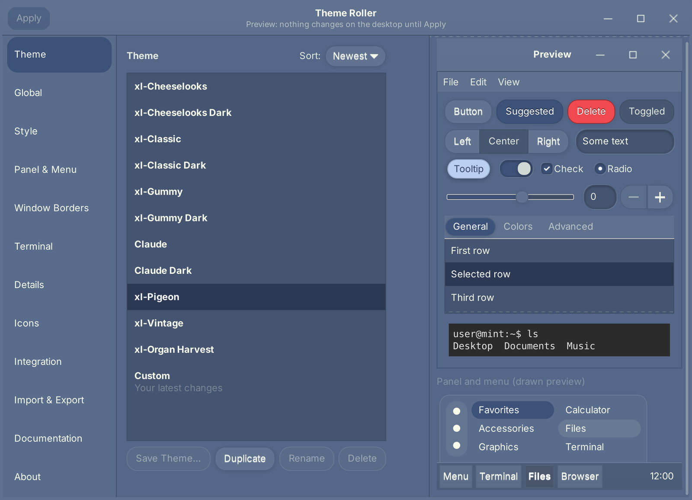<br><b>Theme</b>, in xl-Pigeon: built-in themes, yours, and ones shared with you.</td>
    <td>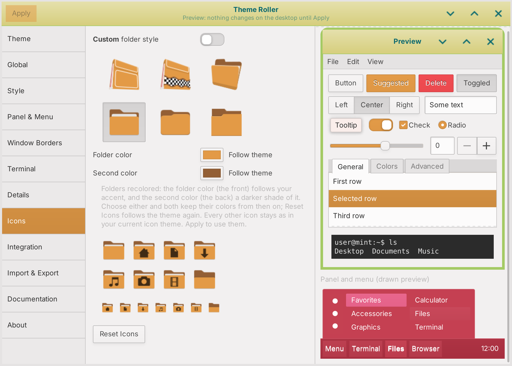<br><b>Icons</b>, in xl-Organ Harvest: folders in your colors.</td>
  </tr>
  <tr>
    <td>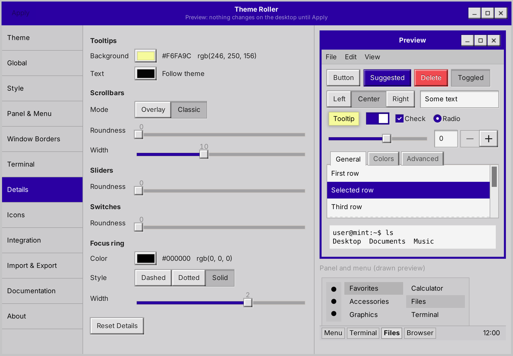<br><b>Details</b>, in xl-Vintage: tooltips, scrollbars, sliders and switches.</td>
    <td>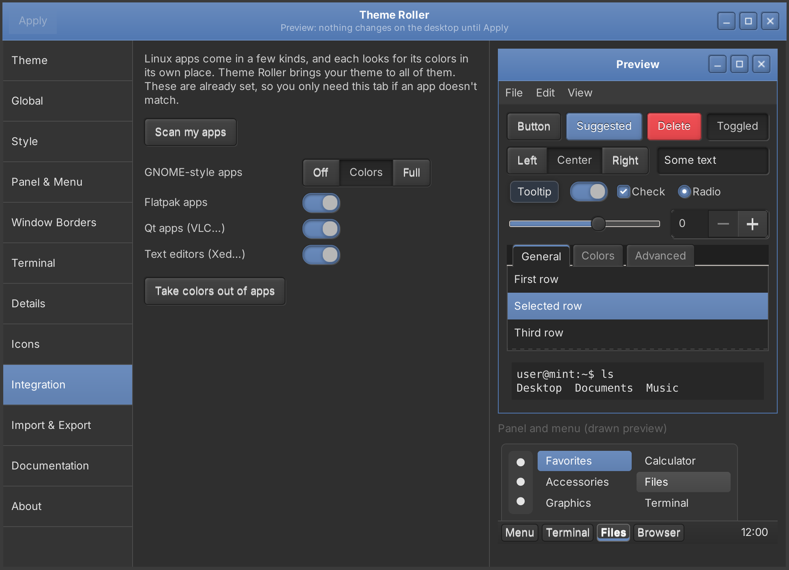<br><b>Integration</b>, in xl-Classic Dark: your colors in apps that don't read the theme.</td>
  </tr>
</table>

## How far Theme Roller reaches

Linux Mint runs apps built with several different toolkits, and each looks for its colors in a specific place. Theme Roller goes as far as a theme can to make the Linux Mint desktop look unified without fighting the system:

- **GTK 3 apps** (most of Mint, Nemo, Xed, LibreOffice, Firefox…) and **the Cinnamon desktop**: fully themed.
- **GTK 4 and Mint's libadwaita apps**: fully themed.
- **Flatpak apps and GNOME-style apps** (libadwaita): your colors, with full styling as an option.
- **Qt apps** (VLC, KDE apps): your colors.
- **Text editors** (Xed, gedit, Meld): a matching color scheme.
- **Web-based apps** (Electron, Chrome apps) and apps that draw everything themselves: no theme reaches these.

## Languages

Theme Roller speaks English, Spanish, German, French, Brazilian Portuguese, Italian, Russian and Dutch. It follows the language set in Mint. The command line, and theme and style names, stay in English. To help with a translation or add a language, see [po/README.md](po/README.md).

## Installing

On Linux Mint 22, download `theme-roller_<version>_all.deb` from the [Releases page](https://github.com/xlcheese/theme-roller/releases) and double-click it, or from a terminal:

```bash
sudo apt install ./theme-roller_*_all.deb
```

Theme Roller is then in the menu under **Preferences**. Pick a theme, change what you like, and click **Apply**.

To go back to Mint's own look, pick it again in **System Settings → Themes**. Theme Roller notices and takes its colors out of your other apps too.

### Uninstalling

First open Theme Roller and click **About → Remove from my desktop…** (or run `theme-roller remove`). Then uninstall it from the Software Manager, or:

```bash
sudo apt remove theme-roller
```

The first step matters because the package can't tidy your home folder itself. It does that tidying: Mint's default theme comes back, Theme Roller's colors leave your apps, and its files go. Your settings and your own themes stay in `~/.config/theme-roller` and `~/.local/share/theme-roller`, in case you come back. Delete those two folders to remove every trace.

### From a copy of this repository

```bash
git clone https://github.com/xlcheese/theme-roller.git
```

```bash
cd theme-roller
```

```bash
./bin/theme-roller
```

## The command line

Everything the app does can also be done from a terminal. `theme-roller --help` lists it all; the main ones:

| Command | What it does |
|---|---|
| `theme-roller` | Opens the app |
| `theme-roller apply` | Builds the theme from your saved settings and applies it |
| `theme-roller apply --theme "xl-Classic"` | Applies a built-in or saved theme |
| `theme-roller revert` | Goes back to the theme you had before the last Apply |
| `theme-roller themes` | Lists the built-in themes and yours |
| `theme-roller export-theme` / `import-theme` | Shares a theme as one `.xltheme` file |
| `theme-roller scan --why` | Lists your apps by kind, and why for any it can't place |
| `theme-roller set-aside` | Takes Theme Roller's colors out of your apps for now |
| `theme-roller remove` | Takes Theme Roller off your desktop (before uninstalling) |

From a copy of the repository, run them as `./bin/theme-roller …`.

## Where things go

Theme Roller only writes inside your home folder:

- the theme: `~/.themes/xl-Cheeselooks`
- folder icons, if you turn them on: `~/.icons/xl-Cheeselooks`
- your settings and your own themes: `~/.config/theme-roller/` and `~/.local/share/theme-roller/`
- for other apps: a marked block in `~/.config/gtk-4.0/gtk.css`, a Qt color scheme (qt5ct), a text editor scheme, and read access to your theme for Flatpak apps.

## Requirements

Linux Mint 22.x with Cinnamon 6.x. Everything uses the Python 3 and GTK that Mint already ships. For Qt apps to get your colors, install qt5ct (`sudo apt install qt5ct`).

## For developers

- Tests: `python3 -m unittest discover tests`
- Every computed value: `./bin/theme-roller tokens [filter]`
- Check a style file: `./bin/theme-roller check-style PATH`
- The package: `tools/build-deb.py` writes `dist/theme-roller_<version>_all.deb`
- Translations: `tools/update-po.py` (see [po/README.md](po/README.md)); try one with `THEME_ROLLER_LANG=de ./bin/theme-roller`
- How it all works, and why: [the design spec](docs/design-spec.md)

## Credits

- Built on [Linux Mint](https://github.com/linuxmint/mint-themes)'s Mint-Y theme.
- Inspired by GNOME 2's Clearlooks theme and the GNOME Color Chooser.
- Folder icons from [Mint-Y](https://github.com/linuxmint/mint-y-icons) (CC BY-SA 4.0, Sam Hewitt and Alexey Varfolomeev), [Yaru](https://github.com/ubuntu/yaru) (CC BY-SA 4.0, Canonical and the Yaru contributors) and [Breeze](https://github.com/KDE/breeze-icons) (LGPL 3+, the KDE contributors). Each style's licence is in its folder under `data/icons/`.
- xl-Big Baddy and xl-Rad are Wesley Hayslip's designs; the Claude folders and the Claude themes were designed by Claude.

## License

Theme Roller is [GPL-3.0](LICENSE). The folder icons keep their own licences (see Credits).
