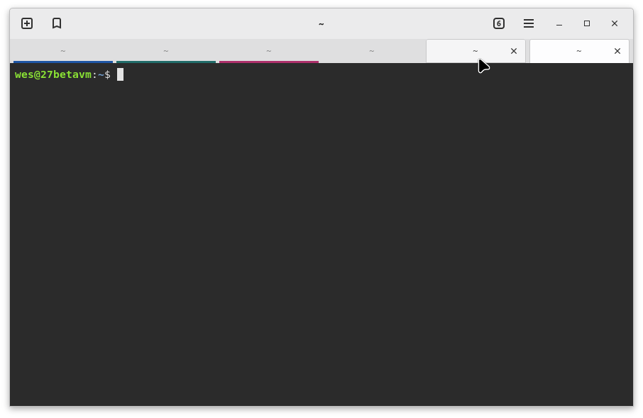
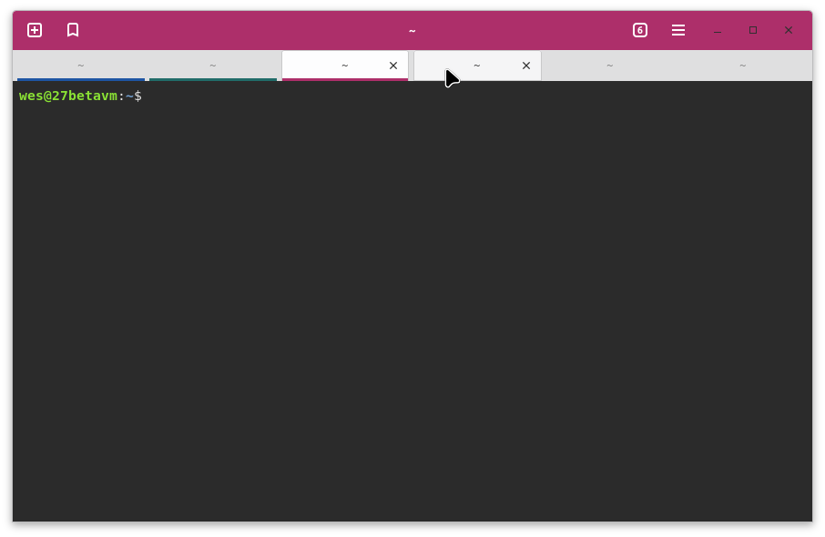
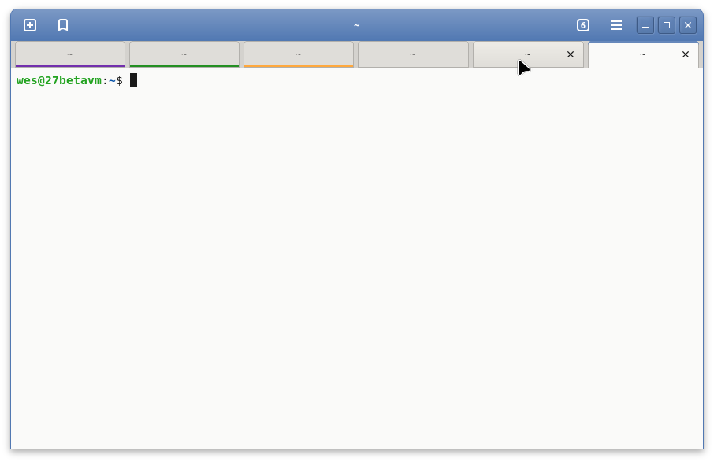
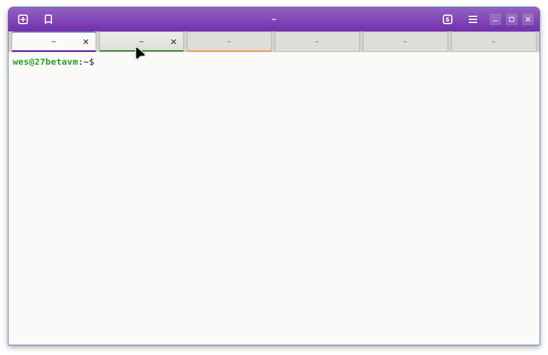
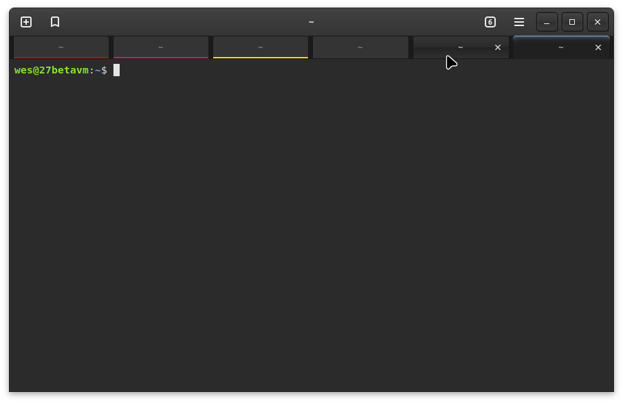
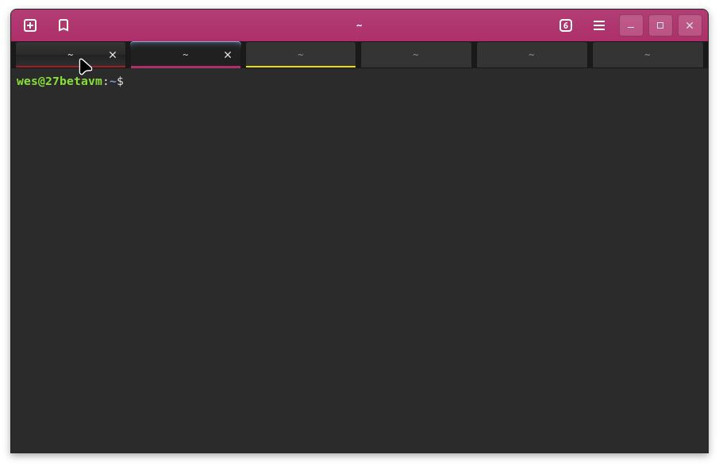
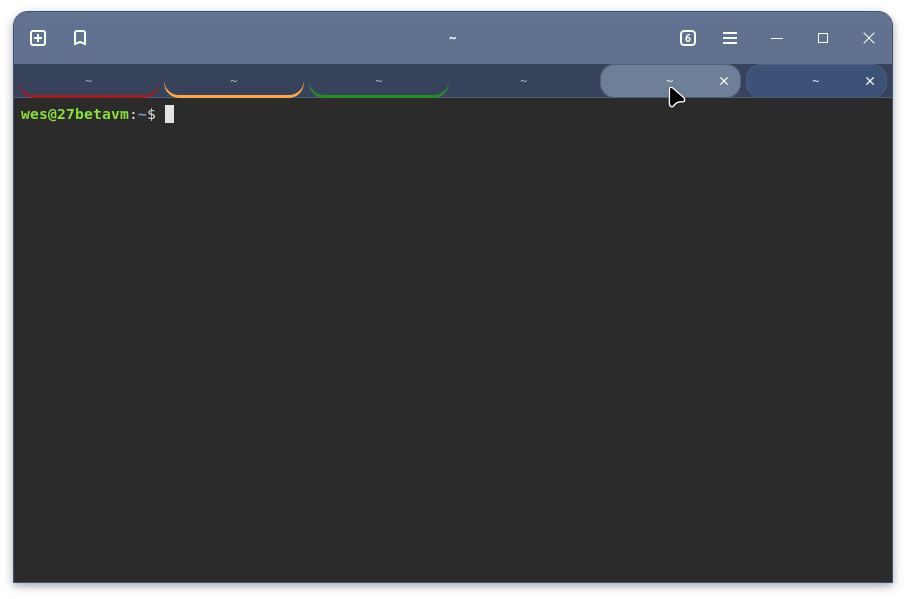
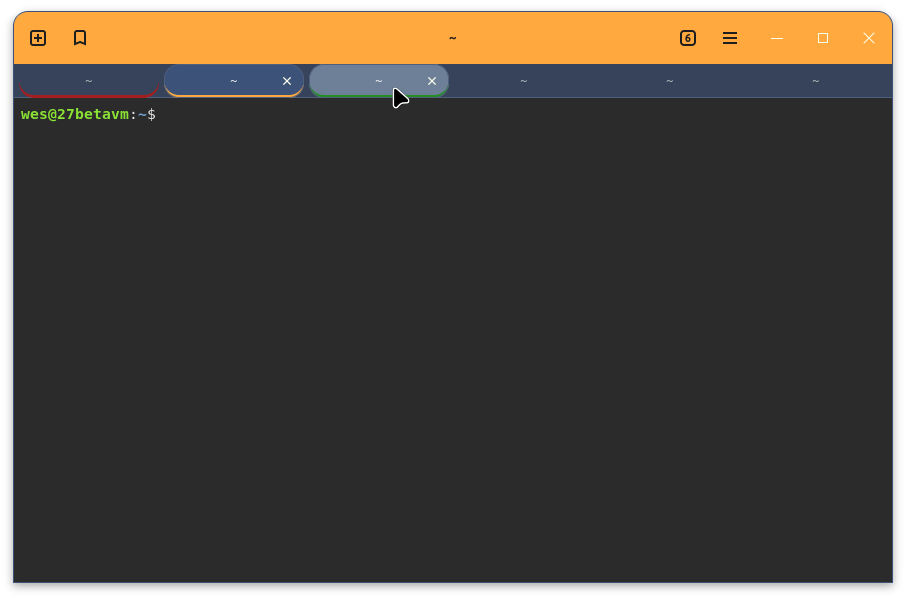

# Velocitty with Theme Roller

Velocitty, Linux Mint 23's terminal, styled by Theme Roller on the Mint 23 beta (Wayland). In each pair, the first screenshot is a normal session. The second has a color-marked tab selected, so the header bar takes that tab's color.

Theme Roller gives Velocitty a "Theme Roller" palette with your terminal colors and title bar color. With **GNOME-style apps** set to **Full** (Integration tab), the window also takes your style: the title bar gradient, your window buttons, rounded corners, and a tab strip apart from the header bar. Each tab's color shows as a line under the tab. When the header bar takes a session color, its buttons let that color show through.

These screenshots need the development version of Theme Roller (the `v1-generator` branch). Close and reopen Velocitty after Apply.

## Mint-Y look

## xl-Classic

## xl-Gummy Dark

## xl-Pigeon

Gargantuan window buttons, with rounded tabs and colored tab lines.

