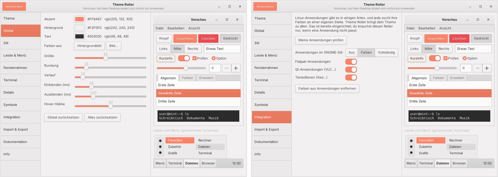

# Theme Roller auf Deutsch: bitte prüfen

Theme Roller ist ein kostenloses Programm, das den Cinnamon-Desktop von Linux Mint gestaltet. Die deutsche Übersetzung entstand ohne Muttersprachler. Wenn etwas falsch, holprig oder unnatürlich klingt, sag uns bitte Bescheid. Schon zehn Minuten helfen sehr.

- **Mit dem Programm:** Ist dein Mint auf Deutsch eingestellt, installiere Theme Roller ([Download](https://github.com/xlcheese/theme-roller/releases/latest)) und klicke dich durch die Reiter.
- **Ohne Installation:** Lies einfach die Tabelle unten.
- **Antworten:** im Beitrag, in dem du diese Seite gefunden hast, oder auf GitHub: die Nummer und deine bessere Formulierung, z. B. „#94: … statt …“.

> Bitte beibehalten: Wörter in `{Klammern}` unverändert, Auszeichnungen wie `<b>` unverändert; kurze Beschriftungen (✂) kurz halten, sonst wird das Fenster breiter; Namen wie Theme Roller, Cinnamon, GNOME, Flatpak, Qt bleiben.

| Nr. | Englisch | Deutsch |
|---:|---|---|
| 1 ✂ | Global | Global |
| 2 ✂ | Panel & Menu | Leiste & Menü |
| 3 ✂ | Theme | Thema |
| 4 ✂ | Terminal | Terminal |
| 5 ✂ | Window Borders | Fensterrahmen |
| 6 ✂ | Details | Details |
| 7 ✂ | Icons | Symbole |
| 8 ✂ | Integration | Integration |
| 9 ✂ | About | Info |
| 10 ✂ | Documentation | Dokumentation |
| 11 ✂ | Import & Export | Import & Export |
| 12 | Folders recolored: the folder color (the front) follows your accent, and the second color (the back) a darker shade of it. Choose either and both keep their colors from then on; Reset Icons follows the theme again. Every other icon stays as in your current icon theme. Apply to use them. | Ordner neu eingefärbt: Die Ordnerfarbe (die Vorderseite) folgt deiner Akzentfarbe, die zweite Farbe (die Rückseite) einem dunkleren Ton davon. Wählst du eine davon, behalten beide ab dann ihre Farben; Symbole zurücksetzen folgt wieder dem Thema. Alle anderen Symbole bleiben wie in deinem aktuellen Symbolthema. Mit Anwenden übernehmen. |
| 13 ✂ | Themes and styles | Themen und Stile |
| 14 | A <b>theme</b> is your colors and settings: everything on these tabs. A <b>style</b> is how things are drawn: edges, hovers, tabs and panel buttons. Any theme can use any style. Everything shows in the preview first; nothing changes on your desktop until you click <b>Apply</b>, and <b>Revert</b> puts your previous theme back. | Ein <b>Thema</b> sind deine Farben und Einstellungen: alles auf diesen Reitern. Ein <b>Stil</b> legt fest, wie alles gezeichnet wird: Kanten, Hover-Effekte, Reiter und Leistenknöpfe. Jedes Thema kann jeden Stil nutzen. Alles erscheint zuerst in der Vorschau; auf deinem Desktop ändert sich nichts, bis du <b>Anwenden</b> klickst, und <b>Rückgängig</b> holt dein vorheriges Thema zurück. |
| 15 | Start from a built-in theme, one shared by someone else, or one of your own. Change anything and it becomes <b>Custom</b>; <b>Save Theme…</b> keeps your changes under a name. Your own themes can be duplicated, renamed and deleted. | Beginne mit einem mitgelieferten Thema, einem von jemand anderem geteilten oder einem eigenen. Änderst du etwas, wird es zu <b>Eigenes</b>; <b>Speichern…</b> behält deine Änderungen unter einem Namen. Eigene Themen lassen sich duplizieren, umbenennen und löschen. |
| 16 | Three colors make a complete light or dark theme: accent, background and text. Then the shape of everything: Size, Roundness, Gradient, and how hovers fade. <b>Colors from</b> picks an accent from your wallpaper or any picture. | Drei Farben ergeben ein vollständiges helles oder dunkles Thema: Akzent, Hintergrund und Text. Dann die Form von allem: Größe, Rundung, Verlauf und wie Hover-Effekte ein- und ausblenden. <b>Farben aus</b> holt eine Akzentfarbe aus deinem Hintergrundbild oder einem beliebigen Bild. |
| 17 | Pick how things are drawn, and set its Depth (how strong edges and shadows are) and Unfocused depth (how much of that unfocused windows keep). You can also make your own: a style is one style.toml file, in ~/.local/share/theme-roller/styles/&lt;name&gt;/. <b>Create a starter style…</b> makes one with every option explained: the essentials are on, the rest switched off with a #, each with a short note. Edit it, then pick it on the Style tab. <b>Check a style sheet for issues…</b> tells you if anything in it needs fixing. | Wähle, wie alles gezeichnet wird, und stelle die Tiefe (wie kräftig Kanten und Schatten sind) und die Tiefe ohne Fokus (wie viel davon Fenster ohne Fokus behalten) ein. Du kannst auch eigene Stile erstellen: Ein Stil ist eine style.toml-Datei in ~/.local/share/theme-roller/styles/&lt;Name&gt;/. <b>Startstil erstellen…</b> legt einen an, in dem jede Option erklärt ist: das Wichtigste ist aktiv, der Rest mit # abgeschaltet, jeweils mit einer kurzen Notiz. Bearbeite ihn und wähle ihn dann auf dem Reiter Stil. <b>Stildatei auf Fehler prüfen…</b> sagt dir, ob darin etwas korrigiert werden muss. |
| 18 ✂ | Panel &amp; Menu | Leiste &amp; Menü |
| 19 | The Cinnamon panel and its menus: their own colors, label weight, height, roundness, gradient and see-through. Left alone, they follow Global. | Die Cinnamon-Leiste und ihre Menüs: eigene Farben, Schriftstärke, Höhe, Rundung, Verlauf und Transparenz. Unverändert folgen sie Global. |
| 20 | Title bars and window buttons: colors, height, gradient, border, roundness, and a choice of button styles and Minimize, Maximize and Close glyphs. When these change, Apply restarts Cinnamon by itself (your windows stay open), as window borders only reload then. | Titelleisten und Fensterknöpfe: Farben, Höhe, Verlauf, Rahmen, Rundung sowie eine Auswahl an Knopfstilen und Symbolen für Minimieren, Maximieren und Schließen. Ändern sie sich, startet Anwenden Cinnamon selbst neu (deine Fenster bleiben offen), da Fensterrahmen nur dann neu geladen werden. |
| 21 | The terminal follows the theme, or pick one of the color sets, or your own colors. | Das Terminal folgt dem Thema, oder wähle eine der Farbzusammenstellungen oder eigene Farben. |
| 22 | Tooltips, scrollbars (overlay or classic, roundness, width), sliders, switches and the focus ring. | Kurzinfos, Bildlaufleisten (überlagernd oder klassisch, Rundung, Breite), Schieberegler, Schalter und der Fokusrahmen. |
| 23 | Folder icons in your colors, in six styles. Only the folders change; other icons stay as they were. The folder color follows your accent unless you pick one; on xl-Big Baddy, the second color is its racing stripes. Off until you switch it on. | Ordnersymbole in deinen Farben, in sechs Stilen. Nur die Ordner ändern sich; andere Symbole bleiben, wie sie waren. Die Ordnerfarbe folgt deiner Akzentfarbe, außer du wählst eine; bei xl-Big Baddy ist die zweite Farbe seine Rennstreifen. Aus, bis du es einschaltest. |
| 24 | Linux apps come in a few kinds, and each looks for its colors in its own place. These switches bring your colors to the hodgepodge that doesn't read the theme on its own: GNOME-style apps, Flatpak apps, Qt apps like VLC, and text editors. <b>Scan my apps</b> shows which of your apps are which kind; <b>Take colors out of apps</b> removes them until the next Apply. Pick another theme in Mint's settings and Theme Roller's colors leave your apps by themselves. | Linux-Anwendungen gibt es in einigen Arten, und jede sucht ihre Farben an einer eigenen Stelle. Diese Schalter bringen deine Farben zu dem Sammelsurium, das das Thema nicht von selbst liest: Anwendungen im GNOME-Stil, Flatpak-Anwendungen, Qt-Anwendungen wie VLC und Texteditoren. <b>Meine Anwendungen prüfen</b> zeigt, welche deiner Anwendungen welcher Art sind; <b>Farben aus Anwendungen entfernen</b> nimmt sie bis zum nächsten Anwenden heraus. Wählst du in Mints Einstellungen ein anderes Thema, verschwinden die Farben von Theme Roller von selbst aus deinen Anwendungen. |
| 25 ✂ | Import &amp; Export | Import &amp; Export |
| 26 | Share a theme as one <tt>.xltheme</tt> file, and add themes others shared with you. | Teile ein Thema als eine einzige <tt>.xltheme</tt>-Datei und füge Themen hinzu, die andere mit dir geteilt haben. |
| 27 ✂ | Accent | Akzent |
| 28 ✂ | Background | Hintergrund |
| 29 ✂ | Size | Größe |
| 30 ✂ | Text | Text |
| 31 ✂ | Gradient | Verlauf |
| 32 ✂ | Hover in (ms) | Einblenden (ms) |
| 33 ✂ | Roundness | Rundung |
| 34 ✂ | Depth | Tiefe |
| 35 ✂ | Hover out (ms) | Ausblenden (ms) |
| 36 ✂ | Hover strength | Hover-Stärke |
| 37 ✂ | Unfocused depth | Tiefe ohne Fokus |
| 38 ✂ | Label weight | Schriftstärke |
| 39 ✂ | Opacity | Deckkraft |
| 40 ✂ | Height | Höhe |
| 41 ✂ | Notification opacity | Meldungs-Deckkraft |
| 42 ✂ | Menu-item roundness | Eintragsrundung |
| 43 ✂ | Border | Rahmen |
| 44 ✂ | Title bar | Titelleiste |
| 45 ✂ | Title text | Titeltext |
| 46 ✂ | Border width | Rahmenbreite |
| 47 ✂ | Round bottom corners | Untere Ecken abrunden |
| 48 ✂ | Title bar height | Höhe der Titelleiste |
| 49 ✂ | Window roundness | Fensterrundung |
| 50 ✂ | Buttons on the | Knöpfe |
| 51 ✂ | Title bar gradient | Verlauf der Titelleiste |
| 52 ✂ | Button roundness | Knopfrundung |
| 53 ✂ | Button spacing | Knopfabstand |
| 54 ✂ | Button style | Knopfstil |
| 55 ✂ | Glyphs | Symbole |
| 56 ✂ | Color | Farbe |
| 57 ✂ | Mode | Modus |
| 58 ✂ | Style | Stil |
| 59 ✂ | Width | Breite |
| 60 ✂ | GNOME-style apps | Anwendungen im GNOME-Stil |
| 61 ✂ | Custom folder style | Eigener Ordnerstil |
| 62 ✂ | Folder color | Ordnerfarbe |
| 63 ✂ | Second color | Zweite Farbe |
| 64 ✂ | Flatpak apps | Flatpak-Anwendungen |
| 65 ✂ | Qt apps (VLC…) | Qt-Anwendungen (VLC…) |
| 66 ✂ | Text editors (Xed…) | Texteditoren (Xed…) |
| 67 ✂ | Menu style | Menüstil |
| 68 ✂ | Panel style | Leistenstil |
| 69 ✂ | Tooltips | Kurzinfos |
| 70 ✂ | Scrollbars | Bildlaufleisten |
| 71 ✂ | Sliders | Schieberegler |
| 72 ✂ | Switches | Schalter |
| 73 ✂ | Focus ring | Fokusrahmen |
| 74 | Colors left on “Follow theme” use the Global colors. | Farben auf „Thema folgen“ nutzen die Farben von Global. |
| 75 | Colors left on “Follow theme” come from the Global colors. | Farben auf „Thema folgen“ kommen aus den Farben von Global. |
| 76 | Left on “Follow theme”, the terminal uses the theme's content colors. | Auf „Thema folgen“ nutzt das Terminal die Inhaltsfarben des Themas. |
| 77 | Linux apps come in a few kinds, and each looks for its colors in its own place. Theme Roller brings your theme to all of them. These are already set, so you only need this tab if an app doesn't match. | Linux-Anwendungen gibt es in einigen Arten, und jede sucht ihre Farben an einer eigenen Stelle. Theme Roller bringt dein Thema zu allen. Das ist bereits eingerichtet; du brauchst diesen Reiter nur, wenn eine Anwendung nicht passt. |
| 78 | GNOME apps such as Calculator and Text Editor (libadwaita). Colors: your colors, and GNOME's accent to match. Full: also your buttons, title buttons and tabs; this overrides apps' own styling, so some lose colors of their own (Flatpak ones need Flatpak apps on). Reopen apps to see changes. | GNOME-Anwendungen wie Rechner und Texteditor (libadwaita). Farben: deine Farben und die passende GNOME-Akzentfarbe. Vollständig: auch deine Knöpfe, Titelknöpfe und Reiter; das überschreibt das eigene Aussehen der Anwendungen, sodass manche eigene Farben verlieren (Flatpak-Anwendungen brauchen dazu Flatpak-Anwendungen an). Öffne die Anwendungen neu, um die Änderungen zu sehen. |
| 79 | Lets Flatpak apps read your theme, so they get its colors. Reopen open apps to see them. | Lässt Flatpak-Anwendungen dein Thema lesen, damit sie seine Farben bekommen. Öffne offene Anwendungen neu, um sie zu sehen. |
| 80 | Flatpak isn't installed. | Flatpak ist nicht installiert. |
| 81 ✂ | A–Z | A–Z |
| 82 ✂ | Newest | Neueste |
| 83 ✂ | Oldest | Älteste |
| 84 ✂ | Z–A | Z–A |
| 85 ✂ | Colors | Farben |
| 86 ✂ | Full | Vollständig |
| 87 ✂ | Off | Aus |
| 88 | Preview: nothing changes on the desktop until Apply | Vorschau: Auf dem Desktop ändert sich nichts bis Anwenden |
| 89 ✂ | Apply | Anwenden |
| 90 ✂ | Revert | Rückgängig |
| 91 | Put the previous theme back on the desktop (your settings here stay) | Das vorherige Thema auf dem Desktop wiederherstellen (deine Einstellungen hier bleiben) |
| 92 ✂ | Scan my apps | Meine Anwendungen prüfen |
| 93 | Lists the apps on this computer by kind, and whether Theme Roller reaches them: the answer to “why doesn't this app match?” | Listet die Anwendungen auf diesem Rechner nach Art auf und ob Theme Roller sie erreicht: die Antwort auf „Warum passt diese Anwendung nicht?“ |
| 94 ✂ | Reset {tab} | {tab} zurücksetzen |
| 95 ✂ | Reset All to Theme Defaults | Alles zurücksetzen |
| 96 ✂ | No stripes | Keine Streifen |
| 97 ✂ | Save Theme… | Speichern… |
| 98 | Keep your Custom settings as a theme with its own name | Deine Einstellungen aus Eigenes als Thema mit eigenem Namen behalten |
| 99 ✂ | Duplicate | Duplizieren |
| 100 | Save a copy of the selected theme as one of your themes | Eine Kopie des gewählten Themas als eines deiner Themen speichern |
| 101 ✂ | Rename | Umbenennen |
| 102 | Rename one of your themes (built-in themes keep their names) | Eines deiner Themen umbenennen (mitgelieferte Themen behalten ihren Namen) |
| 103 ✂ | Delete | Löschen |
| 104 ✂ | Sort: | Sortieren: |
| 105 ✂ | Your theme | Dein Thema |
| 106 ✂ | Your latest changes | Deine letzten Änderungen |
| 107 | Your latest changes, based on {theme} | Deine letzten Änderungen, basierend auf {theme} |
| 108 ✂ | Your style | Dein Stil |
| 109 ✂ | Theme default | Vorgabe des Themas |
| 110 | Off: switch it on in the Integration tab | Aus: auf dem Reiter Integration einschalten |
| 111 ✂ | On | An |
| 112 | Follow the theme on their own | Folgen dem Thema von selbst |
| 113 | Nothing to do: they always match. | Nichts zu tun: Sie passen immer. |
| 114 ✂ | Colors on | Farben an |
| 115 | Off: set GNOME-style apps to Colors in the Integration tab | Aus: Anwendungen im GNOME-Stil auf dem Reiter Integration auf Farben stellen |
| 116 ✂ | Colors and full styling on | Farben und vollständiges Aussehen an |
| 117 | . GNOME-style ones also need GNOME-style apps set to Colors | . Solche im GNOME-Stil brauchen außerdem Anwendungen im GNOME-Stil auf Farben |
| 118 ✂ | Qt apps | Qt-Anwendungen |
| 119 ✂ | Text editors | Texteditoren |
| 120 ✂ | Run in a terminal | Laufen in einem Terminal |
| 121 | They use the terminal's colors (Terminal tab). | Sie nutzen die Farben des Terminals (Reiter Terminal). |
| 122 | They draw their own look; no theme reaches them. | Sie zeichnen ihr eigenes Aussehen; kein Thema erreicht sie. |
| 123 ✂ | Web-based apps | Webbasierte Anwendungen |
| 124 ✂ | Couldn't tell | Nicht erkennbar |
| 125 | Many of these draw their own look. | Viele davon zeichnen ihr eigenes Aussehen. |
| 126 ✂ | Your apps | Deine Anwendungen |
| 127 ✂ | Close | Schließen |
| 128 | {count} apps in your menu, by kind. Changes show after Apply, in apps opened afterwards. | {count} Anwendungen in deinem Menü, nach Art. Änderungen zeigen sich nach Anwenden, in danach geöffneten Anwendungen. |
| 129 ✂ | Take colors out of apps | Farben aus Anwendungen entfernen |
| 130 | Theme Roller's colors are out of your apps. Reopen open apps. The next Apply puts them back. | Die Farben von Theme Roller sind aus deinen Anwendungen entfernt. Öffne offene Anwendungen neu. Das nächste Anwenden bringt sie zurück. |
| 131 | Removes Theme Roller's colors from all apps now. Your settings and the theme stay; the next Apply puts the colors back. | Entfernt die Farben von Theme Roller jetzt aus allen Anwendungen. Deine Einstellungen und das Thema bleiben; das nächste Anwenden bringt die Farben zurück. |
| 132 ✂ | Colors from | Farben aus |
| 133 ✂ | Wallpaper | Hintergrundbild |
| 134 | Take an accent from your desktop wallpaper | Eine Akzentfarbe aus deinem Hintergrundbild nehmen |
| 135 ✂ | Image… | Bild… |
| 136 | Take an accent from any picture | Eine Akzentfarbe aus einem beliebigen Bild nehmen |
| 137 ✂ | Take colors from a picture | Farben aus einem Bild nehmen |
| 138 ✂ | Cancel | Abbrechen |
| 139 ✂ | Use | Verwenden |
| 140 ✂ | Pictures | Bilder |
| 141 | Couldn't find your wallpaper (Cinnamon's background setting has no picture). | Dein Hintergrundbild wurde nicht gefunden (Cinnamons Hintergrund hat kein Bild). |
| 142 | Couldn't read {file}: {problem} | {file} konnte nicht gelesen werden: {problem} |
| 143 ✂ | Use {color} as the accent | {color} als Akzentfarbe verwenden |
| 144 | Accent from {file}. Or click another color. | Akzentfarbe aus {file}. Oder klicke eine andere Farbe an. |
| 145 | {file} has no colors vivid enough for an accent. | {file} hat keine Farben, die kräftig genug für eine Akzentfarbe sind. |
| 146 | The xl-Cheeselooks theme maker for Linux Mint and the Cinnamon desktop: your colors and shapes, drawn by a style, for GTK 3 and GTK 4 apps, libadwaita apps, the Cinnamon panel and menus, and the window borders. | Der Ersteller des Themas xl-Cheeselooks für Linux Mint und den Cinnamon-Desktop: deine Farben und Formen, gezeichnet von einem Stil, für GTK-3- und GTK-4-Anwendungen, libadwaita-Anwendungen, die Cinnamon-Leiste und -Menüs und die Fensterrahmen. |
| 147 ✂ | Website | Webseite |
| 148 | Enjoying {app}? It's free and always will be. | Gefällt dir {app}? Es ist kostenlos und wird es immer bleiben. |
| 149 ✂ | Leave a tip ☕ | Trinkgeld geben ☕ |
| 150 | Developed with the help of Claude, an AI assistant by Anthropic | Entwickelt mit Hilfe von Claude, einem KI-Assistenten von Anthropic |
| 151 | This program comes with absolutely no warranty. See the <a href='https://www.gnu.org/licenses/gpl-3.0.html'>GNU General Public License, version 3 or later</a> for details. | Dieses Programm kommt ohne jegliche Garantie. Einzelheiten in der <a href='https://www.gnu.org/licenses/gpl-3.0.html'>GNU General Public License, Version 3 oder neuer</a>. |
| 152 ✂ | Remove from my desktop… | Vom Desktop entfernen… |
| 153 | Before uninstalling Theme Roller: puts Mint's default theme back and takes Theme Roller's colors out of your apps | Vor dem Deinstallieren von Theme Roller: stellt Mints Standardthema wieder her und entfernt die Farben von Theme Roller aus deinen Anwendungen |
| 154 | Remove Theme Roller from your desktop? | Theme Roller vom Desktop entfernen? |
| 155 | Mint's default theme comes back, Theme Roller's colors leave your apps, and the theme watcher stops starting at login. Your settings and your own themes stay, so you can pick up where you left off. Do this before uninstalling Theme Roller. | Mints Standardthema kommt zurück, die Farben von Theme Roller verschwinden aus deinen Anwendungen und der Themenwächter startet nicht mehr bei der Anmeldung. Deine Einstellungen und eigenen Themen bleiben, sodass du weitermachen kannst, wo du aufgehört hast. Tu das vor dem Deinstallieren von Theme Roller. |
| 156 | Removing… the desktop flickers once while it reloads. | Wird entfernt… der Desktop flackert einmal beim Neuladen. |
| 157 | Theme Roller is off your desktop. You can uninstall it now; Apply puts it back. | Theme Roller ist vom Desktop entfernt. Du kannst es jetzt deinstallieren; Anwenden bringt es zurück. |
| 158 ✂ | Remove failed: {problem} | Entfernen fehlgeschlagen: {problem} |
| 159 ✂ | Create a starter style… | Startstil erstellen… |
| 160 | Check a style sheet for issues… | Stildatei auf Fehler prüfen… |
| 161 | Pick a style.toml: it's checked as Theme Roller reads it, and any problems are listed with what to fix | Wähle eine style.toml: Sie wird so geprüft, wie Theme Roller sie liest, und alle Probleme werden mit dem, was zu korrigieren ist, aufgelistet |
| 162 ✂ | Full documentation (online) | Vollständige Dokumentation (online) |
| 163 ✂ | Check a style sheet | Stildatei prüfen |
| 164 ✂ | Check | Prüfen |
| 165 ✂ | Style sheets (style.toml) | Stildateien (style.toml) |
| 166 ✂ | “{style}” looks good | „{style}“ sieht gut aus |
| 167 ✂ | Warning: {problem} | Warnung: {problem} |
| 168 | No problems found. Pick it on the Style tab to use it. | Keine Probleme gefunden. Wähle ihn auf dem Reiter Stil, um ihn zu nutzen. |
| 169 ✂ | Problems to fix: {count} | Zu behebende Probleme: {count} |
| 170 | Fix these in the file, then check it again. | Behebe sie in der Datei und prüfe sie dann erneut. |
| 171 ✂ | the style needs a name | der Stil braucht einen Namen |
| 172 | names can be up to {count} characters | Namen dürfen bis zu {count} Zeichen lang sein |
| 173 | names can't contain / or start with a dot | Namen dürfen kein / enthalten und nicht mit einem Punkt beginnen |
| 174 | there's already a style called {name} | es gibt bereits einen Stil namens {name} |
| 175 ✂ | Create Style | Stil erstellen |
| 176 | Give your new style a good name. | Gib deinem neuen Stil einen guten Namen. |
| 177 ✂ | My Style | Mein Stil |
| 178 ✂ | Create | Erstellen |
| 179 | Created {file}. Edit it, then pick it on the Style tab. | {file} erstellt. Bearbeite sie und wähle den Stil dann auf dem Reiter Stil. |
| 180 | Share a theme as one file (.xltheme). It holds every setting, the theme's name, the version of Theme Roller it was made with, and your style when the theme uses one of your own, so the person importing it gets exactly your look. | Teile ein Thema als eine einzige Datei (.xltheme). Sie enthält jede Einstellung, den Namen des Themas, die Version von Theme Roller, mit der es erstellt wurde, und deinen Stil, wenn das Thema einen eigenen nutzt, sodass die importierende Person genau dein Aussehen bekommt. |
| 181 ✂ | Export the current theme… | Aktuelles Thema exportieren… |
| 182 ✂ | Import a theme… | Thema importieren… |
| 183 ✂ | Preview | Vorschau |
| 184 ✂ | Edit | Bearbeiten |
| 185 ✂ | File | Datei |
| 186 ✂ | View | Ansicht |
| 187 ✂ | Open | Öffnen |
| 188 ✂ | Quit | Beenden |
| 189 ✂ | Button | Knopf |
| 190 ✂ | Suggested | Empfohlen |
| 191 ✂ | Toggled | Gedrückt |
| 192 ✂ | A tooltip on {button} | Eine Kurzinfo zu {button} |
| 193 ✂ | Center | Mitte |
| 194 ✂ | Left | Links |
| 195 ✂ | Right | Rechts |
| 196 ✂ | Some text | Etwas Text |
| 197 ✂ | Tooltip | Kurzinfo |
| 198 ✂ | Radio | Option |
| 199 ✂ | Advanced | Erweitert |
| 200 ✂ | General | Allgemein |
| 201 ✂ | Fifth row | Fünfte Zeile |
| 202 ✂ | First row | Erste Zeile |
| 203 ✂ | Fourth row | Vierte Zeile |
| 204 ✂ | Selected row | Gewählte Zeile |
| 205 ✂ | Third row | Dritte Zeile |
| 206 ✂ | Eighth row | Achte Zeile |
| 207 ✂ | Seventh row | Siebte Zeile |
| 208 ✂ | Sixth row | Sechste Zeile |
| 209 ✂ | Desktop  Documents  Music | Schreibtisch  Dokumente  Musik |
| 210 ✂ | Accessories | Zubehör |
| 211 ✂ | Favorites | Favoriten |
| 212 ✂ | Graphics | Grafik |
| 213 ✂ | Calculator | Rechner |
| 214 ✂ | Files | Dateien |
| 215 | Panel and menu (drawn preview) | Leiste und Menü (gezeichnete Vorschau) |
| 216 ✂ | Menu | Menü |
| 217 ✂ | Browser | Browser |
| 218 ✂ | Can't preview: {problem} | Keine Vorschau möglich: {problem} |
| 219 | Preview CSS problem: {problem} | CSS-Problem in der Vorschau: {problem} |
| 220 ✂ | None | Keine |
| 221 ✂ | Follow theme | Thema folgen |
| 222 ✂ | Custom | Eigenes |
| 223 ✂ | <b>{name}</b> folder style | Ordnerstil <b>{name}</b> |
| 224 | Put every tab back to {theme}. Your latest changes stay in Custom. | Alle Reiter auf {theme} zurücksetzen. Deine letzten Änderungen bleiben in Eigenes. |
| 225 | Put Global back to {theme}. Other tabs keep what you set there, but colors on “Follow theme” and shapes that follow Global change with it. | Global auf {theme} zurücksetzen. Andere Reiter behalten, was du dort eingestellt hast, aber Farben auf „Thema folgen“ und Formen, die Global folgen, ändern sich mit. |
| 226 | Put {tab} back to {theme} (other tabs stay as they are) | {tab} auf {theme} zurücksetzen (andere Reiter bleiben, wie sie sind) |
| 227 ✂ | Theme: {theme} | Thema: {theme} |
| 228 | Every tab reset to {theme}. Your latest changes are still in Custom. | Alle Reiter auf {theme} zurückgesetzt. Deine letzten Änderungen sind weiter in Eigenes. |
| 229 | {tab} reset to {theme}. | {tab} auf {theme} zurückgesetzt. |
| 230 ✂ | Save Theme | Thema speichern |
| 231 ✂ | Save | Speichern |
| 232 | Name your theme. It uses the style “{style}” and all your current settings. | Gib deinem Thema einen Namen. Es nutzt den Stil „{style}“ und alle deine aktuellen Einstellungen. |
| 233 ✂ | {theme} copy | {theme} (Kopie) |
| 234 | Up to {count} characters. Built-in themes can't be replaced; your own can. | Bis zu {count} Zeichen. Mitgelieferte Themen lassen sich nicht ersetzen, deine eigenen schon. |
| 235 | Replace your theme “{theme}”? | Dein Thema „{theme}“ ersetzen? |
| 236 | Saved the theme “{theme}”. | Thema „{theme}“ gespeichert. |
| 237 ✂ | OK | OK |
| 238 ✂ | Duplicate Theme | Thema duplizieren |
| 239 | A copy of “{theme}”, as one of your themes: | Eine Kopie von „{theme}“, als eines deiner Themen: |
| 240 | Duplicated “{theme}” as “{copy}”. | „{theme}“ als „{copy}“ dupliziert. |
| 241 ✂ | A new name for “{theme}”: | Ein neuer Name für „{theme}“: |
| 242 ✂ | Rename Theme | Thema umbenennen |
| 243 | Renamed “{old}” to “{new}”. | „{old}“ in „{new}“ umbenannt. |
| 244 | Delete your theme “{theme}”? Its style stays installed. | Dein Thema „{theme}“ löschen? Sein Stil bleibt installiert. |
| 245 ✂ | My theme | Mein Thema |
| 246 ✂ | Export theme | Thema exportieren |
| 247 ✂ | Exported “{theme}” to {file} | „{theme}“ nach {file} exportiert |
| 248 ✂ | Export failed: {problem} | Export fehlgeschlagen: {problem} |
| 249 ✂ | Import theme | Thema importieren |
| 250 ✂ | Theme Roller themes | Theme-Roller-Themen |
| 251 | Imported “{theme}”. | „{theme}“ importiert. |
| 252 ✂ | Import failed: {problem} | Import fehlgeschlagen: {problem} |
| 253 | Applying… the desktop flickers once while it reloads. | Wird angewendet… der Desktop flackert einmal beim Neuladen. |
| 254 ✂ | Apply failed: {problem} | Anwenden fehlgeschlagen: {problem} |
| 255 | “{theme}” is on the desktop. Revert puts the previous theme back. | „{theme}“ ist auf dem Desktop. Rückgängig holt das vorherige Thema zurück. |
| 256 ✂ | Qt apps now match your theme | Qt-Anwendungen passen jetzt zu deinem Thema |
| 257 | Reverting… the desktop flickers once while it reloads. | Wird rückgängig gemacht… der Desktop flackert einmal beim Neuladen. |
| 258 ✂ | Revert failed: {problem} | Rückgängig fehlgeschlagen: {problem} |
| 259 | The previous theme is back on the desktop. Your settings here are unchanged. | Das vorherige Thema ist wieder auf dem Desktop. Deine Einstellungen hier bleiben unverändert. |
| 260 ✂ | GNOME runtime | GNOME-Laufzeit |
| 261 ✂ | KDE runtime | KDE-Laufzeit |
| 262 | Gives Xed, gedit and Meld a color scheme from your theme, mainly for syntax colors and highlights. Most editors' own schemes follow your theme too. Reopen them to see changes. | Gibt Xed, gedit und Meld ein Farbschema aus deinem Thema, vor allem für Syntaxfarben und Hervorhebungen. Die eigenen Schemata der meisten Editoren folgen deinem Thema ebenfalls. Öffne sie neu, um die Änderungen zu sehen. |
| 263 ✂ | Racing stripes | Rennstreifen |
| 264 | Binders in your colors: the folder color follows your accent. Racing stripes are off until you pick a color for them; No stripes takes them off again. Every other icon stays as in your current icon theme. Apply to use them. | Ringbücher in deinen Farben: Die Ordnerfarbe folgt deiner Akzentfarbe. Rennstreifen sind aus, bis du eine Farbe für sie wählst; Keine Streifen nimmt sie wieder weg. Alle anderen Symbole bleiben wie in deinem aktuellen Symbolthema. Mit Anwenden übernehmen. |
| 265 ✂ | Wavy lines | Wellenlinien |
| 266 | Binders in your colors: the folder color follows your accent, and the wavy lines a darker shade of it. Choose either and both keep their colors from then on; Reset Icons follows the theme again. Every other icon stays as in your current icon theme. Apply to use them. | Ringbücher in deinen Farben: Die Ordnerfarbe folgt deiner Akzentfarbe, die Wellenlinien einem dunkleren Ton davon. Wählst du eine davon, behalten beide ab dann ihre Farben; Symbole zurücksetzen folgt wieder dem Thema. Alle anderen Symbole bleiben wie in deinem aktuellen Symbolthema. Mit Anwenden übernehmen. |
| 267 | Your Qt apps now use your theme's colors.  Your previous Qt setup is saved: {saved}.  Turning off Integration → Qt apps puts it back. | Deine Qt-Anwendungen nutzen jetzt die Farben deines Themas.  Deine bisherige Qt-Einrichtung ist gesichert: {saved}.  Integration → Qt-Anwendungen auszuschalten bringt sie zurück. |
| 268 | The first time, log out and back in to see your colors in Qt apps; after that, reopening them is enough. If you had your own Qt setup, it's saved and comes back when this is off. | Beim ersten Mal musst du dich ab- und wieder anmelden, um deine Farben in Qt-Anwendungen zu sehen; danach genügt es, sie neu zu öffnen. Hattest du eine eigene Qt-Einrichtung, wird sie gesichert und kommt zurück, wenn dies aus ist. |
| 269 | Needs qt5ct: sudo apt install qt5ct | Braucht qt5ct: sudo apt install qt5ct |
| 270 | give the theme a name (not “Custom”) | gib dem Thema einen Namen (nicht „Eigenes“) |
| 271 | a theme's name can be up to {count} characters ({given} given) | der Name eines Themas darf bis zu {count} Zeichen lang sein ({given} angegeben) |
| 272 | “{theme}” is a built-in theme: choose another name | „{theme}“ ist ein mitgeliefertes Thema: wähle einen anderen Namen |
| 273 | you already have a theme called “{theme}” | du hast bereits ein Thema namens „{theme}“ |
| 274 | there's already a theme called “{theme}” | es gibt bereits ein Thema namens „{theme}“ |
| 275 | couldn't find a free name for the copy | kein freier Name für die Kopie gefunden |
| 276 | built-in themes can't be renamed: duplicate it instead | mitgelieferte Themen können nicht umbenannt werden: dupliziere es stattdessen |
| 277 | built-in themes can't be deleted | mitgelieferte Themen können nicht gelöscht werden |
| 278 | {file} isn't a Theme Roller theme file | {file} ist keine Themendatei von Theme Roller |
| 279 | This theme was made with a newer Theme Roller ({version}). Some of it may not show as intended; updating Theme Roller is recommended. | Dieses Thema wurde mit einem neueren Theme Roller ({version}) erstellt. Manches wird vielleicht nicht wie gedacht angezeigt; ein Update von Theme Roller wird empfohlen. |
| 280 | You already have a style folder “{folder}”: kept yours, so the theme uses your copy of that style. | Du hast bereits einen Stilordner „{folder}“: Deiner wurde behalten, das Thema nutzt also deine Kopie dieses Stils. |
| 281 | the theme file contains an unsafe path | die Themendatei enthält einen unsicheren Pfad |
| 282 | The theme's name was longer than {count} characters: shortened to “{theme}”. | Der Name des Themas war länger als {count} Zeichen: gekürzt auf „{theme}“. |
| 283 | A theme called “{theme}” already exists: imported as “{copy}”. | Ein Thema namens „{theme}“ gibt es bereits: als „{copy}“ importiert. |
| 284 ✂ | Chevrons | Winkel |
| 285 ✂ | Regular | Normal |
| 286 ✂ | Thin | Dünn |
| 287 ✂ | Icon Theme | Symbolthema |
| 288 ✂ | Marks | Zeichen |
| 289 ✂ | Bold | Fett |
| 290 ✂ | Classic | Klassisch |
| 291 ✂ | Dashed | Gestrichelt |
| 292 ✂ | Dotted | Gepunktet |
| 293 ✂ | Follow global | Global folgen |
| 294 ✂ | Light | Leicht |
| 295 ✂ | Overlay | Überlagernd |
| 296 ✂ | Separate colors | Eigene Farben |
| 297 ✂ | Solid | Durchgezogen |
