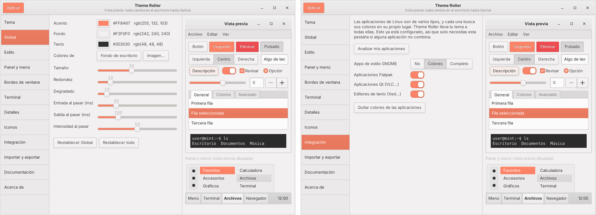

# Theme Roller en español: ayuda para revisarlo

Theme Roller es una aplicación gratuita que personaliza el escritorio Cinnamon de Linux Mint. La traducción al español se hizo sin un hablante nativo. Si algo suena mal, raro o poco natural, avísanos, por favor. Con diez minutos ya ayudas mucho.

- **Con la aplicación:** si tu Mint está en español, instala Theme Roller ([descarga](https://github.com/xlcheese/theme-roller/releases/latest)) y recorre las pestañas.
- **Sin instalar nada:** lee la tabla de abajo.
- **Cómo responder:** en la publicación donde encontraste esta página, o en GitHub: el número y tu mejor redacción, por ejemplo «#94: … en vez de …».

> Por favor, conserva: las palabras entre `{llaves}` tal cual, y las marcas como `<b>`; las etiquetas cortas (✂) deben seguir siendo cortas, o la ventana se ensancha; los nombres como Theme Roller, Cinnamon, GNOME, Flatpak y Qt no se traducen.

| N.º | Inglés | Español |
|---:|---|---|
| 1 ✂ | Global | Global |
| 2 ✂ | Panel & Menu | Panel y menú |
| 3 ✂ | Theme | Tema |
| 4 ✂ | Terminal | Terminal |
| 5 ✂ | Window Borders | Bordes de ventana |
| 6 ✂ | Details | Detalles |
| 7 ✂ | Icons | Iconos |
| 8 ✂ | Integration | Integración |
| 9 ✂ | About | Acerca de |
| 10 ✂ | Documentation | Documentación |
| 11 ✂ | Import & Export | Importar y exportar |
| 12 | Folders recolored: the folder color (the front) follows your accent, and the second color (the back) a darker shade of it. Choose either and both keep their colors from then on; Reset Icons follows the theme again. Every other icon stays as in your current icon theme. Apply to use them. | Carpetas recoloreadas: el color de carpeta (el frente) sigue a tu color de acento, y el segundo color (el fondo) un tono más oscuro de él. Elige cualquiera de los dos y ambos conservarán sus colores desde entonces; Restablecer Iconos vuelve a seguir el tema. Todos los demás iconos quedan como en tu tema de iconos actual. Aplica para usarlas. |
| 13 ✂ | Themes and styles | Temas y estilos |
| 14 | A <b>theme</b> is your colors and settings: everything on these tabs. A <b>style</b> is how things are drawn: edges, hovers, tabs and panel buttons. Any theme can use any style. Everything shows in the preview first; nothing changes on your desktop until you click <b>Apply</b>, and <b>Revert</b> puts your previous theme back. | Un <b>tema</b> son tus colores y ajustes: todo lo de estas pestañas. Un <b>estilo</b> es cómo se dibujan las cosas: bordes, efectos al pasar el ratón, pestañas y botones del panel. Cualquier tema puede usar cualquier estilo. Todo se muestra primero en la vista previa; nada cambia en tu escritorio hasta que pulses <b>Aplicar</b>, y <b>Revertir</b> devuelve tu tema anterior. |
| 15 | Start from a built-in theme, one shared by someone else, or one of your own. Change anything and it becomes <b>Custom</b>; <b>Save Theme…</b> keeps your changes under a name. Your own themes can be duplicated, renamed and deleted. | Empieza con un tema incluido, uno compartido por otra persona o uno tuyo. Cambia cualquier cosa y se convierte en <b>Personalizado</b>; <b>Guardar tema…</b> conserva tus cambios con un nombre. Tus propios temas se pueden duplicar, renombrar y eliminar. |
| 16 | Three colors make a complete light or dark theme: accent, background and text. Then the shape of everything: Size, Roundness, Gradient, and how hovers fade. <b>Colors from</b> picks an accent from your wallpaper or any picture. | Tres colores forman un tema claro u oscuro completo: acento, fondo y texto. Luego la forma de todo: Tamaño, Redondez, Degradado y cómo se desvanecen los efectos al pasar el ratón. <b>Colores de</b> toma un color de acento de tu fondo de escritorio o de cualquier imagen. |
| 17 | Pick how things are drawn, and set its Depth (how strong edges and shadows are) and Unfocused depth (how much of that unfocused windows keep). You can also make your own: a style is one style.toml file, in ~/.local/share/theme-roller/styles/&lt;name&gt;/. <b>Create a starter style…</b> makes one with every option explained: the essentials are on, the rest switched off with a #, each with a short note. Edit it, then pick it on the Style tab. <b>Check a style sheet for issues…</b> tells you if anything in it needs fixing. | Elige cómo se dibujan las cosas y ajusta su Profundidad (la fuerza de bordes y sombras) y la Profundidad sin foco (cuánto de eso conservan las ventanas sin foco). También puedes crear los tuyos: un estilo es un archivo style.toml, en ~/.local/share/theme-roller/styles/&lt;nombre&gt;/. <b>Crear un estilo inicial…</b> crea uno con cada opción explicada: lo esencial activado y el resto desactivado con un #, cada uno con una nota breve. Edítalo y luego elígelo en la pestaña Estilo. <b>Revisar una hoja de estilo…</b> te dice si algo en ella necesita arreglo. |
| 18 ✂ | Panel &amp; Menu | Panel y menú |
| 19 | The Cinnamon panel and its menus: their own colors, label weight, height, roundness, gradient and see-through. Left alone, they follow Global. | El panel de Cinnamon y sus menús: sus propios colores, grosor de etiquetas, altura, redondez, degradado y transparencia. Si no los tocas, siguen a Global. |
| 20 | Title bars and window buttons: colors, height, gradient, border, roundness, and a choice of button styles and Minimize, Maximize and Close glyphs. When these change, Apply restarts Cinnamon by itself (your windows stay open), as window borders only reload then. | Barras de título y botones de ventana: colores, altura, degradado, borde, redondez, y varios estilos de botón y símbolos para Minimizar, Maximizar y Cerrar. Cuando cambian, Aplicar reinicia Cinnamon por sí solo (tus ventanas siguen abiertas), ya que los bordes de ventana solo se recargan entonces. |
| 21 | The terminal follows the theme, or pick one of the color sets, or your own colors. | La terminal sigue el tema, o elige uno de los juegos de colores, o tus propios colores. |
| 22 | Tooltips, scrollbars (overlay or classic, roundness, width), sliders, switches and the focus ring. | Descripciones emergentes, barras de desplazamiento (superpuestas o clásicas, redondez, anchura), deslizadores, interruptores y el anillo de foco. |
| 23 | Folder icons in your colors, in six styles. Only the folders change; other icons stay as they were. The folder color follows your accent unless you pick one; on xl-Big Baddy, the second color is its racing stripes. Off until you switch it on. | Iconos de carpeta en tus colores, en seis estilos. Solo cambian las carpetas; los demás iconos quedan como estaban. El color de carpeta sigue a tu acento salvo que elijas uno; en xl-Big Baddy, el segundo color son sus franjas de carreras. Desactivado hasta que lo actives. |
| 24 | Linux apps come in a few kinds, and each looks for its colors in its own place. These switches bring your colors to the hodgepodge that doesn't read the theme on its own: GNOME-style apps, Flatpak apps, Qt apps like VLC, and text editors. <b>Scan my apps</b> shows which of your apps are which kind; <b>Take colors out of apps</b> removes them until the next Apply. Pick another theme in Mint's settings and Theme Roller's colors leave your apps by themselves. | Las aplicaciones de Linux son de varios tipos, y cada una busca sus colores en su propio lugar. Estos interruptores llevan tus colores al batiburrillo que no lee el tema por sí solo: aplicaciones de estilo GNOME, aplicaciones Flatpak, aplicaciones Qt como VLC y editores de texto. <b>Analizar mis aplicaciones</b> muestra de qué tipo es cada una de tus aplicaciones; <b>Quitar colores de las aplicaciones</b> los retira hasta el próximo Aplicar. Elige otro tema en la configuración de Mint y los colores de Theme Roller dejarán tus aplicaciones por sí solos. |
| 25 ✂ | Import &amp; Export | Importar y exportar |
| 26 | Share a theme as one <tt>.xltheme</tt> file, and add themes others shared with you. | Comparte un tema como un único archivo <tt>.xltheme</tt>, y añade temas que otros compartan contigo. |
| 27 ✂ | Accent | Acento |
| 28 ✂ | Background | Fondo |
| 29 ✂ | Size | Tamaño |
| 30 ✂ | Text | Texto |
| 31 ✂ | Gradient | Degradado |
| 32 ✂ | Hover in (ms) | Entrada al pasar (ms) |
| 33 ✂ | Roundness | Redondez |
| 34 ✂ | Depth | Profundidad |
| 35 ✂ | Hover out (ms) | Salida al pasar (ms) |
| 36 ✂ | Hover strength | Intensidad al pasar |
| 37 ✂ | Unfocused depth | Profundidad sin foco |
| 38 ✂ | Label weight | Grosor de etiquetas |
| 39 ✂ | Opacity | Opacidad |
| 40 ✂ | Height | Altura |
| 41 ✂ | Notification opacity | Opacidad de avisos |
| 42 ✂ | Menu-item roundness | Redondez de ítems |
| 43 ✂ | Border | Borde |
| 44 ✂ | Title bar | Barra de título |
| 45 ✂ | Title text | Texto del título |
| 46 ✂ | Border width | Anchura del borde |
| 47 ✂ | Round bottom corners | Esquinas inferiores redondeadas |
| 48 ✂ | Title bar height | Altura del título |
| 49 ✂ | Window roundness | Redondez de ventana |
| 50 ✂ | Buttons on the | Botones a la |
| 51 ✂ | Title bar gradient | Degradado del título |
| 52 ✂ | Button roundness | Redondez de botones |
| 53 ✂ | Button spacing | Espacio entre botones |
| 54 ✂ | Button style | Estilo de botones |
| 55 ✂ | Glyphs | Símbolos |
| 56 ✂ | Color | Color |
| 57 ✂ | Mode | Modo |
| 58 ✂ | Style | Estilo |
| 59 ✂ | Width | Anchura |
| 60 ✂ | GNOME-style apps | Apps de estilo GNOME |
| 61 ✂ | Custom folder style | Estilo de carpetas personalizado |
| 62 ✂ | Folder color | Color de carpeta |
| 63 ✂ | Second color | Segundo color |
| 64 ✂ | Flatpak apps | Aplicaciones Flatpak |
| 65 ✂ | Qt apps (VLC…) | Aplicaciones Qt (VLC…) |
| 66 ✂ | Text editors (Xed…) | Editores de texto (Xed…) |
| 67 ✂ | Menu style | Estilo del menú |
| 68 ✂ | Panel style | Estilo del panel |
| 69 ✂ | Tooltips | Descripciones emergentes |
| 70 ✂ | Scrollbars | Barras de desplazamiento |
| 71 ✂ | Sliders | Deslizadores |
| 72 ✂ | Switches | Interruptores |
| 73 ✂ | Focus ring | Anillo de foco |
| 74 | Colors left on “Follow theme” use the Global colors. | Los colores en «Seguir el tema» usan los colores de Global. |
| 75 | Colors left on “Follow theme” come from the Global colors. | Los colores en «Seguir el tema» vienen de los colores de Global. |
| 76 | Left on “Follow theme”, the terminal uses the theme's content colors. | En «Seguir el tema», la terminal usa los colores de contenido del tema. |
| 77 | Linux apps come in a few kinds, and each looks for its colors in its own place. Theme Roller brings your theme to all of them. These are already set, so you only need this tab if an app doesn't match. | Las aplicaciones de Linux son de varios tipos, y cada una busca sus colores en su propio lugar. Theme Roller lleva tu tema a todas ellas. Esto ya está configurado, así que solo necesitas esta pestaña si alguna aplicación no combina. |
| 78 | GNOME apps such as Calculator and Text Editor (libadwaita). Colors: your colors, and GNOME's accent to match. Full: also your buttons, title buttons and tabs; this overrides apps' own styling, so some lose colors of their own (Flatpak ones need Flatpak apps on). Reopen apps to see changes. | Aplicaciones de GNOME como Calculadora y Editor de texto (libadwaita). Colores: tus colores, y el acento de GNOME a juego. Completo: también tus botones, botones de título y pestañas; esto sustituye el estilo propio de las aplicaciones, así que algunas pierden colores propios (las Flatpak necesitan Aplicaciones Flatpak activado). Vuelve a abrir las aplicaciones para ver los cambios. |
| 79 | Lets Flatpak apps read your theme, so they get its colors. Reopen open apps to see them. | Permite que las aplicaciones Flatpak lean tu tema, para que tomen sus colores. Vuelve a abrir las aplicaciones abiertas para verlos. |
| 80 | Flatpak isn't installed. | Flatpak no está instalado. |
| 81 ✂ | A–Z | A–Z |
| 82 ✂ | Newest | Más reciente |
| 83 ✂ | Oldest | Más antiguo |
| 84 ✂ | Z–A | Z–A |
| 85 ✂ | Colors | Colores |
| 86 ✂ | Full | Completo |
| 87 ✂ | Off | No |
| 88 | Preview: nothing changes on the desktop until Apply | Vista previa: nada cambia en el escritorio hasta Aplicar |
| 89 ✂ | Apply | Aplicar |
| 90 ✂ | Revert | Revertir |
| 91 | Put the previous theme back on the desktop (your settings here stay) | Devolver el tema anterior al escritorio (tus ajustes aquí se mantienen) |
| 92 ✂ | Scan my apps | Analizar mis aplicaciones |
| 93 | Lists the apps on this computer by kind, and whether Theme Roller reaches them: the answer to “why doesn't this app match?” | Muestra las aplicaciones de este equipo por tipo, y si Theme Roller llega a ellas: la respuesta a «¿por qué esta aplicación no combina?» |
| 94 ✂ | Reset {tab} | Restablecer {tab} |
| 95 ✂ | Reset All to Theme Defaults | Restablecer todo |
| 96 ✂ | No stripes | Sin franjas |
| 97 ✂ | Save Theme… | Guardar tema… |
| 98 | Keep your Custom settings as a theme with its own name | Guarda tus ajustes de Personalizado como un tema con su propio nombre |
| 99 ✂ | Duplicate | Duplicar |
| 100 | Save a copy of the selected theme as one of your themes | Guarda una copia del tema seleccionado como uno de tus temas |
| 101 ✂ | Rename | Renombrar |
| 102 | Rename one of your themes (built-in themes keep their names) | Cambia el nombre de uno de tus temas (los temas incluidos mantienen su nombre) |
| 103 ✂ | Delete | Eliminar |
| 104 ✂ | Sort: | Ordenar: |
| 105 ✂ | Your theme | Tu tema |
| 106 ✂ | Your latest changes | Tus últimos cambios |
| 107 | Your latest changes, based on {theme} | Tus últimos cambios, basados en {theme} |
| 108 ✂ | Your style | Tu estilo |
| 109 ✂ | Theme default | Predeterminado del tema |
| 110 | Off: switch it on in the Integration tab | Desactivado: actívalo en la pestaña Integración |
| 111 ✂ | On | Activado |
| 112 | Follow the theme on their own | Siguen el tema por sí solas |
| 113 | Nothing to do: they always match. | Nada que hacer: siempre combinan. |
| 114 ✂ | Colors on | Colores activados |
| 115 | Off: set GNOME-style apps to Colors in the Integration tab | Desactivado: pon Apps de estilo GNOME en Colores en la pestaña Integración |
| 116 ✂ | Colors and full styling on | Colores y estilo completo activados |
| 117 | . GNOME-style ones also need GNOME-style apps set to Colors | . Las de estilo GNOME también necesitan Apps de estilo GNOME en Colores |
| 118 ✂ | Qt apps | Aplicaciones Qt |
| 119 ✂ | Text editors | Editores de texto |
| 120 ✂ | Run in a terminal | Se ejecutan en una terminal |
| 121 | They use the terminal's colors (Terminal tab). | Usan los colores de la terminal (pestaña Terminal). |
| 122 | They draw their own look; no theme reaches them. | Dibujan su propio aspecto; ningún tema llega a ellas. |
| 123 ✂ | Web-based apps | Aplicaciones web |
| 124 ✂ | Couldn't tell | No se pudo saber |
| 125 | Many of these draw their own look. | Muchas de estas dibujan su propio aspecto. |
| 126 ✂ | Your apps | Tus aplicaciones |
| 127 ✂ | Close | Cerrar |
| 128 | {count} apps in your menu, by kind. Changes show after Apply, in apps opened afterwards. | {count} aplicaciones en tu menú, por tipo. Los cambios se ven después de Aplicar, en las aplicaciones que abras después. |
| 129 ✂ | Take colors out of apps | Quitar colores de las aplicaciones |
| 130 | Theme Roller's colors are out of your apps. Reopen open apps. The next Apply puts them back. | Los colores de Theme Roller ya no están en tus aplicaciones. Vuelve a abrir las aplicaciones abiertas. El próximo Aplicar los devuelve. |
| 131 | Removes Theme Roller's colors from all apps now. Your settings and the theme stay; the next Apply puts the colors back. | Quita ahora los colores de Theme Roller de todas las aplicaciones. Tus ajustes y el tema se mantienen; el próximo Aplicar devuelve los colores. |
| 132 ✂ | Colors from | Colores de |
| 133 ✂ | Wallpaper | Fondo de escritorio |
| 134 | Take an accent from your desktop wallpaper | Toma un acento de tu fondo de escritorio |
| 135 ✂ | Image… | Imagen… |
| 136 | Take an accent from any picture | Toma un acento de cualquier imagen |
| 137 ✂ | Take colors from a picture | Tomar colores de una imagen |
| 138 ✂ | Cancel | Cancelar |
| 139 ✂ | Use | Usar |
| 140 ✂ | Pictures | Imágenes |
| 141 | Couldn't find your wallpaper (Cinnamon's background setting has no picture). | No se encontró tu fondo de escritorio (el fondo de Cinnamon no tiene imagen). |
| 142 | Couldn't read {file}: {problem} | No se pudo leer {file}: {problem} |
| 143 ✂ | Use {color} as the accent | Usar {color} como acento |
| 144 | Accent from {file}. Or click another color. | Acento tomado de {file}. O haz clic en otro color. |
| 145 | {file} has no colors vivid enough for an accent. | {file} no tiene colores lo bastante vivos para un acento. |
| 146 | The xl-Cheeselooks theme maker for Linux Mint and the Cinnamon desktop: your colors and shapes, drawn by a style, for GTK 3 and GTK 4 apps, libadwaita apps, the Cinnamon panel and menus, and the window borders. | El creador del tema xl-Cheeselooks para Linux Mint y el escritorio Cinnamon: tus colores y formas, dibujados por un estilo, para aplicaciones GTK 3 y GTK 4, aplicaciones libadwaita, el panel y los menús de Cinnamon, y los bordes de ventana. |
| 147 ✂ | Website | Sitio web |
| 148 | Enjoying {app}? It's free and always will be. | ¿Te gusta {app}? Es gratis y siempre lo será. |
| 149 ✂ | Leave a tip ☕ | Deja una propina ☕ |
| 150 | Developed with the help of Claude, an AI assistant by Anthropic | Desarrollado con la ayuda de Claude, un asistente de IA de Anthropic |
| 151 | This program comes with absolutely no warranty. See the <a href='https://www.gnu.org/licenses/gpl-3.0.html'>GNU General Public License, version 3 or later</a> for details. | Este programa no tiene absolutamente ninguna garantía. Consulta la <a href='https://www.gnu.org/licenses/gpl-3.0.html'>Licencia Pública General de GNU, versión 3 o posterior</a> para más detalles. |
| 152 ✂ | Remove from my desktop… | Quitar de mi escritorio… |
| 153 | Before uninstalling Theme Roller: puts Mint's default theme back and takes Theme Roller's colors out of your apps | Antes de desinstalar Theme Roller: devuelve el tema predeterminado de Mint y quita los colores de Theme Roller de tus aplicaciones |
| 154 | Remove Theme Roller from your desktop? | ¿Quitar Theme Roller de tu escritorio? |
| 155 | Mint's default theme comes back, Theme Roller's colors leave your apps, and the theme watcher stops starting at login. Your settings and your own themes stay, so you can pick up where you left off. Do this before uninstalling Theme Roller. | Vuelve el tema predeterminado de Mint, los colores de Theme Roller dejan tus aplicaciones y el vigilante de temas deja de iniciarse al entrar. Tus ajustes y tus propios temas se mantienen, así puedes seguir donde lo dejaste. Hazlo antes de desinstalar Theme Roller. |
| 156 | Removing… the desktop flickers once while it reloads. | Quitando… el escritorio parpadea una vez mientras se recarga. |
| 157 | Theme Roller is off your desktop. You can uninstall it now; Apply puts it back. | Theme Roller ya no está en tu escritorio. Puedes desinstalarlo ahora; Aplicar lo devuelve. |
| 158 ✂ | Remove failed: {problem} | Falló Quitar: {problem} |
| 159 ✂ | Create a starter style… | Crear un estilo inicial… |
| 160 | Check a style sheet for issues… | Revisar una hoja de estilo… |
| 161 | Pick a style.toml: it's checked as Theme Roller reads it, and any problems are listed with what to fix | Elige un style.toml: se revisa tal como lo lee Theme Roller, y cualquier problema se muestra con lo que hay que arreglar |
| 162 ✂ | Full documentation (online) | Documentación completa (en línea) |
| 163 ✂ | Check a style sheet | Revisar una hoja de estilo |
| 164 ✂ | Check | Revisar |
| 165 ✂ | Style sheets (style.toml) | Hojas de estilo (style.toml) |
| 166 ✂ | “{style}” looks good | «{style}» está bien |
| 167 ✂ | Warning: {problem} | Aviso: {problem} |
| 168 | No problems found. Pick it on the Style tab to use it. | No se encontraron problemas. Elígelo en la pestaña Estilo para usarlo. |
| 169 ✂ | Problems to fix: {count} | Problemas que arreglar: {count} |
| 170 | Fix these in the file, then check it again. | Arréglalos en el archivo y vuelve a revisarlo. |
| 171 ✂ | the style needs a name | el estilo necesita un nombre |
| 172 | names can be up to {count} characters | los nombres pueden tener hasta {count} caracteres |
| 173 | names can't contain / or start with a dot | los nombres no pueden contener / ni empezar con un punto |
| 174 | there's already a style called {name} | ya hay un estilo llamado {name} |
| 175 ✂ | Create Style | Crear estilo |
| 176 | Give your new style a good name. | Dale un buen nombre a tu nuevo estilo. |
| 177 ✂ | My Style | Mi estilo |
| 178 ✂ | Create | Crear |
| 179 | Created {file}. Edit it, then pick it on the Style tab. | Se creó {file}. Edítalo y luego elígelo en la pestaña Estilo. |
| 180 | Share a theme as one file (.xltheme). It holds every setting, the theme's name, the version of Theme Roller it was made with, and your style when the theme uses one of your own, so the person importing it gets exactly your look. | Comparte un tema como un único archivo (.xltheme). Contiene cada ajuste, el nombre del tema, la versión de Theme Roller con la que se hizo y tu estilo cuando el tema usa uno tuyo, así quien lo importe obtiene exactamente tu aspecto. |
| 181 ✂ | Export the current theme… | Exportar el tema actual… |
| 182 ✂ | Import a theme… | Importar un tema… |
| 183 ✂ | Preview | Vista previa |
| 184 ✂ | Edit | Editar |
| 185 ✂ | File | Archivo |
| 186 ✂ | View | Ver |
| 187 ✂ | Open | Abrir |
| 188 ✂ | Quit | Salir |
| 189 ✂ | Button | Botón |
| 190 ✂ | Suggested | Sugerido |
| 191 ✂ | Toggled | Pulsado |
| 192 ✂ | A tooltip on {button} | Una descripción sobre {button} |
| 193 ✂ | Center | Centro |
| 194 ✂ | Left | Izquierda |
| 195 ✂ | Right | Derecha |
| 196 ✂ | Some text | Algo de texto |
| 197 ✂ | Tooltip | Descripción |
| 198 ✂ | Radio | Opción |
| 199 ✂ | Advanced | Avanzado |
| 200 ✂ | General | General |
| 201 ✂ | Fifth row | Quinta fila |
| 202 ✂ | First row | Primera fila |
| 203 ✂ | Fourth row | Cuarta fila |
| 204 ✂ | Selected row | Fila seleccionada |
| 205 ✂ | Third row | Tercera fila |
| 206 ✂ | Eighth row | Octava fila |
| 207 ✂ | Seventh row | Séptima fila |
| 208 ✂ | Sixth row | Sexta fila |
| 209 ✂ | Desktop  Documents  Music | Escritorio  Documentos  Música |
| 210 ✂ | Accessories | Accesorios |
| 211 ✂ | Favorites | Favoritos |
| 212 ✂ | Graphics | Gráficos |
| 213 ✂ | Calculator | Calculadora |
| 214 ✂ | Files | Archivos |
| 215 | Panel and menu (drawn preview) | Panel y menú (vista previa dibujada) |
| 216 ✂ | Menu | Menú |
| 217 ✂ | Browser | Navegador |
| 218 ✂ | Can't preview: {problem} | No se puede mostrar la vista previa: {problem} |
| 219 | Preview CSS problem: {problem} | Problema en el CSS de la vista previa: {problem} |
| 220 ✂ | None | Ninguno |
| 221 ✂ | Follow theme | Seguir el tema |
| 222 ✂ | Custom | Personalizado |
| 223 ✂ | <b>{name}</b> folder style | Estilo de carpetas <b>{name}</b> |
| 224 | Put every tab back to {theme}. Your latest changes stay in Custom. | Devuelve todas las pestañas a {theme}. Tus últimos cambios se quedan en Personalizado. |
| 225 | Put Global back to {theme}. Other tabs keep what you set there, but colors on “Follow theme” and shapes that follow Global change with it. | Devuelve Global a {theme}. Las demás pestañas conservan lo que ajustaste, pero los colores en «Seguir el tema» y las formas que siguen a Global cambian con él. |
| 226 | Put {tab} back to {theme} (other tabs stay as they are) | Devuelve {tab} a {theme} (las demás pestañas quedan como están) |
| 227 ✂ | Theme: {theme} | Tema: {theme} |
| 228 | Every tab reset to {theme}. Your latest changes are still in Custom. | Todas las pestañas restablecidas a {theme}. Tus últimos cambios siguen en Personalizado. |
| 229 | {tab} reset to {theme}. | {tab} restablecido a {theme}. |
| 230 ✂ | Save Theme | Guardar tema |
| 231 ✂ | Save | Guardar |
| 232 | Name your theme. It uses the style “{style}” and all your current settings. | Ponle nombre a tu tema. Usa el estilo «{style}» y todos tus ajustes actuales. |
| 233 ✂ | {theme} copy | {theme} (copia) |
| 234 | Up to {count} characters. Built-in themes can't be replaced; your own can. | Hasta {count} caracteres. Los temas incluidos no se pueden reemplazar; los tuyos sí. |
| 235 | Replace your theme “{theme}”? | ¿Reemplazar tu tema «{theme}»? |
| 236 | Saved the theme “{theme}”. | Se guardó el tema «{theme}». |
| 237 ✂ | OK | Aceptar |
| 238 ✂ | Duplicate Theme | Duplicar tema |
| 239 | A copy of “{theme}”, as one of your themes: | Una copia de «{theme}», como uno de tus temas: |
| 240 | Duplicated “{theme}” as “{copy}”. | Se duplicó «{theme}» como «{copy}». |
| 241 ✂ | A new name for “{theme}”: | Un nombre nuevo para «{theme}»: |
| 242 ✂ | Rename Theme | Renombrar tema |
| 243 | Renamed “{old}” to “{new}”. | Se renombró «{old}» a «{new}». |
| 244 | Delete your theme “{theme}”? Its style stays installed. | ¿Eliminar tu tema «{theme}»? Su estilo sigue instalado. |
| 245 ✂ | My theme | Mi tema |
| 246 ✂ | Export theme | Exportar tema |
| 247 ✂ | Exported “{theme}” to {file} | Se exportó «{theme}» a {file} |
| 248 ✂ | Export failed: {problem} | Falló la exportación: {problem} |
| 249 ✂ | Import theme | Importar tema |
| 250 ✂ | Theme Roller themes | Temas de Theme Roller |
| 251 | Imported “{theme}”. | Se importó «{theme}». |
| 252 ✂ | Import failed: {problem} | Falló la importación: {problem} |
| 253 | Applying… the desktop flickers once while it reloads. | Aplicando… el escritorio parpadea una vez mientras se recarga. |
| 254 ✂ | Apply failed: {problem} | Falló Aplicar: {problem} |
| 255 | “{theme}” is on the desktop. Revert puts the previous theme back. | «{theme}» está en el escritorio. Revertir devuelve el tema anterior. |
| 256 ✂ | Qt apps now match your theme | Las aplicaciones Qt ya combinan con tu tema |
| 257 | Reverting… the desktop flickers once while it reloads. | Revirtiendo… el escritorio parpadea una vez mientras se recarga. |
| 258 ✂ | Revert failed: {problem} | Falló Revertir: {problem} |
| 259 | The previous theme is back on the desktop. Your settings here are unchanged. | El tema anterior vuelve a estar en el escritorio. Tus ajustes aquí no cambian. |
| 260 ✂ | GNOME runtime | entorno GNOME |
| 261 ✂ | KDE runtime | entorno KDE |
| 262 | Gives Xed, gedit and Meld a color scheme from your theme, mainly for syntax colors and highlights. Most editors' own schemes follow your theme too. Reopen them to see changes. | Da a Xed, gedit y Meld un esquema de colores de tu tema, sobre todo para colores de sintaxis y resaltados. Los esquemas propios de la mayoría de los editores también siguen tu tema. Vuelve a abrirlos para ver los cambios. |
| 263 ✂ | Racing stripes | Franjas de carreras |
| 264 | Binders in your colors: the folder color follows your accent. Racing stripes are off until you pick a color for them; No stripes takes them off again. Every other icon stays as in your current icon theme. Apply to use them. | Carpetas de anillas en tus colores: el color de carpeta sigue a tu acento. Las franjas de carreras están desactivadas hasta que elijas un color para ellas; Sin franjas las vuelve a quitar. Todos los demás iconos quedan como en tu tema de iconos actual. Aplica para usarlas. |
| 265 ✂ | Wavy lines | Líneas onduladas |
| 266 | Binders in your colors: the folder color follows your accent, and the wavy lines a darker shade of it. Choose either and both keep their colors from then on; Reset Icons follows the theme again. Every other icon stays as in your current icon theme. Apply to use them. | Carpetas de anillas en tus colores: el color de carpeta sigue a tu acento, y las líneas onduladas un tono más oscuro de él. Elige cualquiera de los dos y ambos conservarán sus colores desde entonces; Restablecer Iconos vuelve a seguir el tema. Todos los demás iconos quedan como en tu tema de iconos actual. Aplica para usarlas. |
| 267 | Your Qt apps now use your theme's colors.  Your previous Qt setup is saved: {saved}.  Turning off Integration → Qt apps puts it back. | Tus aplicaciones Qt ahora usan los colores de tu tema.  Tu configuración anterior de Qt está guardada: {saved}.  Desactivar Integración → Aplicaciones Qt la devuelve. |
| 268 | The first time, log out and back in to see your colors in Qt apps; after that, reopening them is enough. If you had your own Qt setup, it's saved and comes back when this is off. | La primera vez, cierra la sesión y vuelve a entrar para ver tus colores en las aplicaciones Qt; después basta con volver a abrirlas. Si tenías tu propia configuración de Qt, se guarda y vuelve cuando esto está desactivado. |
| 269 | Needs qt5ct: sudo apt install qt5ct | Necesita qt5ct: sudo apt install qt5ct |
| 270 | give the theme a name (not “Custom”) | dale un nombre al tema (que no sea «Personalizado») |
| 271 | a theme's name can be up to {count} characters ({given} given) | el nombre de un tema puede tener hasta {count} caracteres (tiene {given}) |
| 272 | “{theme}” is a built-in theme: choose another name | «{theme}» es un tema incluido: elige otro nombre |
| 273 | you already have a theme called “{theme}” | ya tienes un tema llamado «{theme}» |
| 274 | there's already a theme called “{theme}” | ya hay un tema llamado «{theme}» |
| 275 | couldn't find a free name for the copy | no se encontró un nombre libre para la copia |
| 276 | built-in themes can't be renamed: duplicate it instead | los temas incluidos no se pueden renombrar: duplícalo en su lugar |
| 277 | built-in themes can't be deleted | los temas incluidos no se pueden eliminar |
| 278 | {file} isn't a Theme Roller theme file | {file} no es un archivo de tema de Theme Roller |
| 279 | This theme was made with a newer Theme Roller ({version}). Some of it may not show as intended; updating Theme Roller is recommended. | Este tema se hizo con un Theme Roller más reciente ({version}). Parte de él puede no verse como se pretendía; se recomienda actualizar Theme Roller. |
| 280 | You already have a style folder “{folder}”: kept yours, so the theme uses your copy of that style. | Ya tienes una carpeta de estilo «{folder}»: se conservó la tuya, así que el tema usa tu copia de ese estilo. |
| 281 | the theme file contains an unsafe path | el archivo de tema contiene una ruta insegura |
| 282 | The theme's name was longer than {count} characters: shortened to “{theme}”. | El nombre del tema tenía más de {count} caracteres: se acortó a «{theme}». |
| 283 | A theme called “{theme}” already exists: imported as “{copy}”. | Ya existe un tema llamado «{theme}»: se importó como «{copy}». |
| 284 ✂ | Chevrons | Galones |
| 285 ✂ | Regular | Normal |
| 286 ✂ | Thin | Fino |
| 287 ✂ | Icon Theme | Tema de iconos |
| 288 ✂ | Marks | Marcas |
| 289 ✂ | Bold | Negrita |
| 290 ✂ | Classic | Clásico |
| 291 ✂ | Dashed | Discontinuo |
| 292 ✂ | Dotted | Punteado |
| 293 ✂ | Follow global | Seguir Global |
| 294 ✂ | Light | Fina |
| 295 ✂ | Overlay | Superpuesto |
| 296 ✂ | Separate colors | Colores propios |
| 297 ✂ | Solid | Continuo |
