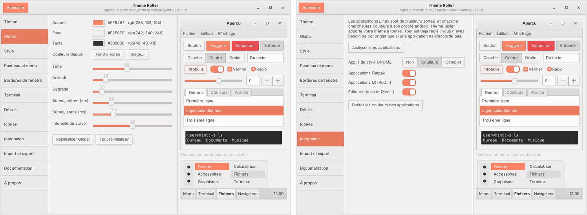

# Theme Roller en français : aidez-nous à le relire

Theme Roller est une application gratuite qui personnalise le bureau Cinnamon de Linux Mint. La traduction française a été faite sans locuteur natif. Si quelque chose sonne faux, maladroit ou peu naturel, dites-le-nous. Dix minutes suffisent à beaucoup aider.

- **Avec l'application :** si votre Mint est en français, installez Theme Roller ([téléchargement](https://github.com/xlcheese/theme-roller/releases/latest)) et parcourez les onglets.
- **Sans rien installer :** lisez simplement le tableau ci-dessous.
- **Pour répondre :** dans la publication où vous avez trouvé cette page, ou sur GitHub : le numéro et votre meilleure formulation, par ex. « #94 : … plutôt que … ».

> À garder : les mots entre `{accolades}` tels quels, et les balises comme `<b>` ; les libellés courts (✂) doivent rester courts, sinon la fenêtre s'élargit ; les noms comme Theme Roller, Cinnamon, GNOME, Flatpak et Qt ne se traduisent pas.

| N° | Anglais | Français |
|---:|---|---|
| 1 ✂ | Global | Global |
| 2 ✂ | Panel & Menu | Panneau et menu |
| 3 ✂ | Theme | Thème |
| 4 ✂ | Terminal | Terminal |
| 5 ✂ | Window Borders | Bordures de fenêtre |
| 6 ✂ | Details | Détails |
| 7 ✂ | Icons | Icônes |
| 8 ✂ | Integration | Intégration |
| 9 ✂ | About | À propos |
| 10 ✂ | Documentation | Documentation |
| 11 ✂ | Import & Export | Import et export |
| 12 | Folders recolored: the folder color (the front) follows your accent, and the second color (the back) a darker shade of it. Choose either and both keep their colors from then on; Reset Icons follows the theme again. Every other icon stays as in your current icon theme. Apply to use them. | Dossiers recolorés : la couleur du dossier (l'avant) suit votre couleur d'accent, et la seconde couleur (l'arrière) une nuance plus sombre de celle-ci. Choisissez l'une ou l'autre et les deux gardent leurs couleurs dès lors ; Réinitialiser Icônes suit de nouveau le thème. Toutes les autres icônes restent comme dans votre thème d'icônes actuel. Appliquez pour les utiliser. |
| 13 ✂ | Themes and styles | Thèmes et styles |
| 14 | A <b>theme</b> is your colors and settings: everything on these tabs. A <b>style</b> is how things are drawn: edges, hovers, tabs and panel buttons. Any theme can use any style. Everything shows in the preview first; nothing changes on your desktop until you click <b>Apply</b>, and <b>Revert</b> puts your previous theme back. | Un <b>thème</b>, ce sont vos couleurs et réglages : tout ce qui se trouve dans ces onglets. Un <b>style</b>, c'est la façon dont les choses sont dessinées : bords, survols, onglets et boutons du panneau. Tout thème peut utiliser tout style. Tout s'affiche d'abord dans l'aperçu ; rien ne change sur votre bureau tant que vous n'avez pas cliqué sur <b>Appliquer</b>, et <b>Annuler</b> remet votre thème précédent. |
| 15 | Start from a built-in theme, one shared by someone else, or one of your own. Change anything and it becomes <b>Custom</b>; <b>Save Theme…</b> keeps your changes under a name. Your own themes can be duplicated, renamed and deleted. | Partez d'un thème intégré, d'un thème partagé par quelqu'un d'autre ou de l'un des vôtres. Modifiez quoi que ce soit et il devient <b>Personnalisé</b> ; <b>Enregistrer…</b> conserve vos changements sous un nom. Vos propres thèmes peuvent être dupliqués, renommés et supprimés. |
| 16 | Three colors make a complete light or dark theme: accent, background and text. Then the shape of everything: Size, Roundness, Gradient, and how hovers fade. <b>Colors from</b> picks an accent from your wallpaper or any picture. | Trois couleurs suffisent pour un thème clair ou sombre complet : accent, fond et texte. Puis la forme de tout : Taille, Arrondi, Dégradé et la façon dont les survols apparaissent et disparaissent. <b>Couleurs depuis</b> prend une couleur d'accent dans votre fond d'écran ou n'importe quelle image. |
| 17 | Pick how things are drawn, and set its Depth (how strong edges and shadows are) and Unfocused depth (how much of that unfocused windows keep). You can also make your own: a style is one style.toml file, in ~/.local/share/theme-roller/styles/&lt;name&gt;/. <b>Create a starter style…</b> makes one with every option explained: the essentials are on, the rest switched off with a #, each with a short note. Edit it, then pick it on the Style tab. <b>Check a style sheet for issues…</b> tells you if anything in it needs fixing. | Choisissez comment les choses sont dessinées, et réglez sa Profondeur (la force des bords et des ombres) et la Profondeur inactive (ce qu'en gardent les fenêtres inactives). Vous pouvez aussi créer les vôtres : un style est un fichier style.toml, dans ~/.local/share/theme-roller/styles/&lt;nom&gt;/. <b>Créer un style de départ…</b> en crée un où chaque option est expliquée : l'essentiel est activé, le reste désactivé par un #, chacun avec une courte note. Modifiez-le, puis choisissez-le dans l'onglet Style. <b>Vérifier une feuille de style…</b> vous dit si quelque chose doit y être corrigé. |
| 18 ✂ | Panel &amp; Menu | Panneau et menu |
| 19 | The Cinnamon panel and its menus: their own colors, label weight, height, roundness, gradient and see-through. Left alone, they follow Global. | Le panneau de Cinnamon et ses menus : leurs propres couleurs, graisse des libellés, hauteur, arrondi, dégradé et transparence. Sans réglage, ils suivent Global. |
| 20 | Title bars and window buttons: colors, height, gradient, border, roundness, and a choice of button styles and Minimize, Maximize and Close glyphs. When these change, Apply restarts Cinnamon by itself (your windows stay open), as window borders only reload then. | Barres de titre et boutons de fenêtre : couleurs, hauteur, dégradé, bordure, arrondi, et un choix de styles de boutons et de symboles pour Réduire, Agrandir et Fermer. Quand ils changent, Appliquer redémarre Cinnamon tout seul (vos fenêtres restent ouvertes), car les bordures de fenêtre ne se rechargent qu'alors. |
| 21 | The terminal follows the theme, or pick one of the color sets, or your own colors. | Le terminal suit le thème, ou choisissez l'un des jeux de couleurs, ou vos propres couleurs. |
| 22 | Tooltips, scrollbars (overlay or classic, roundness, width), sliders, switches and the focus ring. | Infobulles, barres de défilement (superposées ou classiques, arrondi, largeur), curseurs, interrupteurs et l'anneau de focus. |
| 23 | Folder icons in your colors, in six styles. Only the folders change; other icons stay as they were. The folder color follows your accent unless you pick one; on xl-Big Baddy, the second color is its racing stripes. Off until you switch it on. | Des icônes de dossier à vos couleurs, en six styles. Seuls les dossiers changent ; les autres icônes restent telles quelles. La couleur du dossier suit votre accent sauf si vous en choisissez une ; avec xl-Big Baddy, la seconde couleur est celle de ses bandes de course. Désactivé tant que vous ne l'activez pas. |
| 24 | Linux apps come in a few kinds, and each looks for its colors in its own place. These switches bring your colors to the hodgepodge that doesn't read the theme on its own: GNOME-style apps, Flatpak apps, Qt apps like VLC, and text editors. <b>Scan my apps</b> shows which of your apps are which kind; <b>Take colors out of apps</b> removes them until the next Apply. Pick another theme in Mint's settings and Theme Roller's colors leave your apps by themselves. | Les applications Linux sont de plusieurs sortes, et chacune cherche ses couleurs à son propre endroit. Ces interrupteurs apportent vos couleurs à ce méli-mélo qui ne lit pas le thème tout seul : applications de style GNOME, applications Flatpak, applications Qt comme VLC et éditeurs de texte. <b>Analyser mes applications</b> montre de quelle sorte est chacune de vos applications ; <b>Retirer les couleurs des applications</b> les enlève jusqu'au prochain Appliquer. Choisissez un autre thème dans les paramètres de Mint et les couleurs de Theme Roller quittent vos applications d'elles-mêmes. |
| 25 ✂ | Import &amp; Export | Import et export |
| 26 | Share a theme as one <tt>.xltheme</tt> file, and add themes others shared with you. | Partagez un thème sous la forme d'un seul fichier <tt>.xltheme</tt>, et ajoutez les thèmes que d'autres ont partagés avec vous. |
| 27 ✂ | Accent | Accent |
| 28 ✂ | Background | Fond |
| 29 ✂ | Size | Taille |
| 30 ✂ | Text | Texte |
| 31 ✂ | Gradient | Dégradé |
| 32 ✂ | Hover in (ms) | Survol, entrée (ms) |
| 33 ✂ | Roundness | Arrondi |
| 34 ✂ | Depth | Profondeur |
| 35 ✂ | Hover out (ms) | Survol, sortie (ms) |
| 36 ✂ | Hover strength | Intensité du survol |
| 37 ✂ | Unfocused depth | Profondeur inactive |
| 38 ✂ | Label weight | Graisse des libellés |
| 39 ✂ | Opacity | Opacité |
| 40 ✂ | Height | Hauteur |
| 41 ✂ | Notification opacity | Opacité des alertes |
| 42 ✂ | Menu-item roundness | Arrondi des éléments |
| 43 ✂ | Border | Bordure |
| 44 ✂ | Title bar | Barre de titre |
| 45 ✂ | Title text | Texte du titre |
| 46 ✂ | Border width | Largeur de bordure |
| 47 ✂ | Round bottom corners | Coins inférieurs arrondis |
| 48 ✂ | Title bar height | Hauteur du titre |
| 49 ✂ | Window roundness | Arrondi des fenêtres |
| 50 ✂ | Buttons on the | Boutons à |
| 51 ✂ | Title bar gradient | Dégradé du titre |
| 52 ✂ | Button roundness | Arrondi des boutons |
| 53 ✂ | Button spacing | Écart des boutons |
| 54 ✂ | Button style | Style des boutons |
| 55 ✂ | Glyphs | Symboles |
| 56 ✂ | Color | Couleur |
| 57 ✂ | Mode | Mode |
| 58 ✂ | Style | Style |
| 59 ✂ | Width | Largeur |
| 60 ✂ | GNOME-style apps | Applis de style GNOME |
| 61 ✂ | Custom folder style | Style de dossiers personnalisé |
| 62 ✂ | Folder color | Couleur du dossier |
| 63 ✂ | Second color | Seconde couleur |
| 64 ✂ | Flatpak apps | Applications Flatpak |
| 65 ✂ | Qt apps (VLC…) | Applications Qt (VLC…) |
| 66 ✂ | Text editors (Xed…) | Éditeurs de texte (Xed…) |
| 67 ✂ | Menu style | Style du menu |
| 68 ✂ | Panel style | Style du panneau |
| 69 ✂ | Tooltips | Infobulles |
| 70 ✂ | Scrollbars | Barres de défilement |
| 71 ✂ | Sliders | Curseurs |
| 72 ✂ | Switches | Interrupteurs |
| 73 ✂ | Focus ring | Anneau de focus |
| 74 | Colors left on “Follow theme” use the Global colors. | Les couleurs sur « Suivre le thème » utilisent les couleurs de Global. |
| 75 | Colors left on “Follow theme” come from the Global colors. | Les couleurs sur « Suivre le thème » viennent des couleurs de Global. |
| 76 | Left on “Follow theme”, the terminal uses the theme's content colors. | Sur « Suivre le thème », le terminal utilise les couleurs de contenu du thème. |
| 77 | Linux apps come in a few kinds, and each looks for its colors in its own place. Theme Roller brings your theme to all of them. These are already set, so you only need this tab if an app doesn't match. | Les applications Linux sont de plusieurs sortes, et chacune cherche ses couleurs à son propre endroit. Theme Roller apporte votre thème à toutes. Tout est déjà réglé : vous n'avez besoin de cet onglet que si une application ne s'accorde pas. |
| 78 | GNOME apps such as Calculator and Text Editor (libadwaita). Colors: your colors, and GNOME's accent to match. Full: also your buttons, title buttons and tabs; this overrides apps' own styling, so some lose colors of their own (Flatpak ones need Flatpak apps on). Reopen apps to see changes. | Applications GNOME comme Calculatrice et Éditeur de texte (libadwaita). Couleurs : vos couleurs, et la couleur d'accent de GNOME assortie. Complet : aussi vos boutons, boutons de titre et onglets ; cela remplace le style propre des applications, donc certaines perdent des couleurs à elles (les Flatpak ont besoin d'Applications Flatpak activé). Rouvrez les applications pour voir les changements. |
| 79 | Lets Flatpak apps read your theme, so they get its colors. Reopen open apps to see them. | Permet aux applications Flatpak de lire votre thème, pour qu'elles en prennent les couleurs. Rouvrez les applications ouvertes pour les voir. |
| 80 | Flatpak isn't installed. | Flatpak n'est pas installé. |
| 81 ✂ | A–Z | A–Z |
| 82 ✂ | Newest | Plus récent |
| 83 ✂ | Oldest | Plus ancien |
| 84 ✂ | Z–A | Z–A |
| 85 ✂ | Colors | Couleurs |
| 86 ✂ | Full | Complet |
| 87 ✂ | Off | Non |
| 88 | Preview: nothing changes on the desktop until Apply | Aperçu : rien ne change sur le bureau avant Appliquer |
| 89 ✂ | Apply | Appliquer |
| 90 ✂ | Revert | Annuler |
| 91 | Put the previous theme back on the desktop (your settings here stay) | Remettre le thème précédent sur le bureau (vos réglages ici restent) |
| 92 ✂ | Scan my apps | Analyser mes applications |
| 93 | Lists the apps on this computer by kind, and whether Theme Roller reaches them: the answer to “why doesn't this app match?” | Liste les applications de cet ordinateur par sorte, et si Theme Roller les atteint : la réponse à « pourquoi cette application ne s'accorde-t-elle pas ? » |
| 94 ✂ | Reset {tab} | Réinitialiser {tab} |
| 95 ✂ | Reset All to Theme Defaults | Tout réinitialiser |
| 96 ✂ | No stripes | Sans bandes |
| 97 ✂ | Save Theme… | Enregistrer… |
| 98 | Keep your Custom settings as a theme with its own name | Garder vos réglages Personnalisé comme un thème avec son propre nom |
| 99 ✂ | Duplicate | Dupliquer |
| 100 | Save a copy of the selected theme as one of your themes | Enregistrer une copie du thème sélectionné comme l'un de vos thèmes |
| 101 ✂ | Rename | Renommer |
| 102 | Rename one of your themes (built-in themes keep their names) | Renommer l'un de vos thèmes (les thèmes intégrés gardent leur nom) |
| 103 ✂ | Delete | Supprimer |
| 104 ✂ | Sort: | Trier : |
| 105 ✂ | Your theme | Votre thème |
| 106 ✂ | Your latest changes | Vos derniers changements |
| 107 | Your latest changes, based on {theme} | Vos derniers changements, d'après {theme} |
| 108 ✂ | Your style | Votre style |
| 109 ✂ | Theme default | Par défaut du thème |
| 110 | Off: switch it on in the Integration tab | Désactivé : activez-le dans l'onglet Intégration |
| 111 ✂ | On | Activé |
| 112 | Follow the theme on their own | Suivent le thème d'elles-mêmes |
| 113 | Nothing to do: they always match. | Rien à faire : elles s'accordent toujours. |
| 114 ✂ | Colors on | Couleurs activées |
| 115 | Off: set GNOME-style apps to Colors in the Integration tab | Désactivé : réglez Applis de style GNOME sur Couleurs dans l'onglet Intégration |
| 116 ✂ | Colors and full styling on | Couleurs et style complet activés |
| 117 | . GNOME-style ones also need GNOME-style apps set to Colors | . Celles de style GNOME ont aussi besoin d'Applis de style GNOME sur Couleurs |
| 118 ✂ | Qt apps | Applications Qt |
| 119 ✂ | Text editors | Éditeurs de texte |
| 120 ✂ | Run in a terminal | S'exécutent dans un terminal |
| 121 | They use the terminal's colors (Terminal tab). | Elles utilisent les couleurs du terminal (onglet Terminal). |
| 122 | They draw their own look; no theme reaches them. | Elles dessinent leur propre apparence ; aucun thème ne les atteint. |
| 123 ✂ | Web-based apps | Applications web |
| 124 ✂ | Couldn't tell | Impossible à dire |
| 125 | Many of these draw their own look. | Beaucoup d'entre elles dessinent leur propre apparence. |
| 126 ✂ | Your apps | Vos applications |
| 127 ✂ | Close | Fermer |
| 128 | {count} apps in your menu, by kind. Changes show after Apply, in apps opened afterwards. | {count} applications dans votre menu, par sorte. Les changements se voient après Appliquer, dans les applications ouvertes ensuite. |
| 129 ✂ | Take colors out of apps | Retirer les couleurs des applications |
| 130 | Theme Roller's colors are out of your apps. Reopen open apps. The next Apply puts them back. | Les couleurs de Theme Roller sont retirées de vos applications. Rouvrez les applications ouvertes. Le prochain Appliquer les remet. |
| 131 | Removes Theme Roller's colors from all apps now. Your settings and the theme stay; the next Apply puts the colors back. | Retire maintenant les couleurs de Theme Roller de toutes les applications. Vos réglages et le thème restent ; le prochain Appliquer remet les couleurs. |
| 132 ✂ | Colors from | Couleurs depuis |
| 133 ✂ | Wallpaper | Fond d'écran |
| 134 | Take an accent from your desktop wallpaper | Prendre une couleur d'accent dans votre fond d'écran |
| 135 ✂ | Image… | Image… |
| 136 | Take an accent from any picture | Prendre une couleur d'accent dans n'importe quelle image |
| 137 ✂ | Take colors from a picture | Prendre les couleurs d'une image |
| 138 ✂ | Cancel | Annuler |
| 139 ✂ | Use | Utiliser |
| 140 ✂ | Pictures | Images |
| 141 | Couldn't find your wallpaper (Cinnamon's background setting has no picture). | Votre fond d'écran est introuvable (le fond de Cinnamon n'a pas d'image). |
| 142 | Couldn't read {file}: {problem} | Impossible de lire {file} : {problem} |
| 143 ✂ | Use {color} as the accent | Utiliser {color} comme accent |
| 144 | Accent from {file}. Or click another color. | Accent pris dans {file}. Ou cliquez sur une autre couleur. |
| 145 | {file} has no colors vivid enough for an accent. | {file} n'a pas de couleurs assez vives pour un accent. |
| 146 | The xl-Cheeselooks theme maker for Linux Mint and the Cinnamon desktop: your colors and shapes, drawn by a style, for GTK 3 and GTK 4 apps, libadwaita apps, the Cinnamon panel and menus, and the window borders. | Le créateur du thème xl-Cheeselooks pour Linux Mint et le bureau Cinnamon : vos couleurs et vos formes, dessinées par un style, pour les applications GTK 3 et GTK 4, les applications libadwaita, le panneau et les menus de Cinnamon, et les bordures de fenêtre. |
| 147 ✂ | Website | Site web |
| 148 | Enjoying {app}? It's free and always will be. | Vous aimez {app} ? Il est gratuit et le restera toujours. |
| 149 ✂ | Leave a tip ☕ | Laisser un pourboire ☕ |
| 150 | Developed with the help of Claude, an AI assistant by Anthropic | Développé avec l'aide de Claude, un assistant d'IA d'Anthropic |
| 151 | This program comes with absolutely no warranty. See the <a href='https://www.gnu.org/licenses/gpl-3.0.html'>GNU General Public License, version 3 or later</a> for details. | Ce programme est fourni sans aucune garantie. Consultez la <a href='https://www.gnu.org/licenses/gpl-3.0.html'>Licence publique générale GNU, version 3 ou ultérieure</a> pour plus de détails. |
| 152 ✂ | Remove from my desktop… | Retirer de mon bureau… |
| 153 | Before uninstalling Theme Roller: puts Mint's default theme back and takes Theme Roller's colors out of your apps | Avant de désinstaller Theme Roller : remet le thème par défaut de Mint et retire les couleurs de Theme Roller de vos applications |
| 154 | Remove Theme Roller from your desktop? | Retirer Theme Roller de votre bureau ? |
| 155 | Mint's default theme comes back, Theme Roller's colors leave your apps, and the theme watcher stops starting at login. Your settings and your own themes stay, so you can pick up where you left off. Do this before uninstalling Theme Roller. | Le thème par défaut de Mint revient, les couleurs de Theme Roller quittent vos applications, et le veilleur de thème ne démarre plus à la connexion. Vos réglages et vos propres thèmes restent, pour reprendre là où vous en étiez. Faites-le avant de désinstaller Theme Roller. |
| 156 | Removing… the desktop flickers once while it reloads. | Retrait… le bureau clignote une fois pendant le rechargement. |
| 157 | Theme Roller is off your desktop. You can uninstall it now; Apply puts it back. | Theme Roller est retiré de votre bureau. Vous pouvez le désinstaller maintenant ; Appliquer le remet. |
| 158 ✂ | Remove failed: {problem} | Échec du retrait : {problem} |
| 159 ✂ | Create a starter style… | Créer un style de départ… |
| 160 | Check a style sheet for issues… | Vérifier une feuille de style… |
| 161 | Pick a style.toml: it's checked as Theme Roller reads it, and any problems are listed with what to fix | Choisissez un style.toml : il est vérifié tel que Theme Roller le lit, et chaque problème est indiqué avec ce qu'il faut corriger |
| 162 ✂ | Full documentation (online) | Documentation complète (en ligne) |
| 163 ✂ | Check a style sheet | Vérifier une feuille de style |
| 164 ✂ | Check | Vérifier |
| 165 ✂ | Style sheets (style.toml) | Feuilles de style (style.toml) |
| 166 ✂ | “{style}” looks good | « {style} » est correct |
| 167 ✂ | Warning: {problem} | Avertissement : {problem} |
| 168 | No problems found. Pick it on the Style tab to use it. | Aucun problème trouvé. Choisissez-le dans l'onglet Style pour l'utiliser. |
| 169 ✂ | Problems to fix: {count} | Problèmes à corriger : {count} |
| 170 | Fix these in the file, then check it again. | Corrigez-les dans le fichier, puis vérifiez-le de nouveau. |
| 171 ✂ | the style needs a name | le style a besoin d'un nom |
| 172 | names can be up to {count} characters | les noms peuvent compter jusqu'à {count} caractères |
| 173 | names can't contain / or start with a dot | les noms ne peuvent pas contenir / ni commencer par un point |
| 174 | there's already a style called {name} | il existe déjà un style nommé {name} |
| 175 ✂ | Create Style | Créer un style |
| 176 | Give your new style a good name. | Donnez un bon nom à votre nouveau style. |
| 177 ✂ | My Style | Mon style |
| 178 ✂ | Create | Créer |
| 179 | Created {file}. Edit it, then pick it on the Style tab. | {file} créé. Modifiez-le, puis choisissez-le dans l'onglet Style. |
| 180 | Share a theme as one file (.xltheme). It holds every setting, the theme's name, the version of Theme Roller it was made with, and your style when the theme uses one of your own, so the person importing it gets exactly your look. | Partagez un thème sous la forme d'un seul fichier (.xltheme). Il contient chaque réglage, le nom du thème, la version de Theme Roller avec laquelle il a été fait, et votre style quand le thème utilise l'un des vôtres : la personne qui l'importe obtient exactement votre apparence. |
| 181 ✂ | Export the current theme… | Exporter le thème actuel… |
| 182 ✂ | Import a theme… | Importer un thème… |
| 183 ✂ | Preview | Aperçu |
| 184 ✂ | Edit | Édition |
| 185 ✂ | File | Fichier |
| 186 ✂ | View | Affichage |
| 187 ✂ | Open | Ouvrir |
| 188 ✂ | Quit | Quitter |
| 189 ✂ | Button | Bouton |
| 190 ✂ | Suggested | Suggéré |
| 191 ✂ | Toggled | Enfoncé |
| 192 ✂ | A tooltip on {button} | Une infobulle sur {button} |
| 193 ✂ | Center | Centre |
| 194 ✂ | Left | Gauche |
| 195 ✂ | Right | Droite |
| 196 ✂ | Some text | Du texte |
| 197 ✂ | Tooltip | Infobulle |
| 198 ✂ | Radio | Radio |
| 199 ✂ | Advanced | Avancé |
| 200 ✂ | General | Général |
| 201 ✂ | Fifth row | Cinquième ligne |
| 202 ✂ | First row | Première ligne |
| 203 ✂ | Fourth row | Quatrième ligne |
| 204 ✂ | Selected row | Ligne sélectionnée |
| 205 ✂ | Third row | Troisième ligne |
| 206 ✂ | Eighth row | Huitième ligne |
| 207 ✂ | Seventh row | Septième ligne |
| 208 ✂ | Sixth row | Sixième ligne |
| 209 ✂ | Desktop  Documents  Music | Bureau  Documents  Musique |
| 210 ✂ | Accessories | Accessoires |
| 211 ✂ | Favorites | Favoris |
| 212 ✂ | Graphics | Graphisme |
| 213 ✂ | Calculator | Calculatrice |
| 214 ✂ | Files | Fichiers |
| 215 | Panel and menu (drawn preview) | Panneau et menu (aperçu dessiné) |
| 216 ✂ | Menu | Menu |
| 217 ✂ | Browser | Navigateur |
| 218 ✂ | Can't preview: {problem} | Aperçu impossible : {problem} |
| 219 | Preview CSS problem: {problem} | Problème CSS dans l'aperçu : {problem} |
| 220 ✂ | None | Aucune |
| 221 ✂ | Follow theme | Suivre le thème |
| 222 ✂ | Custom | Personnalisé |
| 223 ✂ | <b>{name}</b> folder style | Style de dossiers <b>{name}</b> |
| 224 | Put every tab back to {theme}. Your latest changes stay in Custom. | Remettre tous les onglets à {theme}. Vos derniers changements restent dans Personnalisé. |
| 225 | Put Global back to {theme}. Other tabs keep what you set there, but colors on “Follow theme” and shapes that follow Global change with it. | Remettre Global à {theme}. Les autres onglets gardent ce que vous y avez réglé, mais les couleurs sur « Suivre le thème » et les formes qui suivent Global changent avec. |
| 226 | Put {tab} back to {theme} (other tabs stay as they are) | Remettre {tab} à {theme} (les autres onglets restent tels quels) |
| 227 ✂ | Theme: {theme} | Thème : {theme} |
| 228 | Every tab reset to {theme}. Your latest changes are still in Custom. | Tous les onglets remis à {theme}. Vos derniers changements sont toujours dans Personnalisé. |
| 229 | {tab} reset to {theme}. | {tab} remis à {theme}. |
| 230 ✂ | Save Theme | Enregistrer le thème |
| 231 ✂ | Save | Enregistrer |
| 232 | Name your theme. It uses the style “{style}” and all your current settings. | Nommez votre thème. Il utilise le style « {style} » et tous vos réglages actuels. |
| 233 ✂ | {theme} copy | {theme} (copie) |
| 234 | Up to {count} characters. Built-in themes can't be replaced; your own can. | Jusqu'à {count} caractères. Les thèmes intégrés ne peuvent pas être remplacés ; les vôtres, si. |
| 235 | Replace your theme “{theme}”? | Remplacer votre thème « {theme} » ? |
| 236 | Saved the theme “{theme}”. | Thème « {theme} » enregistré. |
| 237 ✂ | OK | OK |
| 238 ✂ | Duplicate Theme | Dupliquer le thème |
| 239 | A copy of “{theme}”, as one of your themes: | Une copie de « {theme} », comme l'un de vos thèmes : |
| 240 | Duplicated “{theme}” as “{copy}”. | « {theme} » dupliqué sous le nom « {copy} ». |
| 241 ✂ | A new name for “{theme}”: | Un nouveau nom pour « {theme} » : |
| 242 ✂ | Rename Theme | Renommer le thème |
| 243 | Renamed “{old}” to “{new}”. | « {old} » renommé en « {new} ». |
| 244 | Delete your theme “{theme}”? Its style stays installed. | Supprimer votre thème « {theme} » ? Son style reste installé. |
| 245 ✂ | My theme | Mon thème |
| 246 ✂ | Export theme | Exporter le thème |
| 247 ✂ | Exported “{theme}” to {file} | « {theme} » exporté vers {file} |
| 248 ✂ | Export failed: {problem} | Échec de l'export : {problem} |
| 249 ✂ | Import theme | Importer un thème |
| 250 ✂ | Theme Roller themes | Thèmes Theme Roller |
| 251 | Imported “{theme}”. | « {theme} » importé. |
| 252 ✂ | Import failed: {problem} | Échec de l'import : {problem} |
| 253 | Applying… the desktop flickers once while it reloads. | Application… le bureau clignote une fois pendant le rechargement. |
| 254 ✂ | Apply failed: {problem} | Échec d'Appliquer : {problem} |
| 255 | “{theme}” is on the desktop. Revert puts the previous theme back. | « {theme} » est sur le bureau. Annuler remet le thème précédent. |
| 256 ✂ | Qt apps now match your theme | Les applications Qt s'accordent maintenant avec votre thème |
| 257 | Reverting… the desktop flickers once while it reloads. | Annulation… le bureau clignote une fois pendant le rechargement. |
| 258 ✂ | Revert failed: {problem} | Échec d'Annuler : {problem} |
| 259 | The previous theme is back on the desktop. Your settings here are unchanged. | Le thème précédent est de retour sur le bureau. Vos réglages ici n'ont pas changé. |
| 260 ✂ | GNOME runtime | environnement GNOME |
| 261 ✂ | KDE runtime | environnement KDE |
| 262 | Gives Xed, gedit and Meld a color scheme from your theme, mainly for syntax colors and highlights. Most editors' own schemes follow your theme too. Reopen them to see changes. | Donne à Xed, gedit et Meld un jeu de couleurs tiré de votre thème, surtout pour les couleurs de syntaxe et les surlignages. Les jeux de couleurs propres à la plupart des éditeurs suivent aussi votre thème. Rouvrez-les pour voir les changements. |
| 263 ✂ | Racing stripes | Bandes de course |
| 264 | Binders in your colors: the folder color follows your accent. Racing stripes are off until you pick a color for them; No stripes takes them off again. Every other icon stays as in your current icon theme. Apply to use them. | Classeurs à vos couleurs : la couleur du dossier suit votre accent. Les bandes de course sont désactivées tant que vous ne leur choisissez pas de couleur ; Sans bandes les retire de nouveau. Toutes les autres icônes restent comme dans votre thème d'icônes actuel. Appliquez pour les utiliser. |
| 265 ✂ | Wavy lines | Lignes ondulées |
| 266 | Binders in your colors: the folder color follows your accent, and the wavy lines a darker shade of it. Choose either and both keep their colors from then on; Reset Icons follows the theme again. Every other icon stays as in your current icon theme. Apply to use them. | Classeurs à vos couleurs : la couleur du dossier suit votre accent, et les lignes ondulées une nuance plus sombre de celle-ci. Choisissez l'une ou l'autre et les deux gardent leurs couleurs dès lors ; Réinitialiser Icônes suit de nouveau le thème. Toutes les autres icônes restent comme dans votre thème d'icônes actuel. Appliquez pour les utiliser. |
| 267 | Your Qt apps now use your theme's colors.  Your previous Qt setup is saved: {saved}.  Turning off Integration → Qt apps puts it back. | Vos applications Qt utilisent maintenant les couleurs de votre thème.  Votre configuration Qt précédente est sauvegardée : {saved}.  Désactiver Intégration → Applications Qt la remet. |
| 268 | The first time, log out and back in to see your colors in Qt apps; after that, reopening them is enough. If you had your own Qt setup, it's saved and comes back when this is off. | La première fois, déconnectez-vous puis reconnectez-vous pour voir vos couleurs dans les applications Qt ; ensuite, les rouvrir suffit. Si vous aviez votre propre configuration Qt, elle est sauvegardée et revient quand ceci est désactivé. |
| 269 | Needs qt5ct: sudo apt install qt5ct | Nécessite qt5ct : sudo apt install qt5ct |
| 270 | give the theme a name (not “Custom”) | donnez un nom au thème (autre que « Personnalisé ») |
| 271 | a theme's name can be up to {count} characters ({given} given) | le nom d'un thème peut compter jusqu'à {count} caractères ({given} saisis) |
| 272 | “{theme}” is a built-in theme: choose another name | « {theme} » est un thème intégré : choisissez un autre nom |
| 273 | you already have a theme called “{theme}” | vous avez déjà un thème nommé « {theme} » |
| 274 | there's already a theme called “{theme}” | il existe déjà un thème nommé « {theme} » |
| 275 | couldn't find a free name for the copy | impossible de trouver un nom libre pour la copie |
| 276 | built-in themes can't be renamed: duplicate it instead | les thèmes intégrés ne peuvent pas être renommés : dupliquez-le plutôt |
| 277 | built-in themes can't be deleted | les thèmes intégrés ne peuvent pas être supprimés |
| 278 | {file} isn't a Theme Roller theme file | {file} n'est pas un fichier de thème Theme Roller |
| 279 | This theme was made with a newer Theme Roller ({version}). Some of it may not show as intended; updating Theme Roller is recommended. | Ce thème a été fait avec un Theme Roller plus récent ({version}). Une partie peut ne pas s'afficher comme prévu ; la mise à jour de Theme Roller est recommandée. |
| 280 | You already have a style folder “{folder}”: kept yours, so the theme uses your copy of that style. | Vous avez déjà un dossier de style « {folder} » : le vôtre est conservé, donc le thème utilise votre copie de ce style. |
| 281 | the theme file contains an unsafe path | le fichier de thème contient un chemin dangereux |
| 282 | The theme's name was longer than {count} characters: shortened to “{theme}”. | Le nom du thème dépassait {count} caractères : raccourci en « {theme} ». |
| 283 | A theme called “{theme}” already exists: imported as “{copy}”. | Un thème nommé « {theme} » existe déjà : importé sous le nom « {copy} ». |
| 284 ✂ | Chevrons | Chevrons |
| 285 ✂ | Regular | Normal |
| 286 ✂ | Thin | Fin |
| 287 ✂ | Icon Theme | Thème d'icônes |
| 288 ✂ | Marks | Signes |
| 289 ✂ | Bold | Gras |
| 290 ✂ | Classic | Classique |
| 291 ✂ | Dashed | Tirets |
| 292 ✂ | Dotted | Pointillés |
| 293 ✂ | Follow global | Suivre Global |
| 294 ✂ | Light | Léger |
| 295 ✂ | Overlay | Superposées |
| 296 ✂ | Separate colors | Couleurs propres |
| 297 ✂ | Solid | Plein |
