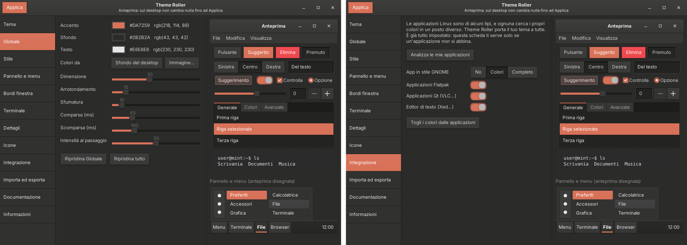

# Theme Roller in italiano: aiutaci a rivederlo

Theme Roller è un'applicazione gratuita che personalizza il desktop Cinnamon di Linux Mint. La traduzione italiana è stata fatta senza un madrelingua. Se qualcosa suona sbagliato, goffo o poco naturale, faccelo sapere. Bastano dieci minuti per aiutare molto.

- **Con l'applicazione:** se il tuo Mint è in italiano, installa Theme Roller ([download](https://github.com/xlcheese/theme-roller/releases/latest)) e scorri le schede.
- **Senza installare nulla:** leggi la tabella qui sotto.
- **Come rispondere:** nel post in cui hai trovato questa pagina, o su GitHub: il numero e la tua formulazione migliore, ad es. «#94: … invece di …».

> Da mantenere: le parole tra `{graffe}` così come sono, e i tag come `<b>`; le etichette brevi (✂) devono restare brevi, altrimenti la finestra si allarga; i nomi come Theme Roller, Cinnamon, GNOME, Flatpak e Qt non si traducono.

| N. | Inglese | Italiano |
|---:|---|---|
| 1 ✂ | Global | Globale |
| 2 ✂ | Panel & Menu | Pannello e menu |
| 3 ✂ | Theme | Tema |
| 4 ✂ | Terminal | Terminale |
| 5 ✂ | Window Borders | Bordi finestra |
| 6 ✂ | Details | Dettagli |
| 7 ✂ | Icons | Icone |
| 8 ✂ | Integration | Integrazione |
| 9 ✂ | About | Informazioni |
| 10 ✂ | Documentation | Documentazione |
| 11 ✂ | Import & Export | Importa ed esporta |
| 12 | Folders recolored: the folder color (the front) follows your accent, and the second color (the back) a darker shade of it. Choose either and both keep their colors from then on; Reset Icons follows the theme again. Every other icon stays as in your current icon theme. Apply to use them. | Cartelle ricolorate: il colore della cartella (il fronte) segue il colore d'accento, e il secondo colore (il retro) una tonalità più scura. Scegline uno e da lì in poi entrambi mantengono i loro colori; Ripristina Icone torna a seguire il tema. Tutte le altre icone restano come nel tuo tema di icone attuale. Applica per usarle. |
| 13 ✂ | Themes and styles | Temi e stili |
| 14 | A <b>theme</b> is your colors and settings: everything on these tabs. A <b>style</b> is how things are drawn: edges, hovers, tabs and panel buttons. Any theme can use any style. Everything shows in the preview first; nothing changes on your desktop until you click <b>Apply</b>, and <b>Revert</b> puts your previous theme back. | Un <b>tema</b> sono i tuoi colori e le tue impostazioni: tutto ciò che c'è in queste schede. Uno <b>stile</b> è il modo in cui le cose vengono disegnate: bordi, effetti al passaggio del mouse, schede e pulsanti del pannello. Qualsiasi tema può usare qualsiasi stile. Tutto appare prima nell'anteprima; sul desktop non cambia nulla finché non fai clic su <b>Applica</b>, e <b>Ripristina precedente</b> rimette il tema di prima. |
| 15 | Start from a built-in theme, one shared by someone else, or one of your own. Change anything and it becomes <b>Custom</b>; <b>Save Theme…</b> keeps your changes under a name. Your own themes can be duplicated, renamed and deleted. | Parti da un tema incluso, da uno condiviso da qualcun altro o da uno tuo. Cambia qualsiasi cosa e diventa <b>Personalizzato</b>; <b>Salva tema…</b> conserva le modifiche con un nome. I tuoi temi si possono duplicare, rinominare ed eliminare. |
| 16 | Three colors make a complete light or dark theme: accent, background and text. Then the shape of everything: Size, Roundness, Gradient, and how hovers fade. <b>Colors from</b> picks an accent from your wallpaper or any picture. | Tre colori formano un tema chiaro o scuro completo: accento, sfondo e testo. Poi la forma di tutto: Dimensione, Arrotondamento, Sfumatura e come compaiono e svaniscono gli effetti al passaggio del mouse. <b>Colori da</b> prende un colore d'accento dallo sfondo del desktop o da qualsiasi immagine. |
| 17 | Pick how things are drawn, and set its Depth (how strong edges and shadows are) and Unfocused depth (how much of that unfocused windows keep). You can also make your own: a style is one style.toml file, in ~/.local/share/theme-roller/styles/&lt;name&gt;/. <b>Create a starter style…</b> makes one with every option explained: the essentials are on, the rest switched off with a #, each with a short note. Edit it, then pick it on the Style tab. <b>Check a style sheet for issues…</b> tells you if anything in it needs fixing. | Scegli come vengono disegnate le cose e regolane la Profondità (quanto sono marcati bordi e ombre) e la Profondità inattiva (quanto ne conservano le finestre non in primo piano). Puoi anche crearne di tuoi: uno stile è un file style.toml, in ~/.local/share/theme-roller/styles/&lt;nome&gt;/. <b>Crea uno stile di partenza…</b> ne crea uno con ogni opzione spiegata: l'essenziale è attivo, il resto disattivato con un #, ciascuno con una breve nota. Modificalo e poi sceglilo nella scheda Stile. <b>Controlla un foglio di stile…</b> ti dice se qualcosa va corretto. |
| 18 ✂ | Panel &amp; Menu | Pannello e menu |
| 19 | The Cinnamon panel and its menus: their own colors, label weight, height, roundness, gradient and see-through. Left alone, they follow Global. | Il pannello di Cinnamon e i suoi menu: colori propri, spessore delle etichette, altezza, arrotondamento, sfumatura e trasparenza. Se non li tocchi, seguono Globale. |
| 20 | Title bars and window buttons: colors, height, gradient, border, roundness, and a choice of button styles and Minimize, Maximize and Close glyphs. When these change, Apply restarts Cinnamon by itself (your windows stay open), as window borders only reload then. | Barre del titolo e pulsanti della finestra: colori, altezza, sfumatura, bordo, arrotondamento, e una scelta di stili dei pulsanti e simboli per Riduci, Ingrandisci e Chiudi. Quando cambiano, Applica riavvia Cinnamon da solo (le finestre restano aperte), dato che i bordi delle finestre si ricaricano solo allora. |
| 21 | The terminal follows the theme, or pick one of the color sets, or your own colors. | Il terminale segue il tema, oppure scegli uno dei set di colori, o colori tuoi. |
| 22 | Tooltips, scrollbars (overlay or classic, roundness, width), sliders, switches and the focus ring. | Suggerimenti, barre di scorrimento (sovrapposte o classiche, arrotondamento, larghezza), cursori, interruttori e l'anello di focus. |
| 23 | Folder icons in your colors, in six styles. Only the folders change; other icons stay as they were. The folder color follows your accent unless you pick one; on xl-Big Baddy, the second color is its racing stripes. Off until you switch it on. | Icone delle cartelle nei tuoi colori, in sei stili. Cambiano solo le cartelle; le altre icone restano com'erano. Il colore della cartella segue l'accento a meno che tu non ne scelga uno; con xl-Big Baddy, il secondo colore sono le strisce da corsa. Disattivato finché non lo attivi. |
| 24 | Linux apps come in a few kinds, and each looks for its colors in its own place. These switches bring your colors to the hodgepodge that doesn't read the theme on its own: GNOME-style apps, Flatpak apps, Qt apps like VLC, and text editors. <b>Scan my apps</b> shows which of your apps are which kind; <b>Take colors out of apps</b> removes them until the next Apply. Pick another theme in Mint's settings and Theme Roller's colors leave your apps by themselves. | Le applicazioni Linux sono di alcuni tipi, e ognuna cerca i propri colori in un posto diverso. Questi interruttori portano i tuoi colori a quel guazzabuglio che non legge il tema da solo: applicazioni in stile GNOME, applicazioni Flatpak, applicazioni Qt come VLC ed editor di testo. <b>Analizza le mie applicazioni</b> mostra di che tipo è ciascuna delle tue applicazioni; <b>Togli i colori dalle applicazioni</b> li rimuove fino al prossimo Applica. Scegli un altro tema nelle impostazioni di Mint e i colori di Theme Roller lasciano da soli le tue applicazioni. |
| 25 ✂ | Import &amp; Export | Importa ed esporta |
| 26 | Share a theme as one <tt>.xltheme</tt> file, and add themes others shared with you. | Condividi un tema come un unico file <tt>.xltheme</tt>, e aggiungi i temi che altri hanno condiviso con te. |
| 27 ✂ | Accent | Accento |
| 28 ✂ | Background | Sfondo |
| 29 ✂ | Size | Dimensione |
| 30 ✂ | Text | Testo |
| 31 ✂ | Gradient | Sfumatura |
| 32 ✂ | Hover in (ms) | Comparsa (ms) |
| 33 ✂ | Roundness | Arrotondamento |
| 34 ✂ | Depth | Profondità |
| 35 ✂ | Hover out (ms) | Scomparsa (ms) |
| 36 ✂ | Hover strength | Intensità al passaggio |
| 37 ✂ | Unfocused depth | Profondità inattiva |
| 38 ✂ | Label weight | Spessore etichette |
| 39 ✂ | Opacity | Opacità |
| 40 ✂ | Height | Altezza |
| 41 ✂ | Notification opacity | Opacità notifiche |
| 42 ✂ | Menu-item roundness | Arrot. voci |
| 43 ✂ | Border | Bordo |
| 44 ✂ | Title bar | Barra del titolo |
| 45 ✂ | Title text | Testo del titolo |
| 46 ✂ | Border width | Spessore bordo |
| 47 ✂ | Round bottom corners | Angoli inferiori arrotondati |
| 48 ✂ | Title bar height | Altezza titolo |
| 49 ✂ | Window roundness | Arrot. finestra |
| 50 ✂ | Buttons on the | Pulsanti a |
| 51 ✂ | Title bar gradient | Sfumatura titolo |
| 52 ✂ | Button roundness | Arrot. pulsanti |
| 53 ✂ | Button spacing | Spazio pulsanti |
| 54 ✂ | Button style | Stile pulsanti |
| 55 ✂ | Glyphs | Simboli |
| 56 ✂ | Color | Colore |
| 57 ✂ | Mode | Modalità |
| 58 ✂ | Style | Stile |
| 59 ✂ | Width | Larghezza |
| 60 ✂ | GNOME-style apps | App in stile GNOME |
| 61 ✂ | Custom folder style | Stile cartelle personalizzato |
| 62 ✂ | Folder color | Colore cartella |
| 63 ✂ | Second color | Secondo colore |
| 64 ✂ | Flatpak apps | Applicazioni Flatpak |
| 65 ✂ | Qt apps (VLC…) | Applicazioni Qt (VLC…) |
| 66 ✂ | Text editors (Xed…) | Editor di testo (Xed…) |
| 67 ✂ | Menu style | Stile del menu |
| 68 ✂ | Panel style | Stile del pannello |
| 69 ✂ | Tooltips | Suggerimenti |
| 70 ✂ | Scrollbars | Barre di scorrimento |
| 71 ✂ | Sliders | Cursori |
| 72 ✂ | Switches | Interruttori |
| 73 ✂ | Focus ring | Anello di focus |
| 74 | Colors left on “Follow theme” use the Global colors. | I colori su «Segui il tema» usano i colori di Globale. |
| 75 | Colors left on “Follow theme” come from the Global colors. | I colori su «Segui il tema» vengono dai colori di Globale. |
| 76 | Left on “Follow theme”, the terminal uses the theme's content colors. | Su «Segui il tema», il terminale usa i colori del contenuto del tema. |
| 77 | Linux apps come in a few kinds, and each looks for its colors in its own place. Theme Roller brings your theme to all of them. These are already set, so you only need this tab if an app doesn't match. | Le applicazioni Linux sono di alcuni tipi, e ognuna cerca i propri colori in un posto diverso. Theme Roller porta il tuo tema a tutte. È già tutto impostato: questa scheda ti serve solo se un'applicazione non si abbina. |
| 78 | GNOME apps such as Calculator and Text Editor (libadwaita). Colors: your colors, and GNOME's accent to match. Full: also your buttons, title buttons and tabs; this overrides apps' own styling, so some lose colors of their own (Flatpak ones need Flatpak apps on). Reopen apps to see changes. | Applicazioni GNOME come Calcolatrice ed Editor di testo (libadwaita). Colori: i tuoi colori, e l'accento di GNOME abbinato. Completo: anche i tuoi pulsanti, pulsanti del titolo e schede; questo sostituisce lo stile proprio delle applicazioni, quindi alcune perdono colori propri (quelle Flatpak richiedono Applicazioni Flatpak attivo). Riapri le applicazioni per vedere le modifiche. |
| 79 | Lets Flatpak apps read your theme, so they get its colors. Reopen open apps to see them. | Permette alle applicazioni Flatpak di leggere il tuo tema, così ne prendono i colori. Riapri le applicazioni aperte per vederli. |
| 80 | Flatpak isn't installed. | Flatpak non è installato. |
| 81 ✂ | A–Z | A–Z |
| 82 ✂ | Newest | Più recenti |
| 83 ✂ | Oldest | Meno recenti |
| 84 ✂ | Z–A | Z–A |
| 85 ✂ | Colors | Colori |
| 86 ✂ | Full | Completo |
| 87 ✂ | Off | No |
| 88 | Preview: nothing changes on the desktop until Apply | Anteprima: sul desktop non cambia nulla fino ad Applica |
| 89 ✂ | Apply | Applica |
| 90 ✂ | Revert | Ripristina precedente |
| 91 | Put the previous theme back on the desktop (your settings here stay) | Rimetti sul desktop il tema precedente (le impostazioni qui restano) |
| 92 ✂ | Scan my apps | Analizza le mie applicazioni |
| 93 | Lists the apps on this computer by kind, and whether Theme Roller reaches them: the answer to “why doesn't this app match?” | Elenca le applicazioni di questo computer per tipo, e se Theme Roller le raggiunge: la risposta a «perché questa applicazione non si abbina?» |
| 94 ✂ | Reset {tab} | Ripristina {tab} |
| 95 ✂ | Reset All to Theme Defaults | Ripristina tutto |
| 96 ✂ | No stripes | Senza strisce |
| 97 ✂ | Save Theme… | Salva tema… |
| 98 | Keep your Custom settings as a theme with its own name | Conserva le impostazioni di Personalizzato come un tema con un nome suo |
| 99 ✂ | Duplicate | Duplica |
| 100 | Save a copy of the selected theme as one of your themes | Salva una copia del tema selezionato come uno dei tuoi temi |
| 101 ✂ | Rename | Rinomina |
| 102 | Rename one of your themes (built-in themes keep their names) | Rinomina uno dei tuoi temi (i temi inclusi mantengono il loro nome) |
| 103 ✂ | Delete | Elimina |
| 104 ✂ | Sort: | Ordina: |
| 105 ✂ | Your theme | Il tuo tema |
| 106 ✂ | Your latest changes | Le tue ultime modifiche |
| 107 | Your latest changes, based on {theme} | Le tue ultime modifiche, basate su {theme} |
| 108 ✂ | Your style | Il tuo stile |
| 109 ✂ | Theme default | Predefinito del tema |
| 110 | Off: switch it on in the Integration tab | Disattivato: attivalo nella scheda Integrazione |
| 111 ✂ | On | Attivo |
| 112 | Follow the theme on their own | Seguono il tema da sole |
| 113 | Nothing to do: they always match. | Niente da fare: si abbinano sempre. |
| 114 ✂ | Colors on | Colori attivi |
| 115 | Off: set GNOME-style apps to Colors in the Integration tab | Disattivato: imposta App in stile GNOME su Colori nella scheda Integrazione |
| 116 ✂ | Colors and full styling on | Colori e stile completo attivi |
| 117 | . GNOME-style ones also need GNOME-style apps set to Colors | . Quelle in stile GNOME richiedono anche App in stile GNOME su Colori |
| 118 ✂ | Qt apps | Applicazioni Qt |
| 119 ✂ | Text editors | Editor di testo |
| 120 ✂ | Run in a terminal | Si avviano in un terminale |
| 121 | They use the terminal's colors (Terminal tab). | Usano i colori del terminale (scheda Terminale). |
| 122 | They draw their own look; no theme reaches them. | Disegnano il proprio aspetto; nessun tema le raggiunge. |
| 123 ✂ | Web-based apps | Applicazioni web |
| 124 ✂ | Couldn't tell | Impossibile dirlo |
| 125 | Many of these draw their own look. | Molte di queste disegnano il proprio aspetto. |
| 126 ✂ | Your apps | Le tue applicazioni |
| 127 ✂ | Close | Chiudi |
| 128 | {count} apps in your menu, by kind. Changes show after Apply, in apps opened afterwards. | {count} applicazioni nel tuo menu, per tipo. Le modifiche si vedono dopo Applica, nelle applicazioni aperte in seguito. |
| 129 ✂ | Take colors out of apps | Togli i colori dalle applicazioni |
| 130 | Theme Roller's colors are out of your apps. Reopen open apps. The next Apply puts them back. | I colori di Theme Roller sono stati tolti dalle tue applicazioni. Riapri le applicazioni aperte. Il prossimo Applica li rimette. |
| 131 | Removes Theme Roller's colors from all apps now. Your settings and the theme stay; the next Apply puts the colors back. | Toglie subito i colori di Theme Roller da tutte le applicazioni. Le impostazioni e il tema restano; il prossimo Applica rimette i colori. |
| 132 ✂ | Colors from | Colori da |
| 133 ✂ | Wallpaper | Sfondo del desktop |
| 134 | Take an accent from your desktop wallpaper | Prendi un accento dallo sfondo del desktop |
| 135 ✂ | Image… | Immagine… |
| 136 | Take an accent from any picture | Prendi un accento da qualsiasi immagine |
| 137 ✂ | Take colors from a picture | Prendi i colori da un'immagine |
| 138 ✂ | Cancel | Annulla |
| 139 ✂ | Use | Usa |
| 140 ✂ | Pictures | Immagini |
| 141 | Couldn't find your wallpaper (Cinnamon's background setting has no picture). | Sfondo del desktop non trovato (lo sfondo di Cinnamon non ha un'immagine). |
| 142 | Couldn't read {file}: {problem} | Impossibile leggere {file}: {problem} |
| 143 ✂ | Use {color} as the accent | Usa {color} come accento |
| 144 | Accent from {file}. Or click another color. | Accento preso da {file}. Oppure fai clic su un altro colore. |
| 145 | {file} has no colors vivid enough for an accent. | {file} non ha colori abbastanza vivaci per un accento. |
| 146 | The xl-Cheeselooks theme maker for Linux Mint and the Cinnamon desktop: your colors and shapes, drawn by a style, for GTK 3 and GTK 4 apps, libadwaita apps, the Cinnamon panel and menus, and the window borders. | Il creatore del tema xl-Cheeselooks per Linux Mint e il desktop Cinnamon: i tuoi colori e le tue forme, disegnati da uno stile, per applicazioni GTK 3 e GTK 4, applicazioni libadwaita, il pannello e i menu di Cinnamon e i bordi delle finestre. |
| 147 ✂ | Website | Sito web |
| 148 | Enjoying {app}? It's free and always will be. | Ti piace {app}? È gratuito e lo sarà sempre. |
| 149 ✂ | Leave a tip ☕ | Lascia una mancia ☕ |
| 150 | Developed with the help of Claude, an AI assistant by Anthropic | Sviluppato con l'aiuto di Claude, un assistente IA di Anthropic |
| 151 | This program comes with absolutely no warranty. See the <a href='https://www.gnu.org/licenses/gpl-3.0.html'>GNU General Public License, version 3 or later</a> for details. | Questo programma è fornito senza alcuna garanzia. Per i dettagli consulta la <a href='https://www.gnu.org/licenses/gpl-3.0.html'>GNU General Public License, versione 3 o successiva</a>. |
| 152 ✂ | Remove from my desktop… | Rimuovi dal mio desktop… |
| 153 | Before uninstalling Theme Roller: puts Mint's default theme back and takes Theme Roller's colors out of your apps | Prima di disinstallare Theme Roller: rimette il tema predefinito di Mint e toglie i colori di Theme Roller dalle tue applicazioni |
| 154 | Remove Theme Roller from your desktop? | Rimuovere Theme Roller dal tuo desktop? |
| 155 | Mint's default theme comes back, Theme Roller's colors leave your apps, and the theme watcher stops starting at login. Your settings and your own themes stay, so you can pick up where you left off. Do this before uninstalling Theme Roller. | Torna il tema predefinito di Mint, i colori di Theme Roller lasciano le tue applicazioni e il controllo del tema smette di avviarsi all'accesso. Le impostazioni e i tuoi temi restano, così puoi riprendere da dove avevi lasciato. Fallo prima di disinstallare Theme Roller. |
| 156 | Removing… the desktop flickers once while it reloads. | Rimozione in corso… il desktop lampeggia una volta mentre si ricarica. |
| 157 | Theme Roller is off your desktop. You can uninstall it now; Apply puts it back. | Theme Roller è stato rimosso dal desktop. Ora puoi disinstallarlo; Applica lo rimette. |
| 158 ✂ | Remove failed: {problem} | Rimozione non riuscita: {problem} |
| 159 ✂ | Create a starter style… | Crea uno stile di partenza… |
| 160 | Check a style sheet for issues… | Controlla un foglio di stile… |
| 161 | Pick a style.toml: it's checked as Theme Roller reads it, and any problems are listed with what to fix | Scegli uno style.toml: viene controllato come lo legge Theme Roller, e ogni problema è elencato con ciò che va corretto |
| 162 ✂ | Full documentation (online) | Documentazione completa (online) |
| 163 ✂ | Check a style sheet | Controlla un foglio di stile |
| 164 ✂ | Check | Controlla |
| 165 ✂ | Style sheets (style.toml) | Fogli di stile (style.toml) |
| 166 ✂ | “{style}” looks good | «{style}» va bene |
| 167 ✂ | Warning: {problem} | Avviso: {problem} |
| 168 | No problems found. Pick it on the Style tab to use it. | Nessun problema trovato. Sceglilo nella scheda Stile per usarlo. |
| 169 ✂ | Problems to fix: {count} | Problemi da correggere: {count} |
| 170 | Fix these in the file, then check it again. | Correggili nel file, poi controllalo di nuovo. |
| 171 ✂ | the style needs a name | lo stile ha bisogno di un nome |
| 172 | names can be up to {count} characters | i nomi possono avere fino a {count} caratteri |
| 173 | names can't contain / or start with a dot | i nomi non possono contenere / né iniziare con un punto |
| 174 | there's already a style called {name} | esiste già uno stile chiamato {name} |
| 175 ✂ | Create Style | Crea stile |
| 176 | Give your new style a good name. | Dai un bel nome al tuo nuovo stile. |
| 177 ✂ | My Style | Il mio stile |
| 178 ✂ | Create | Crea |
| 179 | Created {file}. Edit it, then pick it on the Style tab. | Creato {file}. Modificalo, poi sceglilo nella scheda Stile. |
| 180 | Share a theme as one file (.xltheme). It holds every setting, the theme's name, the version of Theme Roller it was made with, and your style when the theme uses one of your own, so the person importing it gets exactly your look. | Condividi un tema come un unico file (.xltheme). Contiene ogni impostazione, il nome del tema, la versione di Theme Roller con cui è stato creato e il tuo stile quando il tema ne usa uno tuo, così chi lo importa ottiene esattamente il tuo aspetto. |
| 181 ✂ | Export the current theme… | Esporta il tema attuale… |
| 182 ✂ | Import a theme… | Importa un tema… |
| 183 ✂ | Preview | Anteprima |
| 184 ✂ | Edit | Modifica |
| 185 ✂ | File | File |
| 186 ✂ | View | Visualizza |
| 187 ✂ | Open | Apri |
| 188 ✂ | Quit | Esci |
| 189 ✂ | Button | Pulsante |
| 190 ✂ | Suggested | Suggerito |
| 191 ✂ | Toggled | Premuto |
| 192 ✂ | A tooltip on {button} | Un suggerimento su {button} |
| 193 ✂ | Center | Centro |
| 194 ✂ | Left | Sinistra |
| 195 ✂ | Right | Destra |
| 196 ✂ | Some text | Del testo |
| 197 ✂ | Tooltip | Suggerimento |
| 198 ✂ | Radio | Opzione |
| 199 ✂ | Advanced | Avanzate |
| 200 ✂ | General | Generale |
| 201 ✂ | Fifth row | Quinta riga |
| 202 ✂ | First row | Prima riga |
| 203 ✂ | Fourth row | Quarta riga |
| 204 ✂ | Selected row | Riga selezionata |
| 205 ✂ | Third row | Terza riga |
| 206 ✂ | Eighth row | Ottava riga |
| 207 ✂ | Seventh row | Settima riga |
| 208 ✂ | Sixth row | Sesta riga |
| 209 ✂ | Desktop  Documents  Music | Scrivania  Documenti  Musica |
| 210 ✂ | Accessories | Accessori |
| 211 ✂ | Favorites | Preferiti |
| 212 ✂ | Graphics | Grafica |
| 213 ✂ | Calculator | Calcolatrice |
| 214 ✂ | Files | File |
| 215 | Panel and menu (drawn preview) | Pannello e menu (anteprima disegnata) |
| 216 ✂ | Menu | Menu |
| 217 ✂ | Browser | Browser |
| 218 ✂ | Can't preview: {problem} | Impossibile mostrare l'anteprima: {problem} |
| 219 | Preview CSS problem: {problem} | Problema nel CSS dell'anteprima: {problem} |
| 220 ✂ | None | Nessuno |
| 221 ✂ | Follow theme | Segui il tema |
| 222 ✂ | Custom | Personalizzato |
| 223 ✂ | <b>{name}</b> folder style | Stile cartelle <b>{name}</b> |
| 224 | Put every tab back to {theme}. Your latest changes stay in Custom. | Riporta tutte le schede a {theme}. Le ultime modifiche restano in Personalizzato. |
| 225 | Put Global back to {theme}. Other tabs keep what you set there, but colors on “Follow theme” and shapes that follow Global change with it. | Riporta Globale a {theme}. Le altre schede mantengono ciò che vi hai impostato, ma i colori su «Segui il tema» e le forme che seguono Globale cambiano con essa. |
| 226 | Put {tab} back to {theme} (other tabs stay as they are) | Riporta {tab} a {theme} (le altre schede restano come sono) |
| 227 ✂ | Theme: {theme} | Tema: {theme} |
| 228 | Every tab reset to {theme}. Your latest changes are still in Custom. | Tutte le schede riportate a {theme}. Le ultime modifiche sono ancora in Personalizzato. |
| 229 | {tab} reset to {theme}. | {tab} riportato a {theme}. |
| 230 ✂ | Save Theme | Salva tema |
| 231 ✂ | Save | Salva |
| 232 | Name your theme. It uses the style “{style}” and all your current settings. | Dai un nome al tuo tema. Usa lo stile «{style}» e tutte le impostazioni attuali. |
| 233 ✂ | {theme} copy | {theme} (copia) |
| 234 | Up to {count} characters. Built-in themes can't be replaced; your own can. | Fino a {count} caratteri. I temi inclusi non si possono sostituire; i tuoi sì. |
| 235 | Replace your theme “{theme}”? | Sostituire il tuo tema «{theme}»? |
| 236 | Saved the theme “{theme}”. | Tema «{theme}» salvato. |
| 237 ✂ | OK | OK |
| 238 ✂ | Duplicate Theme | Duplica tema |
| 239 | A copy of “{theme}”, as one of your themes: | Una copia di «{theme}», come uno dei tuoi temi: |
| 240 | Duplicated “{theme}” as “{copy}”. | «{theme}» duplicato come «{copy}». |
| 241 ✂ | A new name for “{theme}”: | Un nuovo nome per «{theme}»: |
| 242 ✂ | Rename Theme | Rinomina tema |
| 243 | Renamed “{old}” to “{new}”. | «{old}» rinominato in «{new}». |
| 244 | Delete your theme “{theme}”? Its style stays installed. | Eliminare il tuo tema «{theme}»? Il suo stile resta installato. |
| 245 ✂ | My theme | Il mio tema |
| 246 ✂ | Export theme | Esporta tema |
| 247 ✂ | Exported “{theme}” to {file} | «{theme}» esportato in {file} |
| 248 ✂ | Export failed: {problem} | Esportazione non riuscita: {problem} |
| 249 ✂ | Import theme | Importa tema |
| 250 ✂ | Theme Roller themes | Temi di Theme Roller |
| 251 | Imported “{theme}”. | «{theme}» importato. |
| 252 ✂ | Import failed: {problem} | Importazione non riuscita: {problem} |
| 253 | Applying… the desktop flickers once while it reloads. | Applicazione in corso… il desktop lampeggia una volta mentre si ricarica. |
| 254 ✂ | Apply failed: {problem} | Applicazione non riuscita: {problem} |
| 255 | “{theme}” is on the desktop. Revert puts the previous theme back. | «{theme}» è sul desktop. Ripristina precedente rimette il tema di prima. |
| 256 | Some older apps' title bars change at your next login. | In alcune app meno recenti, le barre del titolo cambieranno al prossimo accesso. |
| 257 ✂ | Qt apps now match your theme | Le applicazioni Qt ora si abbinano al tuo tema |
| 258 | Reverting… the desktop flickers once while it reloads. | Ripristino in corso… il desktop lampeggia una volta mentre si ricarica. |
| 259 ✂ | Revert failed: {problem} | Ripristino non riuscito: {problem} |
| 260 | The previous theme is back on the desktop. Your settings here are unchanged. | Il tema precedente è di nuovo sul desktop. Le impostazioni qui non sono cambiate. |
| 261 ✂ | GNOME runtime | ambiente GNOME |
| 262 ✂ | KDE runtime | ambiente KDE |
| 263 | Gives Xed, gedit and Meld a color scheme from your theme, mainly for syntax colors and highlights. Most editors' own schemes follow your theme too. Reopen them to see changes. | Dà a Xed, gedit e Meld uno schema di colori dal tuo tema, soprattutto per i colori della sintassi e le evidenziazioni. Anche gli schemi propri della maggior parte degli editor seguono il tuo tema. Riaprili per vedere le modifiche. |
| 264 ✂ | Racing stripes | Strisce da corsa |
| 265 | Binders in your colors: the folder color follows your accent. Racing stripes are off until you pick a color for them; No stripes takes them off again. Every other icon stays as in your current icon theme. Apply to use them. | Raccoglitori nei tuoi colori: il colore della cartella segue l'accento. Le strisce da corsa sono disattivate finché non scegli un colore per loro; Senza strisce le toglie di nuovo. Tutte le altre icone restano come nel tuo tema di icone attuale. Applica per usarle. |
| 266 ✂ | Wavy lines | Linee ondulate |
| 267 | Binders in your colors: the folder color follows your accent, and the wavy lines a darker shade of it. Choose either and both keep their colors from then on; Reset Icons follows the theme again. Every other icon stays as in your current icon theme. Apply to use them. | Raccoglitori nei tuoi colori: il colore della cartella segue l'accento, e le linee ondulate una tonalità più scura. Scegline uno e da lì in poi entrambi mantengono i loro colori; Ripristina Icone torna a seguire il tema. Tutte le altre icone restano come nel tuo tema di icone attuale. Applica per usarle. |
| 268 | Your Qt apps now use your theme's colors.  Your previous Qt setup is saved: {saved}.  Turning off Integration → Qt apps puts it back. | Le tue applicazioni Qt ora usano i colori del tuo tema.  La tua configurazione Qt precedente è salvata: {saved}.  Disattivare Integrazione → Applicazioni Qt la rimette. |
| 269 | The first time, log out and back in to see your colors in Qt apps; after that, reopening them is enough. If you had your own Qt setup, it's saved and comes back when this is off. | La prima volta, esci dalla sessione e rientra per vedere i tuoi colori nelle applicazioni Qt; dopo basta riaprirle. Se avevi una tua configurazione Qt, viene salvata e torna quando questa opzione è disattivata. |
| 270 | Needs qt5ct: sudo apt install qt5ct | Richiede qt5ct: sudo apt install qt5ct |
| 271 | give the theme a name (not “Custom”) | dai un nome al tema (diverso da «Personalizzato») |
| 272 | a theme's name can be up to {count} characters ({given} given) | il nome di un tema può avere fino a {count} caratteri (ne ha {given}) |
| 273 | “{theme}” is a built-in theme: choose another name | «{theme}» è un tema incluso: scegli un altro nome |
| 274 | you already have a theme called “{theme}” | hai già un tema chiamato «{theme}» |
| 275 | there's already a theme called “{theme}” | esiste già un tema chiamato «{theme}» |
| 276 | couldn't find a free name for the copy | impossibile trovare un nome libero per la copia |
| 277 | built-in themes can't be renamed: duplicate it instead | i temi inclusi non si possono rinominare: duplicalo invece |
| 278 | built-in themes can't be deleted | i temi inclusi non si possono eliminare |
| 279 | {file} isn't a Theme Roller theme file | {file} non è un file di tema di Theme Roller |
| 280 | This theme was made with a newer Theme Roller ({version}). Some of it may not show as intended; updating Theme Roller is recommended. | Questo tema è stato creato con un Theme Roller più recente ({version}). Una parte potrebbe non apparire come previsto; si consiglia di aggiornare Theme Roller. |
| 281 | You already have a style folder “{folder}”: kept yours, so the theme uses your copy of that style. | Hai già una cartella di stile «{folder}»: è stata mantenuta la tua, quindi il tema usa la tua copia di quello stile. |
| 282 | the theme file contains an unsafe path | il file del tema contiene un percorso non sicuro |
| 283 | The theme's name was longer than {count} characters: shortened to “{theme}”. | Il nome del tema superava i {count} caratteri: accorciato in «{theme}». |
| 284 | A theme called “{theme}” already exists: imported as “{copy}”. | Esiste già un tema chiamato «{theme}»: importato come «{copy}». |
| 285 ✂ | Chevrons | Galloni |
| 286 ✂ | Regular | Normale |
| 287 ✂ | Thin | Sottile |
| 288 ✂ | Icon Theme | Tema di icone |
| 289 ✂ | Marks | Segni |
| 290 ✂ | Bold | Grassetto |
| 291 ✂ | Classic | Classiche |
| 292 ✂ | Dashed | Tratteggiato |
| 293 ✂ | Dotted | Punteggiato |
| 294 ✂ | Follow global | Segui Globale |
| 295 ✂ | Light | Leggero |
| 296 ✂ | Overlay | Sovrapposte |
| 297 ✂ | Separate colors | Colori propri |
| 298 ✂ | Solid | Continuo |
