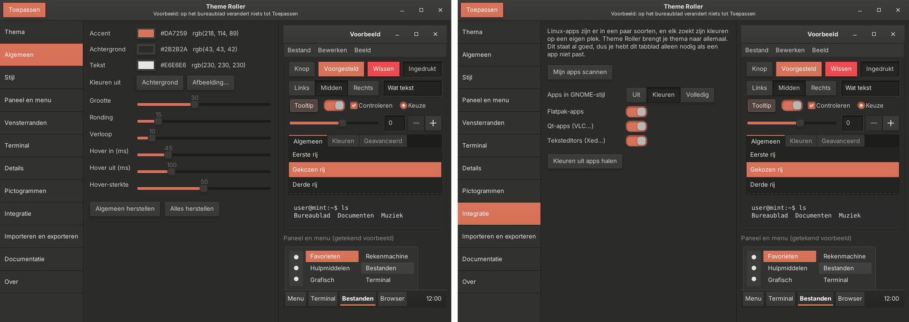

# Theme Roller in het Nederlands: help het na te kijken

Theme Roller is een gratis programma dat het Cinnamon-bureaublad van Linux Mint vormgeeft. De Nederlandse vertaling is gemaakt zonder moedertaalspreker. Klinkt iets fout, stroef of onnatuurlijk, laat het ons dan weten. Tien minuten helpt al enorm.

- **Met het programma:** staat je Mint in het Nederlands, installeer dan Theme Roller ([downloaden](https://github.com/xlcheese/theme-roller/releases/latest)) en klik door de tabbladen.
- **Zonder iets te installeren:** lees de tabel hieronder.
- **Reageren:** in het bericht waar je deze pagina vond, of op GitHub: het nummer en je betere formulering, bijvoorbeeld ‘#94: … in plaats van …’.

> Graag zo laten: woorden tussen `{accolades}` ongewijzigd, en opmaak zoals `<b>`; korte labels (✂) moeten kort blijven, anders wordt het venster breder; namen als Theme Roller, Cinnamon, GNOME, Flatpak en Qt blijven Engels.

| Nr. | Engels | Nederlands |
|---:|---|---|
| 1 ✂ | Global | Algemeen |
| 2 ✂ | Panel & Menu | Paneel en menu |
| 3 ✂ | Theme | Thema |
| 4 ✂ | Terminal | Terminal |
| 5 ✂ | Window Borders | Vensterranden |
| 6 ✂ | Details | Details |
| 7 ✂ | Icons | Pictogrammen |
| 8 ✂ | Integration | Integratie |
| 9 ✂ | About | Over |
| 10 ✂ | Documentation | Documentatie |
| 11 ✂ | Import & Export | Importeren en exporteren |
| 12 | Folders recolored: the folder color (the front) follows your accent, and the second color (the back) a darker shade of it. Choose either and both keep their colors from then on; Reset Icons follows the theme again. Every other icon stays as in your current icon theme. Apply to use them. | Mappen opnieuw gekleurd: de mapkleur (de voorkant) volgt je accentkleur, en de tweede kleur (de achterkant) een donkerdere tint ervan. Kies er een en beide houden vanaf dan hun kleuren; Pictogrammen herstellen volgt het thema weer. Alle andere pictogrammen blijven zoals in je huidige pictogramthema. Pas toe om ze te gebruiken. |
| 13 ✂ | Themes and styles | Thema's en stijlen |
| 14 | A <b>theme</b> is your colors and settings: everything on these tabs. A <b>style</b> is how things are drawn: edges, hovers, tabs and panel buttons. Any theme can use any style. Everything shows in the preview first; nothing changes on your desktop until you click <b>Apply</b>, and <b>Revert</b> puts your previous theme back. | Een <b>thema</b> zijn je kleuren en instellingen: alles op deze tabbladen. Een <b>stijl</b> is hoe alles getekend wordt: randen, hover-effecten, tabbladen en paneelknoppen. Elk thema kan elke stijl gebruiken. Alles verschijnt eerst in het voorbeeld; op je bureaublad verandert niets tot je op <b>Toepassen</b> klikt, en <b>Terugdraaien</b> zet je vorige thema terug. |
| 15 | Start from a built-in theme, one shared by someone else, or one of your own. Change anything and it becomes <b>Custom</b>; <b>Save Theme…</b> keeps your changes under a name. Your own themes can be duplicated, renamed and deleted. | Begin met een ingebouwd thema, een thema dat iemand anders gedeeld heeft of een eigen thema. Verander iets en het wordt <b>Aangepast</b>; <b>Opslaan…</b> bewaart je wijzigingen onder een naam. Je eigen thema's kun je dupliceren, hernoemen en verwijderen. |
| 16 | Three colors make a complete light or dark theme: accent, background and text. Then the shape of everything: Size, Roundness, Gradient, and how hovers fade. <b>Colors from</b> picks an accent from your wallpaper or any picture. | Drie kleuren vormen een compleet licht of donker thema: accent, achtergrond en tekst. Daarna de vorm van alles: Grootte, Ronding, Verloop en hoe hover-effecten op- en wegkomen. <b>Kleuren uit</b> haalt een accentkleur uit je achtergrond of een willekeurige afbeelding. |
| 17 | Pick how things are drawn, and set its Depth (how strong edges and shadows are) and Unfocused depth (how much of that unfocused windows keep). You can also make your own: a style is one style.toml file, in ~/.local/share/theme-roller/styles/&lt;name&gt;/. <b>Create a starter style…</b> makes one with every option explained: the essentials are on, the rest switched off with a #, each with a short note. Edit it, then pick it on the Style tab. <b>Check a style sheet for issues…</b> tells you if anything in it needs fixing. | Kies hoe alles getekend wordt, en stel de Diepte in (hoe sterk randen en schaduwen zijn) en de Diepte zonder focus (hoeveel daarvan vensters zonder focus houden). Je kunt ook je eigen stijl maken: een stijl is één style.toml-bestand, in ~/.local/share/theme-roller/styles/&lt;naam&gt;/. <b>Startstijl maken…</b> maakt er een waarin elke optie uitgelegd is: het belangrijkste staat aan, de rest uit met een #, elk met een korte notitie. Bewerk hem en kies hem daarna op het tabblad Stijl. <b>Stijlbestand controleren…</b> vertelt je of er iets in moet worden verbeterd. |
| 18 ✂ | Panel &amp; Menu | Paneel en menu |
| 19 | The Cinnamon panel and its menus: their own colors, label weight, height, roundness, gradient and see-through. Left alone, they follow Global. | Het Cinnamon-paneel en zijn menu's: eigen kleuren, letterdikte, hoogte, ronding, verloop en doorzichtigheid. Laat je ze met rust, dan volgen ze Algemeen. |
| 20 | Title bars and window buttons: colors, height, gradient, border, roundness, and a choice of button styles and Minimize, Maximize and Close glyphs. When these change, Apply restarts Cinnamon by itself (your windows stay open), as window borders only reload then. | Titelbalken en vensterknoppen: kleuren, hoogte, verloop, rand, ronding, en een keuze uit knopstijlen en symbolen voor Minimaliseren, Maximaliseren en Sluiten. Als die veranderen, herstart Toepassen Cinnamon vanzelf (je vensters blijven open), omdat vensterranden alleen dan opnieuw laden. |
| 21 | The terminal follows the theme, or pick one of the color sets, or your own colors. | De terminal volgt het thema, of kies een van de kleurensets, of je eigen kleuren. |
| 22 | Tooltips, scrollbars (overlay or classic, roundness, width), sliders, switches and the focus ring. | Tooltips, schuifbalken (zwevend of klassiek, ronding, breedte), schuifregelaars, schakelaars en de focusring. |
| 23 | Folder icons in your colors, in six styles. Only the folders change; other icons stay as they were. The folder color follows your accent unless you pick one; on xl-Big Baddy, the second color is its racing stripes. Off until you switch it on. | Mappictogrammen in jouw kleuren, in zes stijlen. Alleen de mappen veranderen; andere pictogrammen blijven zoals ze waren. De mapkleur volgt je accent, tenzij je er zelf een kiest; bij xl-Big Baddy is de tweede kleur zijn racestrepen. Uit tot je het aanzet. |
| 24 | Linux apps come in a few kinds, and each looks for its colors in its own place. These switches bring your colors to the hodgepodge that doesn't read the theme on its own: GNOME-style apps, Flatpak apps, Qt apps like VLC, and text editors. <b>Scan my apps</b> shows which of your apps are which kind; <b>Take colors out of apps</b> removes them until the next Apply. Pick another theme in Mint's settings and Theme Roller's colors leave your apps by themselves. | Linux-apps zijn er in een paar soorten, en elk zoekt zijn kleuren op een eigen plek. Deze schakelaars brengen je kleuren naar het allegaartje dat het thema niet zelf leest: apps in GNOME-stijl, Flatpak-apps, Qt-apps zoals VLC, en teksteditors. <b>Mijn apps scannen</b> laat zien van welke soort elk van je apps is; <b>Kleuren uit apps halen</b> haalt ze eruit tot de volgende keer Toepassen. Kies een ander thema in de instellingen van Mint en de kleuren van Theme Roller verdwijnen vanzelf uit je apps. |
| 25 ✂ | Import &amp; Export | Importeren en exporteren |
| 26 | Share a theme as one <tt>.xltheme</tt> file, and add themes others shared with you. | Deel een thema als één <tt>.xltheme</tt>-bestand, en voeg thema's toe die anderen met je gedeeld hebben. |
| 27 ✂ | Accent | Accent |
| 28 ✂ | Background | Achtergrond |
| 29 ✂ | Size | Grootte |
| 30 ✂ | Text | Tekst |
| 31 ✂ | Gradient | Verloop |
| 32 ✂ | Hover in (ms) | Hover in (ms) |
| 33 ✂ | Roundness | Ronding |
| 34 ✂ | Depth | Diepte |
| 35 ✂ | Hover out (ms) | Hover uit (ms) |
| 36 ✂ | Hover strength | Hover-sterkte |
| 37 ✂ | Unfocused depth | Diepte zonder focus |
| 38 ✂ | Label weight | Letterdikte |
| 39 ✂ | Opacity | Dekking |
| 40 ✂ | Height | Hoogte |
| 41 ✂ | Notification opacity | Dekking meldingen |
| 42 ✂ | Menu-item roundness | Ronding items |
| 43 ✂ | Border | Rand |
| 44 ✂ | Title bar | Titelbalk |
| 45 ✂ | Title text | Titeltekst |
| 46 ✂ | Border width | Randbreedte |
| 47 ✂ | Round bottom corners | Onderhoeken afronden |
| 48 ✂ | Title bar height | Titelbalkhoogte |
| 49 ✂ | Window roundness | Vensterronding |
| 50 ✂ | Buttons on the | Knoppen |
| 51 ✂ | Title bar gradient | Titelbalkverloop |
| 52 ✂ | Button roundness | Knopronding |
| 53 ✂ | Button spacing | Knopafstand |
| 54 ✂ | Button style | Knopstijl |
| 55 ✂ | Glyphs | Symbolen |
| 56 ✂ | Color | Kleur |
| 57 ✂ | Mode | Modus |
| 58 ✂ | Style | Stijl |
| 59 ✂ | Width | Breedte |
| 60 ✂ | GNOME-style apps | Apps in GNOME-stijl |
| 61 ✂ | Custom folder style | Eigen mapstijl |
| 62 ✂ | Folder color | Mapkleur |
| 63 ✂ | Second color | Tweede kleur |
| 64 ✂ | Flatpak apps | Flatpak-apps |
| 65 ✂ | Qt apps (VLC…) | Qt-apps (VLC…) |
| 66 ✂ | Text editors (Xed…) | Teksteditors (Xed…) |
| 67 ✂ | Menu style | Menustijl |
| 68 ✂ | Panel style | Paneelstijl |
| 69 ✂ | Tooltips | Tooltips |
| 70 ✂ | Scrollbars | Schuifbalken |
| 71 ✂ | Sliders | Schuifregelaars |
| 72 ✂ | Switches | Schakelaars |
| 73 ✂ | Focus ring | Focusring |
| 74 | Colors left on “Follow theme” use the Global colors. | Kleuren op ‘Thema volgen’ gebruiken de kleuren van Algemeen. |
| 75 | Colors left on “Follow theme” come from the Global colors. | Kleuren op ‘Thema volgen’ komen uit de kleuren van Algemeen. |
| 76 | Left on “Follow theme”, the terminal uses the theme's content colors. | Op ‘Thema volgen’ gebruikt de terminal de inhoudskleuren van het thema. |
| 77 | Linux apps come in a few kinds, and each looks for its colors in its own place. Theme Roller brings your theme to all of them. These are already set, so you only need this tab if an app doesn't match. | Linux-apps zijn er in een paar soorten, en elk zoekt zijn kleuren op een eigen plek. Theme Roller brengt je thema naar allemaal. Dit staat al goed, dus je hebt dit tabblad alleen nodig als een app niet past. |
| 78 | GNOME apps such as Calculator and Text Editor (libadwaita). Colors: your colors, and GNOME's accent to match. Full: also your buttons, title buttons and tabs; this overrides apps' own styling, so some lose colors of their own (Flatpak ones need Flatpak apps on). Reopen apps to see changes. | GNOME-apps zoals Rekenmachine en Teksteditor (libadwaita). Kleuren: jouw kleuren, en het GNOME-accent erbij. Volledig: ook je knoppen, titelknoppen en tabbladen; dit vervangt de eigen opmaak van apps, dus sommige verliezen eigen kleuren (Flatpak-apps hebben Flatpak-apps aan nodig). Open apps opnieuw om de wijzigingen te zien. |
| 79 | Lets Flatpak apps read your theme, so they get its colors. Reopen open apps to see them. | Laat Flatpak-apps je thema lezen, zodat ze de kleuren ervan krijgen. Open geopende apps opnieuw om ze te zien. |
| 80 | Flatpak isn't installed. | Flatpak is niet geïnstalleerd. |
| 81 ✂ | A–Z | A–Z |
| 82 ✂ | Newest | Nieuwste |
| 83 ✂ | Oldest | Oudste |
| 84 ✂ | Z–A | Z–A |
| 85 ✂ | Colors | Kleuren |
| 86 ✂ | Full | Volledig |
| 87 ✂ | Off | Uit |
| 88 | Preview: nothing changes on the desktop until Apply | Voorbeeld: op het bureaublad verandert niets tot Toepassen |
| 89 ✂ | Apply | Toepassen |
| 90 ✂ | Revert | Terugdraaien |
| 91 | Put the previous theme back on the desktop (your settings here stay) | Het vorige thema terugzetten op het bureaublad (je instellingen hier blijven) |
| 92 ✂ | Scan my apps | Mijn apps scannen |
| 93 | Lists the apps on this computer by kind, and whether Theme Roller reaches them: the answer to “why doesn't this app match?” | Toont de apps op deze computer per soort, en of Theme Roller ze bereikt: het antwoord op ‘waarom past deze app niet?’ |
| 94 ✂ | Reset {tab} | {tab} herstellen |
| 95 ✂ | Reset All to Theme Defaults | Alles herstellen |
| 96 ✂ | No stripes | Geen strepen |
| 97 ✂ | Save Theme… | Opslaan… |
| 98 | Keep your Custom settings as a theme with its own name | Je instellingen van Aangepast bewaren als thema met een eigen naam |
| 99 ✂ | Duplicate | Dupliceren |
| 100 | Save a copy of the selected theme as one of your themes | Een kopie van het gekozen thema opslaan als een van je thema's |
| 101 ✂ | Rename | Hernoemen |
| 102 | Rename one of your themes (built-in themes keep their names) | Een van je thema's hernoemen (ingebouwde thema's houden hun naam) |
| 103 ✂ | Delete | Wissen |
| 104 ✂ | Sort: | Sorteren: |
| 105 ✂ | Your theme | Jouw thema |
| 106 ✂ | Your latest changes | Je laatste wijzigingen |
| 107 | Your latest changes, based on {theme} | Je laatste wijzigingen, op basis van {theme} |
| 108 ✂ | Your style | Jouw stijl |
| 109 ✂ | Theme default | Standaard van het thema |
| 110 | Off: switch it on in the Integration tab | Uit: zet het aan op het tabblad Integratie |
| 111 ✂ | On | Aan |
| 112 | Follow the theme on their own | Volgen het thema vanzelf |
| 113 | Nothing to do: they always match. | Niets te doen: ze passen altijd. |
| 114 ✂ | Colors on | Kleuren aan |
| 115 | Off: set GNOME-style apps to Colors in the Integration tab | Uit: zet Apps in GNOME-stijl op Kleuren op het tabblad Integratie |
| 116 ✂ | Colors and full styling on | Kleuren en volledige opmaak aan |
| 117 | . GNOME-style ones also need GNOME-style apps set to Colors | . Die in GNOME-stijl hebben ook Apps in GNOME-stijl op Kleuren nodig |
| 118 ✂ | Qt apps | Qt-apps |
| 119 ✂ | Text editors | Teksteditors |
| 120 ✂ | Run in a terminal | Draaien in een terminal |
| 121 | They use the terminal's colors (Terminal tab). | Ze gebruiken de kleuren van de terminal (tabblad Terminal). |
| 122 | They draw their own look; no theme reaches them. | Ze tekenen hun eigen uiterlijk; geen thema bereikt ze. |
| 123 ✂ | Web-based apps | Webapps |
| 124 ✂ | Couldn't tell | Niet te zeggen |
| 125 | Many of these draw their own look. | Veel hiervan tekenen hun eigen uiterlijk. |
| 126 ✂ | Your apps | Je apps |
| 127 ✂ | Close | Sluiten |
| 128 | {count} apps in your menu, by kind. Changes show after Apply, in apps opened afterwards. | {count} apps in je menu, per soort. Wijzigingen zie je na Toepassen, in apps die je daarna opent. |
| 129 ✂ | Take colors out of apps | Kleuren uit apps halen |
| 130 | Theme Roller's colors are out of your apps. Reopen open apps. The next Apply puts them back. | De kleuren van Theme Roller zijn uit je apps gehaald. Open geopende apps opnieuw. De volgende keer Toepassen zet ze terug. |
| 131 | Removes Theme Roller's colors from all apps now. Your settings and the theme stay; the next Apply puts the colors back. | Haalt de kleuren van Theme Roller nu uit alle apps. Je instellingen en het thema blijven; de volgende keer Toepassen zet de kleuren terug. |
| 132 ✂ | Colors from | Kleuren uit |
| 133 ✂ | Wallpaper | Achtergrond |
| 134 | Take an accent from your desktop wallpaper | Een accentkleur uit je bureaubladachtergrond halen |
| 135 ✂ | Image… | Afbeelding… |
| 136 | Take an accent from any picture | Een accentkleur uit een willekeurige afbeelding halen |
| 137 ✂ | Take colors from a picture | Kleuren uit een afbeelding halen |
| 138 ✂ | Cancel | Annuleren |
| 139 ✂ | Use | Gebruiken |
| 140 ✂ | Pictures | Afbeeldingen |
| 141 | Couldn't find your wallpaper (Cinnamon's background setting has no picture). | Je bureaubladachtergrond is niet gevonden (de achtergrond van Cinnamon heeft geen afbeelding). |
| 142 | Couldn't read {file}: {problem} | Kan {file} niet lezen: {problem} |
| 143 ✂ | Use {color} as the accent | {color} als accent gebruiken |
| 144 | Accent from {file}. Or click another color. | Accent uit {file}. Of klik op een andere kleur. |
| 145 | {file} has no colors vivid enough for an accent. | {file} heeft geen kleuren die fel genoeg zijn voor een accent. |
| 146 | The xl-Cheeselooks theme maker for Linux Mint and the Cinnamon desktop: your colors and shapes, drawn by a style, for GTK 3 and GTK 4 apps, libadwaita apps, the Cinnamon panel and menus, and the window borders. | De maker van het thema xl-Cheeselooks voor Linux Mint en het Cinnamon-bureaublad: jouw kleuren en vormen, getekend door een stijl, voor GTK 3- en GTK 4-apps, libadwaita-apps, het Cinnamon-paneel en de menu's, en de vensterranden. |
| 147 ✂ | Website | Website |
| 148 | Enjoying {app}? It's free and always will be. | Plezier van {app}? Het is gratis en blijft dat altijd. |
| 149 ✂ | Leave a tip ☕ | Laat een fooi achter ☕ |
| 150 | Developed with the help of Claude, an AI assistant by Anthropic | Ontwikkeld met hulp van Claude, een AI-assistent van Anthropic |
| 151 | This program comes with absolutely no warranty. See the <a href='https://www.gnu.org/licenses/gpl-3.0.html'>GNU General Public License, version 3 or later</a> for details. | Dit programma wordt geleverd zonder enige garantie. Zie de <a href='https://www.gnu.org/licenses/gpl-3.0.html'>GNU General Public License, versie 3 of later</a> voor details. |
| 152 ✂ | Remove from my desktop… | Van mijn bureaublad halen… |
| 153 | Before uninstalling Theme Roller: puts Mint's default theme back and takes Theme Roller's colors out of your apps | Voor je Theme Roller verwijdert: zet het standaardthema van Mint terug en haalt de kleuren van Theme Roller uit je apps |
| 154 | Remove Theme Roller from your desktop? | Theme Roller van je bureaublad halen? |
| 155 | Mint's default theme comes back, Theme Roller's colors leave your apps, and the theme watcher stops starting at login. Your settings and your own themes stay, so you can pick up where you left off. Do this before uninstalling Theme Roller. | Het standaardthema van Mint komt terug, de kleuren van Theme Roller verdwijnen uit je apps, en de themabewaker start niet meer bij het aanmelden. Je instellingen en eigen thema's blijven, zodat je verder kunt waar je gebleven was. Doe dit voor je Theme Roller verwijdert. |
| 156 | Removing… the desktop flickers once while it reloads. | Bezig met verwijderen… het bureaublad knippert één keer tijdens het herladen. |
| 157 | Theme Roller is off your desktop. You can uninstall it now; Apply puts it back. | Theme Roller is van je bureaublad gehaald. Je kunt het nu verwijderen; Toepassen zet het terug. |
| 158 ✂ | Remove failed: {problem} | Verwijderen mislukt: {problem} |
| 159 ✂ | Create a starter style… | Startstijl maken… |
| 160 | Check a style sheet for issues… | Stijlbestand controleren… |
| 161 | Pick a style.toml: it's checked as Theme Roller reads it, and any problems are listed with what to fix | Kies een style.toml: die wordt gecontroleerd zoals Theme Roller hem leest, en elk probleem wordt getoond met wat er verbeterd moet worden |
| 162 ✂ | Full documentation (online) | Volledige documentatie (online) |
| 163 ✂ | Check a style sheet | Stijlbestand controleren |
| 164 ✂ | Check | Controleren |
| 165 ✂ | Style sheets (style.toml) | Stijlbestanden (style.toml) |
| 166 ✂ | “{style}” looks good | ‘{style}’ ziet er goed uit |
| 167 ✂ | Warning: {problem} | Waarschuwing: {problem} |
| 168 | No problems found. Pick it on the Style tab to use it. | Geen problemen gevonden. Kies hem op het tabblad Stijl om hem te gebruiken. |
| 169 ✂ | Problems to fix: {count} | Te verhelpen problemen: {count} |
| 170 | Fix these in the file, then check it again. | Verhelp ze in het bestand en controleer het daarna opnieuw. |
| 171 ✂ | the style needs a name | de stijl heeft een naam nodig |
| 172 | names can be up to {count} characters | namen mogen tot {count} tekens lang zijn |
| 173 | names can't contain / or start with a dot | namen mogen geen / bevatten of met een punt beginnen |
| 174 | there's already a style called {name} | er is al een stijl met de naam {name} |
| 175 ✂ | Create Style | Stijl maken |
| 176 | Give your new style a good name. | Geef je nieuwe stijl een goede naam. |
| 177 ✂ | My Style | Mijn stijl |
| 178 ✂ | Create | Maken |
| 179 | Created {file}. Edit it, then pick it on the Style tab. | {file} gemaakt. Bewerk het en kies de stijl daarna op het tabblad Stijl. |
| 180 | Share a theme as one file (.xltheme). It holds every setting, the theme's name, the version of Theme Roller it was made with, and your style when the theme uses one of your own, so the person importing it gets exactly your look. | Deel een thema als één bestand (.xltheme). Het bevat elke instelling, de naam van het thema, de versie van Theme Roller waarmee het gemaakt is, en je stijl als het thema een eigen stijl gebruikt, zodat wie het importeert precies jouw uiterlijk krijgt. |
| 181 ✂ | Export the current theme… | Huidig thema exporteren… |
| 182 ✂ | Import a theme… | Thema importeren… |
| 183 ✂ | Preview | Voorbeeld |
| 184 ✂ | Edit | Bewerken |
| 185 ✂ | File | Bestand |
| 186 ✂ | View | Beeld |
| 187 ✂ | Open | Openen |
| 188 ✂ | Quit | Afsluiten |
| 189 ✂ | Button | Knop |
| 190 ✂ | Suggested | Voorgesteld |
| 191 ✂ | Toggled | Ingedrukt |
| 192 ✂ | A tooltip on {button} | Een tooltip bij {button} |
| 193 ✂ | Center | Midden |
| 194 ✂ | Left | Links |
| 195 ✂ | Right | Rechts |
| 196 ✂ | Some text | Wat tekst |
| 197 ✂ | Tooltip | Tooltip |
| 198 ✂ | Radio | Keuze |
| 199 ✂ | Advanced | Geavanceerd |
| 200 ✂ | General | Algemeen |
| 201 ✂ | Fifth row | Vijfde rij |
| 202 ✂ | First row | Eerste rij |
| 203 ✂ | Fourth row | Vierde rij |
| 204 ✂ | Selected row | Gekozen rij |
| 205 ✂ | Third row | Derde rij |
| 206 ✂ | Eighth row | Achtste rij |
| 207 ✂ | Seventh row | Zevende rij |
| 208 ✂ | Sixth row | Zesde rij |
| 209 ✂ | Desktop  Documents  Music | Bureaublad  Documenten  Muziek |
| 210 ✂ | Accessories | Hulpmiddelen |
| 211 ✂ | Favorites | Favorieten |
| 212 ✂ | Graphics | Grafisch |
| 213 ✂ | Calculator | Rekenmachine |
| 214 ✂ | Files | Bestanden |
| 215 | Panel and menu (drawn preview) | Paneel en menu (getekend voorbeeld) |
| 216 ✂ | Menu | Menu |
| 217 ✂ | Browser | Browser |
| 218 ✂ | Can't preview: {problem} | Geen voorbeeld mogelijk: {problem} |
| 219 | Preview CSS problem: {problem} | CSS-probleem in het voorbeeld: {problem} |
| 220 ✂ | None | Geen |
| 221 ✂ | Follow theme | Thema volgen |
| 222 ✂ | Custom | Aangepast |
| 223 ✂ | <b>{name}</b> folder style | Mapstijl <b>{name}</b> |
| 224 | Put every tab back to {theme}. Your latest changes stay in Custom. | Alle tabbladen terugzetten naar {theme}. Je laatste wijzigingen blijven in Aangepast. |
| 225 | Put Global back to {theme}. Other tabs keep what you set there, but colors on “Follow theme” and shapes that follow Global change with it. | Algemeen terugzetten naar {theme}. Andere tabbladen houden wat je daar instelde, maar kleuren op ‘Thema volgen’ en vormen die Algemeen volgen veranderen mee. |
| 226 | Put {tab} back to {theme} (other tabs stay as they are) | {tab} terugzetten naar {theme} (andere tabbladen blijven zoals ze zijn) |
| 227 ✂ | Theme: {theme} | Thema: {theme} |
| 228 | Every tab reset to {theme}. Your latest changes are still in Custom. | Alle tabbladen teruggezet naar {theme}. Je laatste wijzigingen staan nog in Aangepast. |
| 229 | {tab} reset to {theme}. | {tab} teruggezet naar {theme}. |
| 230 ✂ | Save Theme | Thema opslaan |
| 231 ✂ | Save | Opslaan |
| 232 | Name your theme. It uses the style “{style}” and all your current settings. | Geef je thema een naam. Het gebruikt de stijl ‘{style}’ en al je huidige instellingen. |
| 233 ✂ | {theme} copy | {theme} (kopie) |
| 234 | Up to {count} characters. Built-in themes can't be replaced; your own can. | Tot {count} tekens. Ingebouwde thema's kunnen niet vervangen worden; je eigen wel. |
| 235 | Replace your theme “{theme}”? | Je thema ‘{theme}’ vervangen? |
| 236 | Saved the theme “{theme}”. | Thema ‘{theme}’ opgeslagen. |
| 237 ✂ | OK | OK |
| 238 ✂ | Duplicate Theme | Thema dupliceren |
| 239 | A copy of “{theme}”, as one of your themes: | Een kopie van ‘{theme}’, als een van je thema's: |
| 240 | Duplicated “{theme}” as “{copy}”. | ‘{theme}’ gedupliceerd als ‘{copy}’. |
| 241 ✂ | A new name for “{theme}”: | Een nieuwe naam voor ‘{theme}’: |
| 242 ✂ | Rename Theme | Thema hernoemen |
| 243 | Renamed “{old}” to “{new}”. | ‘{old}’ hernoemd naar ‘{new}’. |
| 244 | Delete your theme “{theme}”? Its style stays installed. | Je thema ‘{theme}’ verwijderen? De stijl ervan blijft geïnstalleerd. |
| 245 ✂ | My theme | Mijn thema |
| 246 ✂ | Export theme | Thema exporteren |
| 247 ✂ | Exported “{theme}” to {file} | ‘{theme}’ geëxporteerd naar {file} |
| 248 ✂ | Export failed: {problem} | Exporteren mislukt: {problem} |
| 249 ✂ | Import theme | Thema importeren |
| 250 ✂ | Theme Roller themes | Theme Roller-thema's |
| 251 | Imported “{theme}”. | ‘{theme}’ geïmporteerd. |
| 252 ✂ | Import failed: {problem} | Importeren mislukt: {problem} |
| 253 | Applying… the desktop flickers once while it reloads. | Bezig met toepassen… het bureaublad knippert één keer tijdens het herladen. |
| 254 ✂ | Apply failed: {problem} | Toepassen mislukt: {problem} |
| 255 | “{theme}” is on the desktop. Revert puts the previous theme back. | ‘{theme}’ staat op het bureaublad. Terugdraaien zet het vorige thema terug. |
| 256 | Some older apps' title bars change at your next login. | Bij sommige oudere apps veranderen de titelbalken pas bij de volgende keer aanmelden. |
| 257 | These title bars change at your next login: {apps} | Deze titelbalken veranderen pas bij de volgende keer aanmelden: {apps} |
| 258 ✂ | Qt apps now match your theme | Qt-apps passen nu bij je thema |
| 259 | Reverting… the desktop flickers once while it reloads. | Bezig met terugdraaien… het bureaublad knippert één keer tijdens het herladen. |
| 260 ✂ | Revert failed: {problem} | Terugdraaien mislukt: {problem} |
| 261 | The previous theme is back on the desktop. Your settings here are unchanged. | Het vorige thema staat weer op het bureaublad. Je instellingen hier zijn niet veranderd. |
| 262 ✂ | GNOME runtime | GNOME-runtime |
| 263 ✂ | KDE runtime | KDE-runtime |
| 264 | Gives Xed, gedit and Meld a color scheme from your theme, mainly for syntax colors and highlights. Most editors' own schemes follow your theme too. Reopen them to see changes. | Geeft Xed, gedit en Meld een kleurenschema uit je thema, vooral voor syntaxiskleuren en markeringen. De eigen schema's van de meeste editors volgen je thema ook. Open ze opnieuw om de wijzigingen te zien. |
| 265 ✂ | Racing stripes | Racestrepen |
| 266 | Binders in your colors: the folder color follows your accent. Racing stripes are off until you pick a color for them; No stripes takes them off again. Every other icon stays as in your current icon theme. Apply to use them. | Ordners in jouw kleuren: de mapkleur volgt je accent. Racestrepen staan uit tot je er een kleur voor kiest; Geen strepen haalt ze weer weg. Alle andere pictogrammen blijven zoals in je huidige pictogramthema. Pas toe om ze te gebruiken. |
| 267 ✂ | Wavy lines | Golflijnen |
| 268 | Binders in your colors: the folder color follows your accent, and the wavy lines a darker shade of it. Choose either and both keep their colors from then on; Reset Icons follows the theme again. Every other icon stays as in your current icon theme. Apply to use them. | Ordners in jouw kleuren: de mapkleur volgt je accent, en de golflijnen een donkerdere tint ervan. Kies er een en beide houden vanaf dan hun kleuren; Pictogrammen herstellen volgt het thema weer. Alle andere pictogrammen blijven zoals in je huidige pictogramthema. Pas toe om ze te gebruiken. |
| 269 | Your Qt apps now use your theme's colors.  Your previous Qt setup is saved: {saved}.  Turning off Integration → Qt apps puts it back. | Je Qt-apps gebruiken nu de kleuren van je thema.  Je vorige Qt-instelling is bewaard: {saved}.  Integratie → Qt-apps uitzetten zet die terug. |
| 270 | The first time, log out and back in to see your colors in Qt apps; after that, reopening them is enough. If you had your own Qt setup, it's saved and comes back when this is off. | Log de eerste keer uit en weer in om je kleuren in Qt-apps te zien; daarna is ze opnieuw openen genoeg. Had je een eigen Qt-instelling, dan wordt die bewaard en komt die terug als dit uit staat. |
| 271 | Needs qt5ct: sudo apt install qt5ct | Heeft qt5ct nodig: sudo apt install qt5ct |
| 272 | give the theme a name (not “Custom”) | geef het thema een naam (niet ‘Aangepast’) |
| 273 | a theme's name can be up to {count} characters ({given} given) | de naam van een thema mag tot {count} tekens lang zijn ({given} opgegeven) |
| 274 | “{theme}” is a built-in theme: choose another name | ‘{theme}’ is een ingebouwd thema: kies een andere naam |
| 275 | you already have a theme called “{theme}” | je hebt al een thema met de naam ‘{theme}’ |
| 276 | there's already a theme called “{theme}” | er is al een thema met de naam ‘{theme}’ |
| 277 | couldn't find a free name for the copy | geen vrije naam voor de kopie gevonden |
| 278 | built-in themes can't be renamed: duplicate it instead | ingebouwde thema's kunnen niet hernoemd worden: dupliceer het in plaats daarvan |
| 279 | built-in themes can't be deleted | ingebouwde thema's kunnen niet verwijderd worden |
| 280 | {file} isn't a Theme Roller theme file | {file} is geen themabestand van Theme Roller |
| 281 | This theme was made with a newer Theme Roller ({version}). Some of it may not show as intended; updating Theme Roller is recommended. | Dit thema is gemaakt met een nieuwere Theme Roller ({version}). Een deel ervan ziet er misschien niet uit zoals bedoeld; Theme Roller bijwerken wordt aangeraden. |
| 282 | You already have a style folder “{folder}”: kept yours, so the theme uses your copy of that style. | Je hebt al een stijlmap ‘{folder}’: die van jou is behouden, dus het thema gebruikt jouw kopie van die stijl. |
| 283 | the theme file contains an unsafe path | het themabestand bevat een onveilig pad |
| 284 | The theme's name was longer than {count} characters: shortened to “{theme}”. | De naam van het thema was langer dan {count} tekens: ingekort tot ‘{theme}’. |
| 285 | A theme called “{theme}” already exists: imported as “{copy}”. | Er bestaat al een thema met de naam ‘{theme}’: geïmporteerd als ‘{copy}’. |
| 286 ✂ | Chevrons | Punthaken |
| 287 ✂ | Regular | Normaal |
| 288 ✂ | Thin | Dun |
| 289 ✂ | Icon Theme | Pictogramthema |
| 290 ✂ | Marks | Tekens |
| 291 ✂ | Bold | Vet |
| 292 ✂ | Classic | Klassiek |
| 293 ✂ | Dashed | Gestreept |
| 294 ✂ | Dotted | Gestippeld |
| 295 ✂ | Follow global | Algemeen volgen |
| 296 ✂ | Light | Licht |
| 297 ✂ | Overlay | Zwevend |
| 298 ✂ | Separate colors | Eigen kleuren |
| 299 ✂ | Solid | Doorgetrokken |
