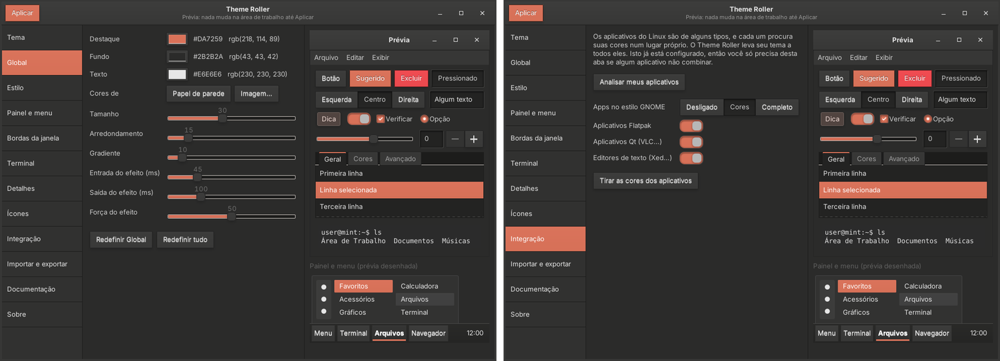

# Theme Roller em português: ajude a revisar

O Theme Roller é um aplicativo gratuito que personaliza a área de trabalho Cinnamon do Linux Mint. A tradução para o português foi feita sem um falante nativo. Se algo soar errado, estranho ou pouco natural, avise a gente. Dez minutos já ajudam muito.

- **Com o aplicativo:** se o seu Mint está em português, instale o Theme Roller ([download](https://github.com/xlcheese/theme-roller/releases/latest)) e percorra as abas.
- **Sem instalar nada:** leia a tabela abaixo.
- **Como responder:** na publicação onde você encontrou esta página, ou no GitHub: o número e a sua redação melhor, por exemplo “#94: … em vez de …”.

> Por favor, mantenha: as palavras entre `{chaves}` como estão, e marcações como `<b>`; os rótulos curtos (✂) precisam continuar curtos, senão a janela fica mais larga; nomes como Theme Roller, Cinnamon, GNOME, Flatpak e Qt não se traduzem.

| Nº | Inglês | Português |
|---:|---|---|
| 1 ✂ | Global | Global |
| 2 ✂ | Panel & Menu | Painel e menu |
| 3 ✂ | Theme | Tema |
| 4 ✂ | Terminal | Terminal |
| 5 ✂ | Window Borders | Bordas da janela |
| 6 ✂ | Details | Detalhes |
| 7 ✂ | Icons | Ícones |
| 8 ✂ | Integration | Integração |
| 9 ✂ | About | Sobre |
| 10 ✂ | Documentation | Documentação |
| 11 ✂ | Import & Export | Importar e exportar |
| 12 | Folders recolored: the folder color (the front) follows your accent, and the second color (the back) a darker shade of it. Choose either and both keep their colors from then on; Reset Icons follows the theme again. Every other icon stays as in your current icon theme. Apply to use them. | Pastas recoloridas: a cor da pasta (a frente) segue sua cor de destaque, e a segunda cor (o fundo) um tom mais escuro dela. Escolha qualquer uma e as duas mantêm suas cores daí em diante; Redefinir Ícones volta a seguir o tema. Todos os outros ícones ficam como no seu tema de ícones atual. Aplique para usá-las. |
| 13 ✂ | Themes and styles | Temas e estilos |
| 14 | A <b>theme</b> is your colors and settings: everything on these tabs. A <b>style</b> is how things are drawn: edges, hovers, tabs and panel buttons. Any theme can use any style. Everything shows in the preview first; nothing changes on your desktop until you click <b>Apply</b>, and <b>Revert</b> puts your previous theme back. | Um <b>tema</b> são suas cores e configurações: tudo nestas abas. Um <b>estilo</b> é como as coisas são desenhadas: bordas, efeitos ao passar o mouse, abas e botões do painel. Qualquer tema pode usar qualquer estilo. Tudo aparece primeiro na prévia; nada muda na sua área de trabalho até você clicar em <b>Aplicar</b>, e <b>Reverter</b> traz de volta seu tema anterior. |
| 15 | Start from a built-in theme, one shared by someone else, or one of your own. Change anything and it becomes <b>Custom</b>; <b>Save Theme…</b> keeps your changes under a name. Your own themes can be duplicated, renamed and deleted. | Comece com um tema incluído, um compartilhado por outra pessoa ou um seu. Mude qualquer coisa e ele vira <b>Personalizado</b>; <b>Salvar tema…</b> guarda suas mudanças com um nome. Seus próprios temas podem ser duplicados, renomeados e excluídos. |
| 16 | Three colors make a complete light or dark theme: accent, background and text. Then the shape of everything: Size, Roundness, Gradient, and how hovers fade. <b>Colors from</b> picks an accent from your wallpaper or any picture. | Três cores formam um tema claro ou escuro completo: destaque, fundo e texto. Depois, a forma de tudo: Tamanho, Arredondamento, Gradiente e como os efeitos ao passar o mouse aparecem e somem. <b>Cores de</b> pega uma cor de destaque do seu papel de parede ou de qualquer imagem. |
| 17 | Pick how things are drawn, and set its Depth (how strong edges and shadows are) and Unfocused depth (how much of that unfocused windows keep). You can also make your own: a style is one style.toml file, in ~/.local/share/theme-roller/styles/&lt;name&gt;/. <b>Create a starter style…</b> makes one with every option explained: the essentials are on, the rest switched off with a #, each with a short note. Edit it, then pick it on the Style tab. <b>Check a style sheet for issues…</b> tells you if anything in it needs fixing. | Escolha como as coisas são desenhadas e ajuste a Profundidade (a força de bordas e sombras) e a Profundidade inativa (quanto disso as janelas sem foco mantêm). Você também pode criar os seus: um estilo é um arquivo style.toml, em ~/.local/share/theme-roller/styles/&lt;nome&gt;/. <b>Criar um estilo inicial…</b> cria um com cada opção explicada: o essencial ligado e o resto desligado com um #, cada um com uma nota curta. Edite-o e depois escolha-o na aba Estilo. <b>Verificar uma folha de estilo…</b> diz se algo nela precisa de correção. |
| 18 ✂ | Panel &amp; Menu | Painel e menu |
| 19 | The Cinnamon panel and its menus: their own colors, label weight, height, roundness, gradient and see-through. Left alone, they follow Global. | O painel do Cinnamon e seus menus: suas próprias cores, peso dos rótulos, altura, arredondamento, gradiente e transparência. Se você não mexer, eles seguem o Global. |
| 20 | Title bars and window buttons: colors, height, gradient, border, roundness, and a choice of button styles and Minimize, Maximize and Close glyphs. When these change, Apply restarts Cinnamon by itself (your windows stay open), as window borders only reload then. | Barras de título e botões de janela: cores, altura, gradiente, borda, arredondamento, e uma escolha de estilos de botão e símbolos para Minimizar, Maximizar e Fechar. Quando mudam, Aplicar reinicia o Cinnamon sozinho (suas janelas continuam abertas), já que as bordas de janela só recarregam então. |
| 21 | The terminal follows the theme, or pick one of the color sets, or your own colors. | O terminal segue o tema, ou escolha um dos conjuntos de cores, ou suas próprias cores. |
| 22 | Tooltips, scrollbars (overlay or classic, roundness, width), sliders, switches and the focus ring. | Dicas, barras de rolagem (sobrepostas ou clássicas, arredondamento, largura), controles deslizantes, interruptores e o anel de foco. |
| 23 | Folder icons in your colors, in six styles. Only the folders change; other icons stay as they were. The folder color follows your accent unless you pick one; on xl-Big Baddy, the second color is its racing stripes. Off until you switch it on. | Ícones de pasta nas suas cores, em seis estilos. Só as pastas mudam; os outros ícones ficam como estavam. A cor da pasta segue seu destaque, a menos que você escolha uma; no xl-Big Baddy, a segunda cor são as faixas de corrida. Desligado até você ligar. |
| 24 | Linux apps come in a few kinds, and each looks for its colors in its own place. These switches bring your colors to the hodgepodge that doesn't read the theme on its own: GNOME-style apps, Flatpak apps, Qt apps like VLC, and text editors. <b>Scan my apps</b> shows which of your apps are which kind; <b>Take colors out of apps</b> removes them until the next Apply. Pick another theme in Mint's settings and Theme Roller's colors leave your apps by themselves. | Os aplicativos do Linux são de alguns tipos, e cada um procura suas cores num lugar próprio. Estes interruptores levam suas cores à salada de aplicativos que não lê o tema sozinha: aplicativos no estilo GNOME, aplicativos Flatpak, aplicativos Qt como o VLC e editores de texto. <b>Analisar meus aplicativos</b> mostra de que tipo é cada um dos seus aplicativos; <b>Tirar as cores dos aplicativos</b> as remove até o próximo Aplicar. Escolha outro tema nas configurações do Mint e as cores do Theme Roller saem dos seus aplicativos sozinhas. |
| 25 ✂ | Import &amp; Export | Importar e exportar |
| 26 | Share a theme as one <tt>.xltheme</tt> file, and add themes others shared with you. | Compartilhe um tema como um único arquivo <tt>.xltheme</tt> e adicione temas que outras pessoas compartilharam com você. |
| 27 ✂ | Accent | Destaque |
| 28 ✂ | Background | Fundo |
| 29 ✂ | Size | Tamanho |
| 30 ✂ | Text | Texto |
| 31 ✂ | Gradient | Gradiente |
| 32 ✂ | Hover in (ms) | Entrada do efeito (ms) |
| 33 ✂ | Roundness | Arredondamento |
| 34 ✂ | Depth | Profundidade |
| 35 ✂ | Hover out (ms) | Saída do efeito (ms) |
| 36 ✂ | Hover strength | Força do efeito |
| 37 ✂ | Unfocused depth | Profundidade inativa |
| 38 ✂ | Label weight | Peso dos rótulos |
| 39 ✂ | Opacity | Opacidade |
| 40 ✂ | Height | Altura |
| 41 ✂ | Notification opacity | Opacidade dos avisos |
| 42 ✂ | Menu-item roundness | Arred. dos itens |
| 43 ✂ | Border | Borda |
| 44 ✂ | Title bar | Barra de título |
| 45 ✂ | Title text | Texto do título |
| 46 ✂ | Border width | Largura da borda |
| 47 ✂ | Round bottom corners | Cantos inferiores redondos |
| 48 ✂ | Title bar height | Altura do título |
| 49 ✂ | Window roundness | Arred. da janela |
| 50 ✂ | Buttons on the | Botões à |
| 51 ✂ | Title bar gradient | Gradiente do título |
| 52 ✂ | Button roundness | Arred. dos botões |
| 53 ✂ | Button spacing | Espaço entre botões |
| 54 ✂ | Button style | Estilo dos botões |
| 55 ✂ | Glyphs | Símbolos |
| 56 ✂ | Color | Cor |
| 57 ✂ | Mode | Modo |
| 58 ✂ | Style | Estilo |
| 59 ✂ | Width | Largura |
| 60 ✂ | GNOME-style apps | Apps no estilo GNOME |
| 61 ✂ | Custom folder style | Estilo de pastas personalizado |
| 62 ✂ | Folder color | Cor da pasta |
| 63 ✂ | Second color | Segunda cor |
| 64 ✂ | Flatpak apps | Aplicativos Flatpak |
| 65 ✂ | Qt apps (VLC…) | Aplicativos Qt (VLC…) |
| 66 ✂ | Text editors (Xed…) | Editores de texto (Xed…) |
| 67 ✂ | Menu style | Estilo do menu |
| 68 ✂ | Panel style | Estilo do painel |
| 69 ✂ | Tooltips | Dicas |
| 70 ✂ | Scrollbars | Barras de rolagem |
| 71 ✂ | Sliders | Controles deslizantes |
| 72 ✂ | Switches | Interruptores |
| 73 ✂ | Focus ring | Anel de foco |
| 74 | Colors left on “Follow theme” use the Global colors. | Cores em “Seguir o tema” usam as cores do Global. |
| 75 | Colors left on “Follow theme” come from the Global colors. | Cores em “Seguir o tema” vêm das cores do Global. |
| 76 | Left on “Follow theme”, the terminal uses the theme's content colors. | Em “Seguir o tema”, o terminal usa as cores de conteúdo do tema. |
| 77 | Linux apps come in a few kinds, and each looks for its colors in its own place. Theme Roller brings your theme to all of them. These are already set, so you only need this tab if an app doesn't match. | Os aplicativos do Linux são de alguns tipos, e cada um procura suas cores num lugar próprio. O Theme Roller leva seu tema a todos eles. Isto já está configurado, então você só precisa desta aba se algum aplicativo não combinar. |
| 78 | GNOME apps such as Calculator and Text Editor (libadwaita). Colors: your colors, and GNOME's accent to match. Full: also your buttons, title buttons and tabs; this overrides apps' own styling, so some lose colors of their own (Flatpak ones need Flatpak apps on). Reopen apps to see changes. | Aplicativos do GNOME como Calculadora e Editor de texto (libadwaita). Cores: suas cores, e o destaque do GNOME combinando. Completo: também seus botões, botões de título e abas; isso substitui o estilo próprio dos aplicativos, então alguns perdem cores próprias (os Flatpak precisam de Aplicativos Flatpak ligado). Reabra os aplicativos para ver as mudanças. |
| 79 | Lets Flatpak apps read your theme, so they get its colors. Reopen open apps to see them. | Deixa os aplicativos Flatpak lerem seu tema, para que peguem as cores dele. Reabra os aplicativos abertos para vê-las. |
| 80 | Flatpak isn't installed. | O Flatpak não está instalado. |
| 81 ✂ | A–Z | A–Z |
| 82 ✂ | Newest | Mais recente |
| 83 ✂ | Oldest | Mais antigo |
| 84 ✂ | Z–A | Z–A |
| 85 ✂ | Colors | Cores |
| 86 ✂ | Full | Completo |
| 87 ✂ | Off | Desligado |
| 88 | Preview: nothing changes on the desktop until Apply | Prévia: nada muda na área de trabalho até Aplicar |
| 89 ✂ | Apply | Aplicar |
| 90 ✂ | Revert | Reverter |
| 91 | Put the previous theme back on the desktop (your settings here stay) | Trazer de volta o tema anterior para a área de trabalho (suas configurações aqui ficam) |
| 92 ✂ | Scan my apps | Analisar meus aplicativos |
| 93 | Lists the apps on this computer by kind, and whether Theme Roller reaches them: the answer to “why doesn't this app match?” | Lista os aplicativos deste computador por tipo, e se o Theme Roller chega até eles: a resposta para “por que este aplicativo não combina?” |
| 94 ✂ | Reset {tab} | Redefinir {tab} |
| 95 ✂ | Reset All to Theme Defaults | Redefinir tudo |
| 96 ✂ | No stripes | Sem faixas |
| 97 ✂ | Save Theme… | Salvar tema… |
| 98 | Keep your Custom settings as a theme with its own name | Guardar suas configurações do Personalizado como um tema com nome próprio |
| 99 ✂ | Duplicate | Duplicar |
| 100 | Save a copy of the selected theme as one of your themes | Salvar uma cópia do tema selecionado como um dos seus temas |
| 101 ✂ | Rename | Renomear |
| 102 | Rename one of your themes (built-in themes keep their names) | Renomear um dos seus temas (temas incluídos mantêm o nome) |
| 103 ✂ | Delete | Excluir |
| 104 ✂ | Sort: | Ordenar: |
| 105 ✂ | Your theme | Seu tema |
| 106 ✂ | Your latest changes | Suas últimas mudanças |
| 107 | Your latest changes, based on {theme} | Suas últimas mudanças, a partir de {theme} |
| 108 ✂ | Your style | Seu estilo |
| 109 ✂ | Theme default | Padrão do tema |
| 110 | Off: switch it on in the Integration tab | Desligado: ligue na aba Integração |
| 111 ✂ | On | Ligado |
| 112 | Follow the theme on their own | Seguem o tema sozinhos |
| 113 | Nothing to do: they always match. | Nada a fazer: sempre combinam. |
| 114 ✂ | Colors on | Cores ligadas |
| 115 | Off: set GNOME-style apps to Colors in the Integration tab | Desligado: ponha Apps no estilo GNOME em Cores na aba Integração |
| 116 ✂ | Colors and full styling on | Cores e estilo completo ligados |
| 117 | . GNOME-style ones also need GNOME-style apps set to Colors | . Os no estilo GNOME também precisam de Apps no estilo GNOME em Cores |
| 118 ✂ | Qt apps | Aplicativos Qt |
| 119 ✂ | Text editors | Editores de texto |
| 120 ✂ | Run in a terminal | Rodam num terminal |
| 121 | They use the terminal's colors (Terminal tab). | Usam as cores do terminal (aba Terminal). |
| 122 | They draw their own look; no theme reaches them. | Desenham a própria aparência; nenhum tema chega até eles. |
| 123 ✂ | Web-based apps | Aplicativos web |
| 124 ✂ | Couldn't tell | Não deu para saber |
| 125 | Many of these draw their own look. | Muitos destes desenham a própria aparência. |
| 126 ✂ | Your apps | Seus aplicativos |
| 127 ✂ | Close | Fechar |
| 128 | {count} apps in your menu, by kind. Changes show after Apply, in apps opened afterwards. | {count} aplicativos no seu menu, por tipo. As mudanças aparecem depois de Aplicar, nos aplicativos abertos em seguida. |
| 129 ✂ | Take colors out of apps | Tirar as cores dos aplicativos |
| 130 | Theme Roller's colors are out of your apps. Reopen open apps. The next Apply puts them back. | As cores do Theme Roller saíram dos seus aplicativos. Reabra os aplicativos abertos. O próximo Aplicar as traz de volta. |
| 131 | Removes Theme Roller's colors from all apps now. Your settings and the theme stay; the next Apply puts the colors back. | Remove agora as cores do Theme Roller de todos os aplicativos. Suas configurações e o tema ficam; o próximo Aplicar traz as cores de volta. |
| 132 ✂ | Colors from | Cores de |
| 133 ✂ | Wallpaper | Papel de parede |
| 134 | Take an accent from your desktop wallpaper | Pegar um destaque do seu papel de parede |
| 135 ✂ | Image… | Imagem… |
| 136 | Take an accent from any picture | Pegar um destaque de qualquer imagem |
| 137 ✂ | Take colors from a picture | Pegar cores de uma imagem |
| 138 ✂ | Cancel | Cancelar |
| 139 ✂ | Use | Usar |
| 140 ✂ | Pictures | Imagens |
| 141 | Couldn't find your wallpaper (Cinnamon's background setting has no picture). | Seu papel de parede não foi encontrado (o fundo do Cinnamon não tem imagem). |
| 142 | Couldn't read {file}: {problem} | Não foi possível ler {file}: {problem} |
| 143 ✂ | Use {color} as the accent | Usar {color} como destaque |
| 144 | Accent from {file}. Or click another color. | Destaque tirado de {file}. Ou clique em outra cor. |
| 145 | {file} has no colors vivid enough for an accent. | {file} não tem cores vivas o bastante para um destaque. |
| 146 | The xl-Cheeselooks theme maker for Linux Mint and the Cinnamon desktop: your colors and shapes, drawn by a style, for GTK 3 and GTK 4 apps, libadwaita apps, the Cinnamon panel and menus, and the window borders. | O criador do tema xl-Cheeselooks para o Linux Mint e a área de trabalho Cinnamon: suas cores e formas, desenhadas por um estilo, para aplicativos GTK 3 e GTK 4, aplicativos libadwaita, o painel e os menus do Cinnamon e as bordas de janela. |
| 147 ✂ | Website | Site |
| 148 | Enjoying {app}? It's free and always will be. | Gostando do {app}? Ele é gratuito e sempre será. |
| 149 ✂ | Leave a tip ☕ | Deixe uma gorjeta ☕ |
| 150 | Developed with the help of Claude, an AI assistant by Anthropic | Desenvolvido com a ajuda do Claude, um assistente de IA da Anthropic |
| 151 | This program comes with absolutely no warranty. See the <a href='https://www.gnu.org/licenses/gpl-3.0.html'>GNU General Public License, version 3 or later</a> for details. | Este programa vem sem nenhuma garantia. Veja a <a href='https://www.gnu.org/licenses/gpl-3.0.html'>Licença Pública Geral GNU, versão 3 ou posterior</a> para mais detalhes. |
| 152 ✂ | Remove from my desktop… | Tirar da minha área de trabalho… |
| 153 | Before uninstalling Theme Roller: puts Mint's default theme back and takes Theme Roller's colors out of your apps | Antes de desinstalar o Theme Roller: traz de volta o tema padrão do Mint e tira as cores do Theme Roller dos seus aplicativos |
| 154 | Remove Theme Roller from your desktop? | Tirar o Theme Roller da sua área de trabalho? |
| 155 | Mint's default theme comes back, Theme Roller's colors leave your apps, and the theme watcher stops starting at login. Your settings and your own themes stay, so you can pick up where you left off. Do this before uninstalling Theme Roller. | O tema padrão do Mint volta, as cores do Theme Roller saem dos seus aplicativos e o vigia de temas deixa de iniciar com a sessão. Suas configurações e seus próprios temas ficam, para você continuar de onde parou. Faça isso antes de desinstalar o Theme Roller. |
| 156 | Removing… the desktop flickers once while it reloads. | Tirando… a área de trabalho pisca uma vez enquanto recarrega. |
| 157 | Theme Roller is off your desktop. You can uninstall it now; Apply puts it back. | O Theme Roller saiu da sua área de trabalho. Você já pode desinstalá-lo; Aplicar o traz de volta. |
| 158 ✂ | Remove failed: {problem} | Falha ao tirar: {problem} |
| 159 ✂ | Create a starter style… | Criar um estilo inicial… |
| 160 | Check a style sheet for issues… | Verificar uma folha de estilo… |
| 161 | Pick a style.toml: it's checked as Theme Roller reads it, and any problems are listed with what to fix | Escolha um style.toml: ele é verificado do jeito que o Theme Roller o lê, e qualquer problema aparece com o que corrigir |
| 162 ✂ | Full documentation (online) | Documentação completa (on-line) |
| 163 ✂ | Check a style sheet | Verificar uma folha de estilo |
| 164 ✂ | Check | Verificar |
| 165 ✂ | Style sheets (style.toml) | Folhas de estilo (style.toml) |
| 166 ✂ | “{style}” looks good | “{style}” está certo |
| 167 ✂ | Warning: {problem} | Aviso: {problem} |
| 168 | No problems found. Pick it on the Style tab to use it. | Nenhum problema encontrado. Escolha-o na aba Estilo para usá-lo. |
| 169 ✂ | Problems to fix: {count} | Problemas para corrigir: {count} |
| 170 | Fix these in the file, then check it again. | Corrija-os no arquivo e verifique de novo. |
| 171 ✂ | the style needs a name | o estilo precisa de um nome |
| 172 | names can be up to {count} characters | nomes podem ter até {count} caracteres |
| 173 | names can't contain / or start with a dot | nomes não podem conter / nem começar com um ponto |
| 174 | there's already a style called {name} | já existe um estilo chamado {name} |
| 175 ✂ | Create Style | Criar estilo |
| 176 | Give your new style a good name. | Dê um bom nome para o seu novo estilo. |
| 177 ✂ | My Style | Meu estilo |
| 178 ✂ | Create | Criar |
| 179 | Created {file}. Edit it, then pick it on the Style tab. | {file} criado. Edite-o e depois escolha-o na aba Estilo. |
| 180 | Share a theme as one file (.xltheme). It holds every setting, the theme's name, the version of Theme Roller it was made with, and your style when the theme uses one of your own, so the person importing it gets exactly your look. | Compartilhe um tema como um único arquivo (.xltheme). Ele guarda cada configuração, o nome do tema, a versão do Theme Roller com que foi feito e seu estilo quando o tema usa um seu, para que quem o importar tenha exatamente a sua aparência. |
| 181 ✂ | Export the current theme… | Exportar o tema atual… |
| 182 ✂ | Import a theme… | Importar um tema… |
| 183 ✂ | Preview | Prévia |
| 184 ✂ | Edit | Editar |
| 185 ✂ | File | Arquivo |
| 186 ✂ | View | Exibir |
| 187 ✂ | Open | Abrir |
| 188 ✂ | Quit | Sair |
| 189 ✂ | Button | Botão |
| 190 ✂ | Suggested | Sugerido |
| 191 ✂ | Toggled | Pressionado |
| 192 ✂ | A tooltip on {button} | Uma dica sobre {button} |
| 193 ✂ | Center | Centro |
| 194 ✂ | Left | Esquerda |
| 195 ✂ | Right | Direita |
| 196 ✂ | Some text | Algum texto |
| 197 ✂ | Tooltip | Dica |
| 198 ✂ | Radio | Opção |
| 199 ✂ | Advanced | Avançado |
| 200 ✂ | General | Geral |
| 201 ✂ | Fifth row | Quinta linha |
| 202 ✂ | First row | Primeira linha |
| 203 ✂ | Fourth row | Quarta linha |
| 204 ✂ | Selected row | Linha selecionada |
| 205 ✂ | Third row | Terceira linha |
| 206 ✂ | Eighth row | Oitava linha |
| 207 ✂ | Seventh row | Sétima linha |
| 208 ✂ | Sixth row | Sexta linha |
| 209 ✂ | Desktop  Documents  Music | Área de Trabalho  Documentos  Músicas |
| 210 ✂ | Accessories | Acessórios |
| 211 ✂ | Favorites | Favoritos |
| 212 ✂ | Graphics | Gráficos |
| 213 ✂ | Calculator | Calculadora |
| 214 ✂ | Files | Arquivos |
| 215 | Panel and menu (drawn preview) | Painel e menu (prévia desenhada) |
| 216 ✂ | Menu | Menu |
| 217 ✂ | Browser | Navegador |
| 218 ✂ | Can't preview: {problem} | Não foi possível mostrar a prévia: {problem} |
| 219 | Preview CSS problem: {problem} | Problema no CSS da prévia: {problem} |
| 220 ✂ | None | Nenhuma |
| 221 ✂ | Follow theme | Seguir o tema |
| 222 ✂ | Custom | Personalizado |
| 223 ✂ | <b>{name}</b> folder style | Estilo de pastas <b>{name}</b> |
| 224 | Put every tab back to {theme}. Your latest changes stay in Custom. | Voltar todas as abas para {theme}. Suas últimas mudanças ficam em Personalizado. |
| 225 | Put Global back to {theme}. Other tabs keep what you set there, but colors on “Follow theme” and shapes that follow Global change with it. | Voltar o Global para {theme}. As outras abas mantêm o que você ajustou nelas, mas as cores em “Seguir o tema” e as formas que seguem o Global mudam junto. |
| 226 | Put {tab} back to {theme} (other tabs stay as they are) | Voltar {tab} para {theme} (as outras abas ficam como estão) |
| 227 ✂ | Theme: {theme} | Tema: {theme} |
| 228 | Every tab reset to {theme}. Your latest changes are still in Custom. | Todas as abas voltaram para {theme}. Suas últimas mudanças continuam em Personalizado. |
| 229 | {tab} reset to {theme}. | {tab} voltou para {theme}. |
| 230 ✂ | Save Theme | Salvar tema |
| 231 ✂ | Save | Salvar |
| 232 | Name your theme. It uses the style “{style}” and all your current settings. | Dê um nome ao seu tema. Ele usa o estilo “{style}” e todas as suas configurações atuais. |
| 233 ✂ | {theme} copy | {theme} (cópia) |
| 234 | Up to {count} characters. Built-in themes can't be replaced; your own can. | Até {count} caracteres. Temas incluídos não podem ser substituídos; os seus, sim. |
| 235 | Replace your theme “{theme}”? | Substituir seu tema “{theme}”? |
| 236 | Saved the theme “{theme}”. | Tema “{theme}” salvo. |
| 237 ✂ | OK | OK |
| 238 ✂ | Duplicate Theme | Duplicar tema |
| 239 | A copy of “{theme}”, as one of your themes: | Uma cópia de “{theme}”, como um dos seus temas: |
| 240 | Duplicated “{theme}” as “{copy}”. | “{theme}” duplicado como “{copy}”. |
| 241 ✂ | A new name for “{theme}”: | Um novo nome para “{theme}”: |
| 242 ✂ | Rename Theme | Renomear tema |
| 243 | Renamed “{old}” to “{new}”. | “{old}” renomeado para “{new}”. |
| 244 | Delete your theme “{theme}”? Its style stays installed. | Excluir seu tema “{theme}”? O estilo dele continua instalado. |
| 245 ✂ | My theme | Meu tema |
| 246 ✂ | Export theme | Exportar tema |
| 247 ✂ | Exported “{theme}” to {file} | “{theme}” exportado para {file} |
| 248 ✂ | Export failed: {problem} | Falha ao exportar: {problem} |
| 249 ✂ | Import theme | Importar tema |
| 250 ✂ | Theme Roller themes | Temas do Theme Roller |
| 251 | Imported “{theme}”. | “{theme}” importado. |
| 252 ✂ | Import failed: {problem} | Falha ao importar: {problem} |
| 253 | Applying… the desktop flickers once while it reloads. | Aplicando… a área de trabalho pisca uma vez enquanto recarrega. |
| 254 ✂ | Apply failed: {problem} | Falha ao aplicar: {problem} |
| 255 | “{theme}” is on the desktop. Revert puts the previous theme back. | “{theme}” está na área de trabalho. Reverter traz de volta o tema anterior. |
| 256 | Some older apps' title bars change at your next login. | Em alguns apps mais antigos, as barras de título mudarão no próximo login. |
| 257 | These title bars change at your next login: {apps} | Estas barras de título mudarão no próximo login: {apps} |
| 258 ✂ | Qt apps now match your theme | Os aplicativos Qt agora combinam com seu tema |
| 259 | Reverting… the desktop flickers once while it reloads. | Revertendo… a área de trabalho pisca uma vez enquanto recarrega. |
| 260 ✂ | Revert failed: {problem} | Falha ao reverter: {problem} |
| 261 | The previous theme is back on the desktop. Your settings here are unchanged. | O tema anterior voltou para a área de trabalho. Suas configurações aqui não mudaram. |
| 262 ✂ | GNOME runtime | ambiente GNOME |
| 263 ✂ | KDE runtime | ambiente KDE |
| 264 | Gives Xed, gedit and Meld a color scheme from your theme, mainly for syntax colors and highlights. Most editors' own schemes follow your theme too. Reopen them to see changes. | Dá ao Xed, gedit e Meld um esquema de cores do seu tema, principalmente para cores de sintaxe e destaques. Os esquemas próprios da maioria dos editores também seguem seu tema. Reabra-os para ver as mudanças. |
| 265 ✂ | Racing stripes | Faixas de corrida |
| 266 | Binders in your colors: the folder color follows your accent. Racing stripes are off until you pick a color for them; No stripes takes them off again. Every other icon stays as in your current icon theme. Apply to use them. | Fichários nas suas cores: a cor da pasta segue seu destaque. As faixas de corrida ficam desligadas até você escolher uma cor para elas; Sem faixas as tira de novo. Todos os outros ícones ficam como no seu tema de ícones atual. Aplique para usá-las. |
| 267 ✂ | Wavy lines | Linhas onduladas |
| 268 | Binders in your colors: the folder color follows your accent, and the wavy lines a darker shade of it. Choose either and both keep their colors from then on; Reset Icons follows the theme again. Every other icon stays as in your current icon theme. Apply to use them. | Fichários nas suas cores: a cor da pasta segue seu destaque, e as linhas onduladas um tom mais escuro dela. Escolha qualquer uma e as duas mantêm suas cores daí em diante; Redefinir Ícones volta a seguir o tema. Todos os outros ícones ficam como no seu tema de ícones atual. Aplique para usá-las. |
| 269 | Your Qt apps now use your theme's colors.  Your previous Qt setup is saved: {saved}.  Turning off Integration → Qt apps puts it back. | Seus aplicativos Qt agora usam as cores do seu tema.  Sua configuração anterior do Qt foi guardada: {saved}.  Desligar Integração → Aplicativos Qt a traz de volta. |
| 270 | The first time, log out and back in to see your colors in Qt apps; after that, reopening them is enough. If you had your own Qt setup, it's saved and comes back when this is off. | Da primeira vez, saia da sessão e entre de novo para ver suas cores nos aplicativos Qt; depois disso, basta reabri-los. Se você tinha sua própria configuração do Qt, ela é guardada e volta quando isto está desligado. |
| 271 | Needs qt5ct: sudo apt install qt5ct | Precisa do qt5ct: sudo apt install qt5ct |
| 272 | give the theme a name (not “Custom”) | dê um nome ao tema (que não seja “Personalizado”) |
| 273 | a theme's name can be up to {count} characters ({given} given) | o nome de um tema pode ter até {count} caracteres (tem {given}) |
| 274 | “{theme}” is a built-in theme: choose another name | “{theme}” é um tema incluído: escolha outro nome |
| 275 | you already have a theme called “{theme}” | você já tem um tema chamado “{theme}” |
| 276 | there's already a theme called “{theme}” | já existe um tema chamado “{theme}” |
| 277 | couldn't find a free name for the copy | não foi possível achar um nome livre para a cópia |
| 278 | built-in themes can't be renamed: duplicate it instead | temas incluídos não podem ser renomeados: duplique-o em vez disso |
| 279 | built-in themes can't be deleted | temas incluídos não podem ser excluídos |
| 280 | {file} isn't a Theme Roller theme file | {file} não é um arquivo de tema do Theme Roller |
| 281 | This theme was made with a newer Theme Roller ({version}). Some of it may not show as intended; updating Theme Roller is recommended. | Este tema foi feito com um Theme Roller mais novo ({version}). Parte dele pode não aparecer como deveria; atualizar o Theme Roller é recomendado. |
| 282 | You already have a style folder “{folder}”: kept yours, so the theme uses your copy of that style. | Você já tem uma pasta de estilo “{folder}”: a sua foi mantida, então o tema usa sua cópia desse estilo. |
| 283 | the theme file contains an unsafe path | o arquivo de tema contém um caminho inseguro |
| 284 | The theme's name was longer than {count} characters: shortened to “{theme}”. | O nome do tema tinha mais de {count} caracteres: encurtado para “{theme}”. |
| 285 | A theme called “{theme}” already exists: imported as “{copy}”. | Já existe um tema chamado “{theme}”: importado como “{copy}”. |
| 286 ✂ | Chevrons | Divisas |
| 287 ✂ | Regular | Normal |
| 288 ✂ | Thin | Fino |
| 289 ✂ | Icon Theme | Tema de ícones |
| 290 ✂ | Marks | Sinais |
| 291 ✂ | Bold | Negrito |
| 292 ✂ | Classic | Clássico |
| 293 ✂ | Dashed | Tracejado |
| 294 ✂ | Dotted | Pontilhado |
| 295 ✂ | Follow global | Seguir o Global |
| 296 ✂ | Light | Leve |
| 297 ✂ | Overlay | Sobrepostas |
| 298 ✂ | Separate colors | Cores próprias |
| 299 ✂ | Solid | Contínuo |
