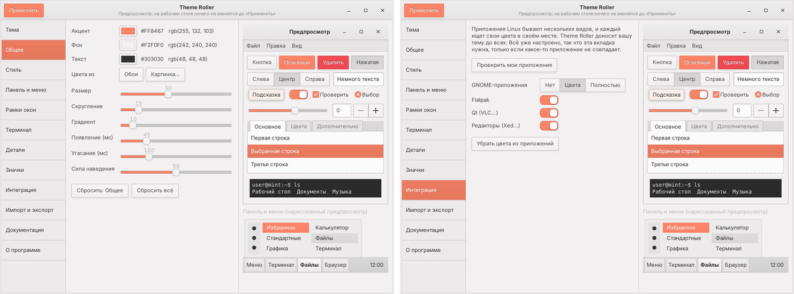

# Theme Roller на русском: помогите проверить перевод

Theme Roller — бесплатная программа для оформления рабочего стола Cinnamon в Linux Mint. Русский перевод сделан без носителя языка. Если что-то звучит неправильно, коряво или неестественно, пожалуйста, сообщите нам. Даже десять минут очень помогут.

- **С программой:** если ваш Mint на русском, установите Theme Roller ([скачать](https://github.com/xlcheese/theme-roller/releases/latest)) и пройдитесь по вкладкам.
- **Без установки:** просто прочитайте таблицу ниже.
- **Как ответить:** в сообщении, где вы нашли эту страницу, или на GitHub: номер и ваш вариант, например «#94: … вместо …».

> Пожалуйста, сохраняйте: слова в `{фигурных скобках}` без изменений, разметку вроде `<b>`; короткие подписи (✂) должны оставаться короткими, иначе окно станет шире; названия Theme Roller, Cinnamon, GNOME, Flatpak и Qt не переводятся.

| № | Английский | Русский |
|---:|---|---|
| 1 ✂ | Global | Общее |
| 2 ✂ | Panel & Menu | Панель и меню |
| 3 ✂ | Theme | Тема |
| 4 ✂ | Terminal | Терминал |
| 5 ✂ | Window Borders | Рамки окон |
| 6 ✂ | Details | Детали |
| 7 ✂ | Icons | Значки |
| 8 ✂ | Integration | Интеграция |
| 9 ✂ | About | О программе |
| 10 ✂ | Documentation | Документация |
| 11 ✂ | Import & Export | Импорт и экспорт |
| 12 | Folders recolored: the folder color (the front) follows your accent, and the second color (the back) a darker shade of it. Choose either and both keep their colors from then on; Reset Icons follows the theme again. Every other icon stays as in your current icon theme. Apply to use them. | Папки перекрашены: цвет папки (передняя часть) следует за акцентным цветом, а второй цвет (задняя часть) — за его более тёмным оттенком. Выберите любой из них, и оба сохранят свои цвета; «Сбросить: Значки» снова следует теме. Все остальные значки остаются как в вашей текущей теме значков. Нажмите «Применить», чтобы использовать их. |
| 13 ✂ | Themes and styles | Темы и стили |
| 14 | A <b>theme</b> is your colors and settings: everything on these tabs. A <b>style</b> is how things are drawn: edges, hovers, tabs and panel buttons. Any theme can use any style. Everything shows in the preview first; nothing changes on your desktop until you click <b>Apply</b>, and <b>Revert</b> puts your previous theme back. | <b>Тема</b> — это ваши цвета и настройки: всё на этих вкладках. <b>Стиль</b> — это то, как всё рисуется: края, наведение, вкладки и кнопки панели. Любая тема может использовать любой стиль. Всё сначала видно в предпросмотре; на рабочем столе ничего не меняется, пока вы не нажмёте <b>Применить</b>, а <b>Вернуть</b> возвращает предыдущую тему. |
| 15 | Start from a built-in theme, one shared by someone else, or one of your own. Change anything and it becomes <b>Custom</b>; <b>Save Theme…</b> keeps your changes under a name. Your own themes can be duplicated, renamed and deleted. | Начните со встроенной темы, темы, которой с вами поделились, или своей. Измените что угодно, и она станет <b>Своей</b>; <b>Сохранить…</b> сохраняет изменения под именем. Свои темы можно дублировать, переименовывать и удалять. |
| 16 | Three colors make a complete light or dark theme: accent, background and text. Then the shape of everything: Size, Roundness, Gradient, and how hovers fade. <b>Colors from</b> picks an accent from your wallpaper or any picture. | Три цвета дают полную светлую или тёмную тему: акцент, фон и текст. Затем форма всего: Размер, Скругление, Градиент и то, как проявляется и гаснет наведение. <b>Цвета из</b> берёт акцентный цвет с обоев или из любой картинки. |
| 17 | Pick how things are drawn, and set its Depth (how strong edges and shadows are) and Unfocused depth (how much of that unfocused windows keep). You can also make your own: a style is one style.toml file, in ~/.local/share/theme-roller/styles/&lt;name&gt;/. <b>Create a starter style…</b> makes one with every option explained: the essentials are on, the rest switched off with a #, each with a short note. Edit it, then pick it on the Style tab. <b>Check a style sheet for issues…</b> tells you if anything in it needs fixing. | Выберите, как всё рисуется, и настройте Глубину (насколько сильны края и тени) и Глубину без фокуса (сколько от этого сохраняют неактивные окна). Можно создать и свой стиль: это один файл style.toml в ~/.local/share/theme-roller/styles/&lt;имя&gt;/. <b>Создать начальный стиль…</b> создаёт стиль, где объяснена каждая настройка: основное включено, остальное отключено знаком #, у каждой — короткая заметка. Отредактируйте его, затем выберите на вкладке Стиль. <b>Проверить файл стиля…</b> скажет, нужно ли в нём что-то исправить. |
| 18 ✂ | Panel &amp; Menu | Панель и меню |
| 19 | The Cinnamon panel and its menus: their own colors, label weight, height, roundness, gradient and see-through. Left alone, they follow Global. | Панель Cinnamon и её меню: свои цвета, начертание подписей, высота, скругление, градиент и прозрачность. Если их не трогать, они следуют вкладке Общее. |
| 20 | Title bars and window buttons: colors, height, gradient, border, roundness, and a choice of button styles and Minimize, Maximize and Close glyphs. When these change, Apply restarts Cinnamon by itself (your windows stay open), as window borders only reload then. | Заголовки и кнопки окон: цвета, высота, градиент, рамка, скругление, а также выбор стилей кнопок и значков для «Свернуть», «Развернуть» и «Закрыть». Когда они меняются, «Применить» сам перезапускает Cinnamon (окна остаются открытыми), так как рамки окон перезагружаются только тогда. |
| 21 | The terminal follows the theme, or pick one of the color sets, or your own colors. | Терминал следует теме, или выберите один из наборов цветов, или свои цвета. |
| 22 | Tooltips, scrollbars (overlay or classic, roundness, width), sliders, switches and the focus ring. | Подсказки, полосы прокрутки (поверх содержимого или классические, скругление, ширина), ползунки, переключатели и рамка фокуса. |
| 23 | Folder icons in your colors, in six styles. Only the folders change; other icons stay as they were. The folder color follows your accent unless you pick one; on xl-Big Baddy, the second color is its racing stripes. Off until you switch it on. | Значки папок в ваших цветах, в шести стилях. Меняются только папки; остальные значки остаются как были. Цвет папки следует за акцентом, если вы не выберете свой; у xl-Big Baddy второй цвет — это его гоночные полосы. Выключено, пока вы не включите. |
| 24 | Linux apps come in a few kinds, and each looks for its colors in its own place. These switches bring your colors to the hodgepodge that doesn't read the theme on its own: GNOME-style apps, Flatpak apps, Qt apps like VLC, and text editors. <b>Scan my apps</b> shows which of your apps are which kind; <b>Take colors out of apps</b> removes them until the next Apply. Pick another theme in Mint's settings and Theme Roller's colors leave your apps by themselves. | Приложения Linux бывают нескольких видов, и каждый ищет свои цвета в своём месте. Эти переключатели доносят ваши цвета до той пёстрой смеси, что не читает тему сама: приложений в стиле GNOME, приложений Flatpak, приложений Qt вроде VLC и текстовых редакторов. <b>Проверить мои приложения</b> показывает, какого вида каждое из ваших приложений; <b>Убрать цвета из приложений</b> убирает их до следующего «Применить». Выберите другую тему в настройках Mint, и цвета Theme Roller сами уйдут из ваших приложений. |
| 25 ✂ | Import &amp; Export | Импорт и экспорт |
| 26 | Share a theme as one <tt>.xltheme</tt> file, and add themes others shared with you. | Делитесь темой как одним файлом <tt>.xltheme</tt> и добавляйте темы, которыми поделились с вами. |
| 27 ✂ | Accent | Акцент |
| 28 ✂ | Background | Фон |
| 29 ✂ | Size | Размер |
| 30 ✂ | Text | Текст |
| 31 ✂ | Gradient | Градиент |
| 32 ✂ | Hover in (ms) | Появление (мс) |
| 33 ✂ | Roundness | Скругление |
| 34 ✂ | Depth | Глубина |
| 35 ✂ | Hover out (ms) | Угасание (мс) |
| 36 ✂ | Hover strength | Сила наведения |
| 37 ✂ | Unfocused depth | Глубина без фокуса |
| 38 ✂ | Label weight | Начертание |
| 39 ✂ | Opacity | Непрозрачность |
| 40 ✂ | Height | Высота |
| 41 ✂ | Notification opacity | Непрозр. уведомл. |
| 42 ✂ | Menu-item roundness | Скругл. пунктов |
| 43 ✂ | Border | Рамка |
| 44 ✂ | Title bar | Заголовок |
| 45 ✂ | Title text | Текст заголовка |
| 46 ✂ | Border width | Толщина рамки |
| 47 ✂ | Round bottom corners | Скруглить нижние углы |
| 48 ✂ | Title bar height | Высота заголовка |
| 49 ✂ | Window roundness | Скругл. окон |
| 50 ✂ | Buttons on the | Кнопки |
| 51 ✂ | Title bar gradient | Градиент заголовка |
| 52 ✂ | Button roundness | Скругл. кнопок |
| 53 ✂ | Button spacing | Отступ кнопок |
| 54 ✂ | Button style | Стиль кнопок |
| 55 ✂ | Glyphs | Значки |
| 56 ✂ | Color | Цвет |
| 57 ✂ | Mode | Режим |
| 58 ✂ | Style | Стиль |
| 59 ✂ | Width | Ширина |
| 60 ✂ | GNOME-style apps | GNOME-приложения |
| 61 ✂ | Custom folder style | Свой стиль папок |
| 62 ✂ | Folder color | Цвет папки |
| 63 ✂ | Second color | Второй цвет |
| 64 ✂ | Flatpak apps | Flatpak |
| 65 ✂ | Qt apps (VLC…) | Qt (VLC…) |
| 66 ✂ | Text editors (Xed…) | Редакторы (Xed…) |
| 67 ✂ | Menu style | Стиль меню |
| 68 ✂ | Panel style | Стиль панели |
| 69 ✂ | Tooltips | Подсказки |
| 70 ✂ | Scrollbars | Полосы прокрутки |
| 71 ✂ | Sliders | Ползунки |
| 72 ✂ | Switches | Переключатели |
| 73 ✂ | Focus ring | Рамка фокуса |
| 74 | Colors left on “Follow theme” use the Global colors. | Цвета на «Следовать теме» берутся с вкладки Общее. |
| 75 | Colors left on “Follow theme” come from the Global colors. | Цвета на «Следовать теме» берутся с вкладки Общее. |
| 76 | Left on “Follow theme”, the terminal uses the theme's content colors. | На «Следовать теме» терминал использует цвета содержимого темы. |
| 77 | Linux apps come in a few kinds, and each looks for its colors in its own place. Theme Roller brings your theme to all of them. These are already set, so you only need this tab if an app doesn't match. | Приложения Linux бывают нескольких видов, и каждый ищет свои цвета в своём месте. Theme Roller доносит вашу тему до всех. Всё уже настроено, так что эта вкладка нужна, только если какое-то приложение не совпадает. |
| 78 | GNOME apps such as Calculator and Text Editor (libadwaita). Colors: your colors, and GNOME's accent to match. Full: also your buttons, title buttons and tabs; this overrides apps' own styling, so some lose colors of their own (Flatpak ones need Flatpak apps on). Reopen apps to see changes. | Приложения GNOME, например Калькулятор и Текстовый редактор (libadwaita). Цвета: ваши цвета и подходящий акцент GNOME. Полностью: ещё и ваши кнопки, кнопки заголовка и вкладки; это заменяет собственное оформление приложений, поэтому некоторые теряют свои цвета (приложениям Flatpak нужен включённый Flatpak). Откройте приложения заново, чтобы увидеть изменения. |
| 79 | Lets Flatpak apps read your theme, so they get its colors. Reopen open apps to see them. | Позволяет приложениям Flatpak читать вашу тему, чтобы они получали её цвета. Откройте открытые приложения заново, чтобы увидеть их. |
| 80 | Flatpak isn't installed. | Flatpak не установлен. |
| 81 ✂ | A–Z | А–Я |
| 82 ✂ | Newest | Новые |
| 83 ✂ | Oldest | Старые |
| 84 ✂ | Z–A | Я–А |
| 85 ✂ | Colors | Цвета |
| 86 ✂ | Full | Полностью |
| 87 ✂ | Off | Нет |
| 88 | Preview: nothing changes on the desktop until Apply | Предпросмотр: на рабочем столе ничего не меняется до «Применить» |
| 89 ✂ | Apply | Применить |
| 90 ✂ | Revert | Вернуть |
| 91 | Put the previous theme back on the desktop (your settings here stay) | Вернуть на рабочий стол предыдущую тему (ваши настройки здесь остаются) |
| 92 ✂ | Scan my apps | Проверить мои приложения |
| 93 | Lists the apps on this computer by kind, and whether Theme Roller reaches them: the answer to “why doesn't this app match?” | Показывает приложения на этом компьютере по видам и доходит ли до них Theme Roller: ответ на вопрос «почему это приложение не совпадает?» |
| 94 ✂ | Reset {tab} | Сбросить: {tab} |
| 95 ✂ | Reset All to Theme Defaults | Сбросить всё |
| 96 ✂ | No stripes | Без полос |
| 97 ✂ | Save Theme… | Сохранить… |
| 98 | Keep your Custom settings as a theme with its own name | Сохранить настройки «Своей» как тему с собственным именем |
| 99 ✂ | Duplicate | Копия |
| 100 | Save a copy of the selected theme as one of your themes | Сохранить копию выбранной темы как одну из своих |
| 101 ✂ | Rename | Переименовать |
| 102 | Rename one of your themes (built-in themes keep their names) | Переименовать одну из своих тем (встроенные темы сохраняют имена) |
| 103 ✂ | Delete | Удалить |
| 104 ✂ | Sort: | Сортировка: |
| 105 ✂ | Your theme | Ваша тема |
| 106 ✂ | Your latest changes | Ваши последние изменения |
| 107 | Your latest changes, based on {theme} | Ваши последние изменения, на основе {theme} |
| 108 ✂ | Your style | Ваш стиль |
| 109 ✂ | Theme default | По умолчанию для темы |
| 110 | Off: switch it on in the Integration tab | Выключено: включите на вкладке Интеграция |
| 111 ✂ | On | Включено |
| 112 | Follow the theme on their own | Сами следуют теме |
| 113 | Nothing to do: they always match. | Ничего делать не нужно: они всегда совпадают. |
| 114 ✂ | Colors on | Цвета включены |
| 115 | Off: set GNOME-style apps to Colors in the Integration tab | Выключено: поставьте «GNOME-приложения» на «Цвета» на вкладке Интеграция |
| 116 ✂ | Colors and full styling on | Цвета и полное оформление включены |
| 117 | . GNOME-style ones also need GNOME-style apps set to Colors | . Приложениям в стиле GNOME нужен ещё «GNOME-приложения» на «Цвета» |
| 118 ✂ | Qt apps | Приложения Qt |
| 119 ✂ | Text editors | Текстовые редакторы |
| 120 ✂ | Run in a terminal | Запускаются в терминале |
| 121 | They use the terminal's colors (Terminal tab). | Используют цвета терминала (вкладка Терминал). |
| 122 | They draw their own look; no theme reaches them. | Рисуют свой собственный вид; никакая тема до них не доходит. |
| 123 ✂ | Web-based apps | Веб-приложения |
| 124 ✂ | Couldn't tell | Не удалось определить |
| 125 | Many of these draw their own look. | Многие из них рисуют свой собственный вид. |
| 126 ✂ | Your apps | Ваши приложения |
| 127 ✂ | Close | Закрыть |
| 128 | {count} apps in your menu, by kind. Changes show after Apply, in apps opened afterwards. | Приложений в вашем меню: {count}, по видам. Изменения видны после «Применить», в приложениях, открытых после этого. |
| 129 ✂ | Take colors out of apps | Убрать цвета из приложений |
| 130 | Theme Roller's colors are out of your apps. Reopen open apps. The next Apply puts them back. | Цвета Theme Roller убраны из ваших приложений. Откройте открытые приложения заново. Следующее «Применить» вернёт их. |
| 131 | Removes Theme Roller's colors from all apps now. Your settings and the theme stay; the next Apply puts the colors back. | Сразу убирает цвета Theme Roller из всех приложений. Ваши настройки и тема остаются; следующее «Применить» вернёт цвета. |
| 132 ✂ | Colors from | Цвета из |
| 133 ✂ | Wallpaper | Обои |
| 134 | Take an accent from your desktop wallpaper | Взять акцентный цвет с обоев рабочего стола |
| 135 ✂ | Image… | Картинка… |
| 136 | Take an accent from any picture | Взять акцентный цвет из любой картинки |
| 137 ✂ | Take colors from a picture | Взять цвета из картинки |
| 138 ✂ | Cancel | Отмена |
| 139 ✂ | Use | Выбрать |
| 140 ✂ | Pictures | Изображения |
| 141 | Couldn't find your wallpaper (Cinnamon's background setting has no picture). | Не удалось найти обои (у фона Cinnamon нет картинки). |
| 142 | Couldn't read {file}: {problem} | Не удалось прочитать {file}: {problem} |
| 143 ✂ | Use {color} as the accent | Сделать {color} акцентным цветом |
| 144 | Accent from {file}. Or click another color. | Акцент взят из {file}. Или нажмите другой цвет. |
| 145 | {file} has no colors vivid enough for an accent. | В {file} нет цветов, достаточно ярких для акцента. |
| 146 | The xl-Cheeselooks theme maker for Linux Mint and the Cinnamon desktop: your colors and shapes, drawn by a style, for GTK 3 and GTK 4 apps, libadwaita apps, the Cinnamon panel and menus, and the window borders. | Создатель темы xl-Cheeselooks для Linux Mint и рабочего стола Cinnamon: ваши цвета и формы, нарисованные стилем, для приложений GTK 3 и GTK 4, приложений libadwaita, панели и меню Cinnamon и рамок окон. |
| 147 ✂ | Website | Сайт |
| 148 | Enjoying {app}? It's free and always will be. | Нравится {app}? Он бесплатный и таким останется. |
| 149 ✂ | Leave a tip ☕ | Оставить чаевые ☕ |
| 150 | Developed with the help of Claude, an AI assistant by Anthropic | Разработано с помощью Claude, ИИ-ассистента от Anthropic |
| 151 | This program comes with absolutely no warranty. See the <a href='https://www.gnu.org/licenses/gpl-3.0.html'>GNU General Public License, version 3 or later</a> for details. | Эта программа предоставляется без каких-либо гарантий. Подробнее см. <a href='https://www.gnu.org/licenses/gpl-3.0.html'>Стандартную общественную лицензию GNU версии 3 или более поздней</a>. |
| 152 ✂ | Remove from my desktop… | Убрать с рабочего стола… |
| 153 | Before uninstalling Theme Roller: puts Mint's default theme back and takes Theme Roller's colors out of your apps | Перед удалением Theme Roller: возвращает стандартную тему Mint и убирает цвета Theme Roller из ваших приложений |
| 154 | Remove Theme Roller from your desktop? | Убрать Theme Roller с рабочего стола? |
| 155 | Mint's default theme comes back, Theme Roller's colors leave your apps, and the theme watcher stops starting at login. Your settings and your own themes stay, so you can pick up where you left off. Do this before uninstalling Theme Roller. | Вернётся стандартная тема Mint, цвета Theme Roller уйдут из ваших приложений, а наблюдатель за темой перестанет запускаться при входе. Ваши настройки и собственные темы останутся, так что вы сможете продолжить с того же места. Сделайте это перед удалением Theme Roller. |
| 156 | Removing… the desktop flickers once while it reloads. | Удаление… рабочий стол один раз мигнёт при перезагрузке. |
| 157 | Theme Roller is off your desktop. You can uninstall it now; Apply puts it back. | Theme Roller убран с рабочего стола. Теперь его можно удалить; «Применить» вернёт его. |
| 158 ✂ | Remove failed: {problem} | Не удалось убрать: {problem} |
| 159 ✂ | Create a starter style… | Создать начальный стиль… |
| 160 | Check a style sheet for issues… | Проверить файл стиля… |
| 161 | Pick a style.toml: it's checked as Theme Roller reads it, and any problems are listed with what to fix | Выберите style.toml: он проверяется так, как его читает Theme Roller, и все проблемы перечисляются с тем, что нужно исправить |
| 162 ✂ | Full documentation (online) | Полная документация (в сети) |
| 163 ✂ | Check a style sheet | Проверить файл стиля |
| 164 ✂ | Check | Проверить |
| 165 ✂ | Style sheets (style.toml) | Файлы стилей (style.toml) |
| 166 ✂ | “{style}” looks good | «{style}» в порядке |
| 167 ✂ | Warning: {problem} | Предупреждение: {problem} |
| 168 | No problems found. Pick it on the Style tab to use it. | Проблем не найдено. Выберите его на вкладке Стиль, чтобы использовать. |
| 169 ✂ | Problems to fix: {count} | Нужно исправить проблем: {count} |
| 170 | Fix these in the file, then check it again. | Исправьте их в файле и проверьте снова. |
| 171 ✂ | the style needs a name | стилю нужно имя |
| 172 | names can be up to {count} characters | имя может быть длиной до {count} символов |
| 173 | names can't contain / or start with a dot | имя не может содержать / или начинаться с точки |
| 174 | there's already a style called {name} | стиль с именем {name} уже есть |
| 175 ✂ | Create Style | Создать стиль |
| 176 | Give your new style a good name. | Дайте новому стилю хорошее имя. |
| 177 ✂ | My Style | Мой стиль |
| 178 ✂ | Create | Создать |
| 179 | Created {file}. Edit it, then pick it on the Style tab. | Создан {file}. Отредактируйте его, затем выберите на вкладке Стиль. |
| 180 | Share a theme as one file (.xltheme). It holds every setting, the theme's name, the version of Theme Roller it was made with, and your style when the theme uses one of your own, so the person importing it gets exactly your look. | Делитесь темой как одним файлом (.xltheme). В нём каждая настройка, имя темы, версия Theme Roller, в которой она сделана, и ваш стиль, если тема использует ваш собственный, так что импортировавший получит в точности ваш вид. |
| 181 ✂ | Export the current theme… | Экспортировать текущую тему… |
| 182 ✂ | Import a theme… | Импортировать тему… |
| 183 ✂ | Preview | Предпросмотр |
| 184 ✂ | Edit | Правка |
| 185 ✂ | File | Файл |
| 186 ✂ | View | Вид |
| 187 ✂ | Open | Открыть |
| 188 ✂ | Quit | Выход |
| 189 ✂ | Button | Кнопка |
| 190 ✂ | Suggested | Основная |
| 191 ✂ | Toggled | Нажатая |
| 192 ✂ | A tooltip on {button} | Подсказка к кнопке «{button}» |
| 193 ✂ | Center | Центр |
| 194 ✂ | Left | Слева |
| 195 ✂ | Right | Справа |
| 196 ✂ | Some text | Немного текста |
| 197 ✂ | Tooltip | Подсказка |
| 198 ✂ | Radio | Выбор |
| 199 ✂ | Advanced | Дополнительно |
| 200 ✂ | General | Основное |
| 201 ✂ | Fifth row | Пятая строка |
| 202 ✂ | First row | Первая строка |
| 203 ✂ | Fourth row | Четвёртая строка |
| 204 ✂ | Selected row | Выбранная строка |
| 205 ✂ | Third row | Третья строка |
| 206 ✂ | Eighth row | Восьмая строка |
| 207 ✂ | Seventh row | Седьмая строка |
| 208 ✂ | Sixth row | Шестая строка |
| 209 ✂ | Desktop  Documents  Music | Рабочий стол  Документы  Музыка |
| 210 ✂ | Accessories | Стандартные |
| 211 ✂ | Favorites | Избранное |
| 212 ✂ | Graphics | Графика |
| 213 ✂ | Calculator | Калькулятор |
| 214 ✂ | Files | Файлы |
| 215 | Panel and menu (drawn preview) | Панель и меню (нарисованный предпросмотр) |
| 216 ✂ | Menu | Меню |
| 217 ✂ | Browser | Браузер |
| 218 ✂ | Can't preview: {problem} | Предпросмотр невозможен: {problem} |
| 219 | Preview CSS problem: {problem} | Проблема CSS в предпросмотре: {problem} |
| 220 ✂ | None | Нет |
| 221 ✂ | Follow theme | Следовать теме |
| 222 ✂ | Custom | Своя |
| 223 ✂ | <b>{name}</b> folder style | Стиль папок <b>{name}</b> |
| 224 | Put every tab back to {theme}. Your latest changes stay in Custom. | Вернуть все вкладки к {theme}. Ваши последние изменения остаются в «Своей». |
| 225 | Put Global back to {theme}. Other tabs keep what you set there, but colors on “Follow theme” and shapes that follow Global change with it. | Вернуть вкладку Общее к {theme}. Другие вкладки сохраняют ваши настройки, но цвета на «Следовать теме» и формы, следующие вкладке Общее, изменятся вместе с ней. |
| 226 | Put {tab} back to {theme} (other tabs stay as they are) | Вернуть «{tab}» к {theme} (другие вкладки остаются как есть) |
| 227 ✂ | Theme: {theme} | Тема: {theme} |
| 228 | Every tab reset to {theme}. Your latest changes are still in Custom. | Все вкладки сброшены к {theme}. Ваши последние изменения по-прежнему в «Своей». |
| 229 | {tab} reset to {theme}. | «{tab}» сброшено к {theme}. |
| 230 ✂ | Save Theme | Сохранить тему |
| 231 ✂ | Save | Сохранить |
| 232 | Name your theme. It uses the style “{style}” and all your current settings. | Назовите свою тему. Она использует стиль «{style}» и все ваши текущие настройки. |
| 233 ✂ | {theme} copy | {theme} (копия) |
| 234 | Up to {count} characters. Built-in themes can't be replaced; your own can. | До {count} символов. Встроенные темы заменить нельзя, свои — можно. |
| 235 | Replace your theme “{theme}”? | Заменить вашу тему «{theme}»? |
| 236 | Saved the theme “{theme}”. | Тема «{theme}» сохранена. |
| 237 ✂ | OK | ОК |
| 238 ✂ | Duplicate Theme | Дублировать тему |
| 239 | A copy of “{theme}”, as one of your themes: | Копия «{theme}» как одна из ваших тем: |
| 240 | Duplicated “{theme}” as “{copy}”. | «{theme}» продублирована как «{copy}». |
| 241 ✂ | A new name for “{theme}”: | Новое имя для «{theme}»: |
| 242 ✂ | Rename Theme | Переименовать тему |
| 243 | Renamed “{old}” to “{new}”. | «{old}» переименована в «{new}». |
| 244 | Delete your theme “{theme}”? Its style stays installed. | Удалить вашу тему «{theme}»? Её стиль останется установленным. |
| 245 ✂ | My theme | Моя тема |
| 246 ✂ | Export theme | Экспорт темы |
| 247 ✂ | Exported “{theme}” to {file} | «{theme}» экспортирована в {file} |
| 248 ✂ | Export failed: {problem} | Не удалось экспортировать: {problem} |
| 249 ✂ | Import theme | Импорт темы |
| 250 ✂ | Theme Roller themes | Темы Theme Roller |
| 251 | Imported “{theme}”. | «{theme}» импортирована. |
| 252 ✂ | Import failed: {problem} | Не удалось импортировать: {problem} |
| 253 | Applying… the desktop flickers once while it reloads. | Применение… рабочий стол один раз мигнёт при перезагрузке. |
| 254 ✂ | Apply failed: {problem} | Не удалось применить: {problem} |
| 255 | “{theme}” is on the desktop. Revert puts the previous theme back. | «{theme}» на рабочем столе. «Вернуть» вернёт предыдущую тему. |
| 256 | Window borders change at your next login. | Рамки окон изменятся при следующем входе в систему. |
| 257 ✂ | Qt apps now match your theme | Приложения Qt теперь совпадают с вашей темой |
| 258 | Reverting… the desktop flickers once while it reloads. | Возврат… рабочий стол один раз мигнёт при перезагрузке. |
| 259 ✂ | Revert failed: {problem} | Не удалось вернуть: {problem} |
| 260 | The previous theme is back on the desktop. Your settings here are unchanged. | Предыдущая тема снова на рабочем столе. Ваши настройки здесь не изменились. |
| 261 ✂ | GNOME runtime | среда GNOME |
| 262 ✂ | KDE runtime | среда KDE |
| 263 | Gives Xed, gedit and Meld a color scheme from your theme, mainly for syntax colors and highlights. Most editors' own schemes follow your theme too. Reopen them to see changes. | Даёт Xed, gedit и Meld цветовую схему из вашей темы, в основном для подсветки синтаксиса и выделений. Собственные схемы большинства редакторов тоже следуют вашей теме. Откройте их заново, чтобы увидеть изменения. |
| 264 ✂ | Racing stripes | Гоночные полосы |
| 265 | Binders in your colors: the folder color follows your accent. Racing stripes are off until you pick a color for them; No stripes takes them off again. Every other icon stays as in your current icon theme. Apply to use them. | Папки-скоросшиватели в ваших цветах: цвет папки следует за акцентом. Гоночные полосы выключены, пока вы не выберете для них цвет; «Без полос» снова убирает их. Все остальные значки остаются как в вашей текущей теме значков. Нажмите «Применить», чтобы использовать их. |
| 266 ✂ | Wavy lines | Волнистые линии |
| 267 | Binders in your colors: the folder color follows your accent, and the wavy lines a darker shade of it. Choose either and both keep their colors from then on; Reset Icons follows the theme again. Every other icon stays as in your current icon theme. Apply to use them. | Папки-скоросшиватели в ваших цветах: цвет папки следует за акцентом, а волнистые линии — за его более тёмным оттенком. Выберите любой из них, и оба сохранят свои цвета; «Сбросить: Значки» снова следует теме. Все остальные значки остаются как в вашей текущей теме значков. Нажмите «Применить», чтобы использовать их. |
| 268 | Your Qt apps now use your theme's colors.  Your previous Qt setup is saved: {saved}.  Turning off Integration → Qt apps puts it back. | Ваши приложения Qt теперь используют цвета вашей темы.  Ваша прежняя настройка Qt сохранена: {saved}.  Выключите «Интеграция → Qt», чтобы вернуть её. |
| 269 | The first time, log out and back in to see your colors in Qt apps; after that, reopening them is enough. If you had your own Qt setup, it's saved and comes back when this is off. | В первый раз выйдите из сеанса и войдите снова, чтобы увидеть свои цвета в приложениях Qt; потом достаточно открыть их заново. Если у вас была своя настройка Qt, она сохраняется и возвращается, когда это выключено. |
| 270 | Needs qt5ct: sudo apt install qt5ct | Нужен qt5ct: sudo apt install qt5ct |
| 271 | give the theme a name (not “Custom”) | дайте теме имя (не «Своя») |
| 272 | a theme's name can be up to {count} characters ({given} given) | имя темы может быть длиной до {count} символов (сейчас {given}) |
| 273 | “{theme}” is a built-in theme: choose another name | «{theme}» — встроенная тема: выберите другое имя |
| 274 | you already have a theme called “{theme}” | у вас уже есть тема «{theme}» |
| 275 | there's already a theme called “{theme}” | тема «{theme}» уже есть |
| 276 | couldn't find a free name for the copy | не удалось подобрать свободное имя для копии |
| 277 | built-in themes can't be renamed: duplicate it instead | встроенные темы нельзя переименовать: продублируйте её |
| 278 | built-in themes can't be deleted | встроенные темы нельзя удалить |
| 279 | {file} isn't a Theme Roller theme file | {file} — не файл темы Theme Roller |
| 280 | This theme was made with a newer Theme Roller ({version}). Some of it may not show as intended; updating Theme Roller is recommended. | Эта тема сделана в более новом Theme Roller ({version}). Часть её может выглядеть не так, как задумано; рекомендуется обновить Theme Roller. |
| 281 | You already have a style folder “{folder}”: kept yours, so the theme uses your copy of that style. | У вас уже есть папка стиля «{folder}»: оставлена ваша, так что тема использует вашу копию этого стиля. |
| 282 | the theme file contains an unsafe path | файл темы содержит небезопасный путь |
| 283 | The theme's name was longer than {count} characters: shortened to “{theme}”. | Имя темы было длиннее {count} символов: сокращено до «{theme}». |
| 284 | A theme called “{theme}” already exists: imported as “{copy}”. | Тема «{theme}» уже есть: импортирована как «{copy}». |
| 285 ✂ | Chevrons | Уголки |
| 286 ✂ | Regular | Обычный |
| 287 ✂ | Thin | Тонкие |
| 288 ✂ | Icon Theme | Тема значков |
| 289 ✂ | Marks | Знаки |
| 290 ✂ | Bold | Жирный |
| 291 ✂ | Classic | Классические |
| 292 ✂ | Dashed | Штрихи |
| 293 ✂ | Dotted | Точки |
| 294 ✂ | Follow global | Следовать Общему |
| 295 ✂ | Light | Светлый |
| 296 ✂ | Overlay | Поверх |
| 297 ✂ | Separate colors | Свои цвета |
| 298 ✂ | Solid | Сплошная |
